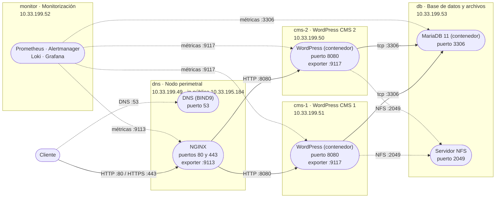

**Departamento de electronica y informatica**
**USM sede Concepción**

 

## NODO SUR
### Plataforma digital resiliente, observable y operable

 

**Informe Proyecto Integrador**
Asignatura: EIN-090B · Taller de Administración de Sistemas (TAS)

 

| | |
|---|---|
| **Integrantes** | Josecarlos Vidal   Octavio Valencia   Lukas Garrido |
| **Equipo** | Grupo 06 (`tas-06`) |
| **Profesor** | Jose Anotino Arellano |
| **Fecha** | 23 de noviembre de 2026 |
| **Versión del documento** | v4.0 |
| **Repositorio** | [NodoSur](https://github.com/LukasGarrido/TAS) |

## Resumen

Nodo Sur es una red regional de pequeñas marcas, talleres creativos, productores y operadores de experiencias que hoy vende, reserva y atiende clientes mediante redes sociales y formularios aislados, con riesgo de pérdida de datos y de indisponibilidad (un formulario caído casi dos horas sin diagnóstico fue el incidente que originó el proyecto). Este informe documenta el diseño, la implementación y la operación de una plataforma centralizada bajo un único dominio interno (`tas-06.arpa`).

La solución usa WordPress + WooCommerce en dos backends contenerizados (`wordpress:php8.3-apache`), un nodo perimetral con BIND9 y Nginx (proxy inverso, balanceador pasivo y bastión SSH), una VM de datos con MariaDB 11 y un servidor NFS compartido para archivos y configuración (`/srv/nfs/wordpress`), y una VM de monitorización con Prometheus (v3.5.0), Alertmanager (v0.28.1), Loki (v3.5.0) y Grafana (v11.6.0). Se definieron ocho requerimientos medibles (RF-01 y RNF-01 a RNF-08), objetivos de servicio (disponibilidad ≥ 99,5 %, detección ≤ 5 min, RTO ≤ 60 min, RPO ≤ 24 h) y un criterio de capacidad N-1.

A la fecha de la entrega final, la arquitectura, el modelo de seguridad, la persistencia NFS y la observabilidad están desplegados y validados según los scripts y bitácoras del repositorio. El capítulo 7 compara el diseño de la Entrega 1 con la arquitectura final y concluye que la estructura se mantuvo, con brechas concentradas en controles operativos como el destino de las alertas, la frecuencia de respaldo y la restauración probada. Se documentan los respaldos automáticos de MariaDB con retención de 30 días, la segmentación mediante UFW y reglas de `DOCKER-USER`, y los puntos únicos de falla identificados (nodo perimetral y VM de datos).

**Palabras clave:** WordPress, Nginx, balanceo, tolerancia a fallas, NFS, MariaDB, Prometheus, Loki, respaldo, RPO/RTO, runbook.

## Índice General

1. [Introducción](#1-introducción)
   - [1.1 Contexto y motivación](#11-contexto-y-motivación)
   - [1.2 Planteamiento del problema](#12-planteamiento-del-problema)
   - [1.3 Objetivos](#13-objetivos)
   - [1.4 Alcance y limitaciones](#14-alcance-y-limitaciones)
   - [1.5 Metodología y organización del equipo](#15-metodología-y-organización-del-equipo)
   - [1.6 Estructura del documento](#16-estructura-del-documento)
2. [Requerimientos y Arquitectura (Entrega 1)](#2-requerimientos-y-arquitectura-entrega-1)
   - [2.1 Problema, actores y activos críticos](#21-problema-actores-y-activos-críticos)
   - [2.2 Requerimientos y criterios de aceptación](#22-requerimientos-y-criterios-de-aceptación)
   - [2.3 Selección del CMS y la suite tecnológica](#23-selección-del-cms-y-la-suite-tecnológica)
   - [2.4 Arquitectura, flujos y puertos](#24-arquitectura-flujos-y-puertos)
   - [2.5 Seguridad y administración de datos](#25-seguridad-y-administración-de-datos)
3. [Plataforma Base y CMS Funcional (Entrega 2)](#3-plataforma-base-y-cms-funcional-entrega-2)
   - [3.1 Infraestructura, inventario y línea base](#31-infraestructura-inventario-y-línea-base)
   - [3.2 Almacenamiento y permisos (NFS)](#32-almacenamiento-y-permisos-nfs)
   - [3.3 DNS, servidor web y TLS](#33-dns-servidor-web-y-tls)
4. [Publicación Resiliente, Contenedores y Seguridad (Entrega 3)](#4-publicación-resiliente-contenedores-y-seguridad-entrega-3)
   - [4.1 Aplicación multicontenedor reproducible](#41-aplicación-multicontenedor-reproducible)
   - [4.2 Balanceo pasivo y alta disponibilidad](#42-balanceo-pasivo-y-alta-disponibilidad)
   - [4.3 Firewall y seguridad de red (DOCKER-USER)](#43-firewall-y-seguridad-de-red-docker-user)
5. [Observabilidad y Continuidad Operacional (Entrega 4)](#5-observabilidad-y-continuidad-operacional-entrega-4)
   - [5.1 Pila de monitorización y métricas](#51-pila-de-monitorización-y-métricas)
   - [5.2 Alertas y trazabilidad de logs](#52-alertas-y-trazabilidad-de-logs)
   - [5.3 Respaldo automático de MariaDB](#53-respaldo-automático-de-mariadb)
6. [Incidente, Auditoría y Defensa Final (Entrega 5)](#6-incidente-auditoría-y-defensa-final-entrega-5)
7. [Análisis Integrado de la Solución](#7-análisis-integrado-de-la-solución)
   - [7.1 Cumplimiento de requerimientos](#71-cumplimiento-de-requerimientos)
   - [7.2 Análisis comparativo: diseño de la Entrega 1 frente a la arquitectura final](#72-análisis-comparativo-diseño-de-la-entrega-1-frente-a-la-arquitectura-final)
8. [Conclusiones y Trabajo Futuro](#8-conclusiones-y-trabajo-futuro)
9. [Referencias](#9-referencias)
10. [Anexos](#10-anexos)
    - [Anexo A — Matriz de trazabilidad](#anexo-a--matriz-de-trazabilidad)
    - [Anexo B — Inventario y versiones](#anexo-b--inventario-y-versiones)
    - [Anexo C — Matriz de flujos, puertos y firewall](#anexo-c--matriz-de-flujos-puertos-y-firewall)
    - [Anexo D — Runbook operativo](#anexo-d--runbook-operativo)
    - [Anexo E — Bitácora de cambios](#anexo-e--bitácora-de-cambios)
    - [Anexo F — Registro de Decisiones (ADR)](#anexo-f--registro-de-decisiones-adr)
    - [Anexo G — Contribución individual](#anexo-g--contribución-individual)
    - [Anexo H — Uso de inteligencia artificial](#anexo-h--uso-de-inteligencia-artificial)
    - [Anexo I — Correspondencia con las rúbricas](#anexo-i--correspondencia-con-las-rúbricas)

## Glosario y siglas

| Sigla | Significado |
|---|---|
| ADR | Architecture Decision Record |
| CMS | Content Management System |
| FQDN | Fully Qualified Domain Name |
| N-1 | Criterio de diseño: el sistema opera con un nodo menos |
| NFS | Network File System |
| RPO / RTO | Recovery Point / Recovery Time Objective |
| SLO | Service Level Objective |
| SPOF | Single Point of Failure |
| TLS | Transport Layer Security |
| UFW | Uncomplicated Firewall |

---

# 1. Introducción

## 1.1 Contexto y motivación

Nodo Sur agrupa a pequeñas marcas, talleres creativos, productores y operadores de experiencias. Hoy gestionan ventas, reservas, inscripciones y atención al cliente por redes sociales, formularios aislados y mensajería. Esto dificulta centralizar la información, aumenta el riesgo de pérdida de datos y genera problemas de disponibilidad.

## 1.2 Planteamiento del problema

Se requiere una plataforma digital **centralizada, administrable y resiliente** que permita a los miembros publicar productos y experiencias, gestionar pedidos y reservas, ofrecer contenidos y comunicarse con sus clientes **desde un único dominio**. Debe soportar picos de demanda por campañas de difusión y mantener el servicio web aun si uno de los nodos web falla.

El equipo actúa como proveedor de infraestructura: cada decisión técnica debe justificarse con requerimientos, pruebas, métricas, logs y procedimientos reproducibles. No basta con instalar un CMS y mostrar su portada.

## 1.3 Objetivos

**Objetivo general.** Diseñar, implementar y operar una plataforma web para Nodo Sur que pueda publicarse, administrarse, diagnosticarse, mantenerse y recuperarse ante fallas.

**Objetivos específicos.**
1. Definir requerimientos medibles y una arquitectura justificada (Entrega 1).
2. Implementar la plataforma base y un CMS funcional con flujo de negocio completo (Entrega 2).
3. Publicar el servicio con dos backends, balanceo, segmentación y secretos controlados (Entrega 3).
4. Implementar monitorización, alertas, logs, respaldos y restauración medida (Entrega 4).
5. Gestionar un incidente no anunciado y auditar la solución (Entrega 5).

## 1.4 Alcance y limitaciones

- **Incluye:** VM Alpine Linux con Docker, WordPress/WooCommerce, MariaDB 11, servidor NFS, BIND9, Nginx, pila completa de monitorización y respaldos automáticos.
- **No incluye:** alta disponibilidad real del nodo perimetral ni de la base de datos, cifrado del tráfico interno entre proxy y backends, ni almacenamiento de objetos.
- **Restricciones:** subred `10.33.199.48/29` (seis direcciones utilizables, cinco asignadas) y software libre, por ausencia de un equipo de desarrollo permanente en la organización.

## 1.5 Metodología y organización del equipo

El trabajo se versiona en el repositorio Git del proyecto (bitácora, ADR, scripts, evidencias e inventario). Las decisiones relevantes se registran como ADR. Distribución de responsabilidades basada en los componentes del sistema:

| Integrante | Rol y responsabilidad principal |
|---|---|
| Octavio Valencia | CMS y backends WordPress (`cms-1`, `cms-2`) |
| Lukas Garrido | Base de datos (MariaDB 11) y servidor NFS (`db`) |
| Josecarlos Vidal | DNS (BIND9), nodo perimetral y balanceador Nginx (`dns`) |
| Equipo completo | Pila de monitorización, alertas, respaldos y operaciones (`monitor`) |

**Calendario de entregas:**

| Entrega | Hito | Fecha |
|---|---|---|
| 1 | Informe de requerimientos y arquitectura | 05/09/2026 |
| 2 | Plataforma base y CMS funcional | 05/09/2026 |
| 3 | Publicación resiliente y seguridad | 23/09/2026 |
| 4 | Observabilidad y continuidad operacional | 23/11/2026 |
| 5 | Incidente, auditoría y defensa final | 30/11/2026 |

## 1.6 Estructura del documento

Los capítulos 2 a 6 corresponden a las cinco entregas. El capítulo 7 integra los resultados y compara el diseño de la Entrega 1 con la arquitectura final, el 8 presenta conclusiones, y los anexos reúnen inventario, matrices, bitácora y registro de uso de IA.

---

# 2. Requerimientos y Arquitectura (Entrega 1)

## 2.1 Problema, actores y activos críticos

**Actores.** Son las marcas, talleres, productores y operadores de la red regional. También el personal con capacitación básica que administrará la plataforma, los clientes finales y el equipo del proyecto como proveedor de infraestructura.

**Activos críticos.** El catálogo de productos y servicios, los registros de ventas, reservas e inscripciones, la base de datos separada, los archivos subidos al CMS y las credenciales administrativas.

**Flujos de negocio.** Venta de catálogo, inscripción a talleres, reservas con cupos limitados, publicación de contenidos y atención posventa.

**Supuestos.** La organización no tiene equipo de desarrollo permanente, por lo que se usa software libre o de bajo costo. El tráfico presenta picos breves durante campañas de difusión.

**Consecuencias de las fallas sobre activos y flujos:**

| Activo / flujo | Falla | Pérdida o interrupción concreta | Requisito |
|---|---|---|---|
| Base de datos (pedidos, reservas, inscripciones) | Servicio caído o dato perdido | Sin ventas ni reservas, pedidos sin registro, cupos sobrevendidos o perdidos | RNF-02, RNF-06 |
| Archivos subidos (NFS) | NFS caído, divergencia o disco lleno | Imágenes de catálogo no disponibles, no se pueden publicar productos | RNF-03 |
| Nodo perimetral (DNS + Nginx) | Caída del host | Sitio inaccesible aunque los backends estén sanos | RNF-01, RNF-05 |
| Backend web | Caída de un nodo | Sin impacto si el otro absorbe la demanda. En caso contrario, degradación o interrupción de ventas | RNF-01 |
| Flujo de reserva con cupos | Escritura duplicada o perdida | Doble reserva o cupo perdido (solicitudes duplicadas del incidente piloto) | RF-01 |
| Respaldos | Backup antiguo o nunca restaurado | Pérdida de semanas de datos y recuperación incierta | RNF-06 |
| Credenciales administrativas | Compartidas, débiles o sin revocación | Acceso indefinido sin trazabilidad | RNF-04 |
| Monitorización y logs | Ausencia de métricas y alertas | Fallas de horas sin diagnóstico | RNF-05, RNF-08 |

## 2.2 Requerimientos y criterios de aceptación

Cada requerimiento tiene umbral medible y prueba. **Tabla 1.**

| ID | Requerimiento | Tipo | Criterio de aceptación | Prueba de validación |
|---|---|---|---|---|
| RF-01 | CMS funcional para catálogo, pedidos, reservas y contenidos | F | Un flujo completo (producto o reserva → pedido) bajo el dominio único, con registro localizable en la aplicación y en la BD | Ejecutar compra o reserva desde un cliente y consultar la tabla en MariaDB |
| RNF-01 | Capa web con al menos dos nodos | NF | Con un backend detenido, ≥ 99 % de 100 GET responden 200 y la conmutación ocurre en ≤ 30 s | Detener un contenedor WordPress, lanzar 100 solicitudes con `curl` y revisar logs de Nginx |
| RNF-02 | BD independiente y no expuesta | NF | El 3306 solo responde a .50 y .51 (WordPress) y .52 (monitor), otros orígenes son rechazados | `nc -zv 10.33.199.53 3306` desde origen autorizado y no autorizado, y revisar reglas de firewall |
| RNF-03 | Persistencia y coherencia del estado compartido | NF | Un archivo subido por un backend se sirve con 200 y el mismo checksum desde el otro en ≤ 5 s | Subir imagen y descargarla por ambos backends, comparar `sha256sum` |
| RNF-04 | Administración remota por canales seguros y nominativos | NF | SSH por clave pública, un usuario por integrante, sin contraseña ni cuentas compartidas, con revocación individual | Revisar `sshd_config`, revocar una clave de prueba y verificar el bloqueo |
| RNF-05 | Detección de falla crítica en tiempo acotado | NF | Alerta recibida en ≤ 5 min tras detener un backend, sin observar un panel | Detener un servicio y medir el tiempo hasta la alerta |
| RNF-06 | Continuidad mediante respaldos verificados | NF | Retención ≥ 30 días, restauración completa en ≤ 60 min con pérdida ≤ 24 h | Restaurar en una VM de prueba y medir tiempos y datos recuperados |
| RNF-07 | Dominio único con HTTPS válido | NF | `https://tas-06.arpa` sin error de certificado, HTTP:80 redirige a HTTPS | `curl -v` y `openssl s_client` desde un cliente |
| RNF-08 | Trazabilidad y hora consistente | NF | Desfase entre nodos ≤ 1 s y misma zona horaria, un evento se reconstruye correlacionando proxy, web, BD y SSH | `chronyc tracking` y `date` en todos los nodos, seguir una solicitud en Loki |

## 2.3 Selección del CMS y la suite tecnológica

Se compararon WordPress, Joomla y Drupal (decisión formal en **ADR-001**, aprobada).

| Criterio | WordPress | Joomla | Drupal |
|---|---|---|---|
| Licenciamiento | GPL, gratuito | GPL, gratuito | GPL, gratuito |
| Comunidad y soporte | Enorme, muchos plugins de reservas | Grande, menos extensiones | Grande, orientada a desarrolladores y proyectos enterprise |
| Curva de operación | Baja | Media | Alta |
| Recursos | Imagen oficial `wordpress:php8.3-apache` y MariaDB 11, 2 vCPU / 2 GB por backend | Comparable a WordPress | Mayor consumo y tuning con Commerce |
| Mantenimiento | Parches frecuentes, el riesgo está en plugins | Actualizaciones mayores exigentes | Actualizaciones mayores costosas |
| Compatibilidad | Docker, MariaDB y NFS, WooCommerce exige versiones mínimas | E-commerce y reservas dependen de extensiones poco integradas | E-commerce requiere Drupal Commerce y desarrollo a medida |
| Límites conocidos | *Stateful* (uploads en disco), `wp-cron` duplicado con dos nodos | Módulo de e-commerce menos maduro | Sin e-commerce/reservas nativo |
| Motivo de descarte | — | Suma extensiones frágiles sin beneficio sobre WordPress | Exige equipo de desarrollo dedicado |

**Justificación de WordPress + Nginx.**
- WordPress + WooCommerce cubre catálogo, pedidos, contenido y reservas.
- Imagen oficial con Apache y PHP 8.3: despliegue simple y réplica por contenedor.
- Nginx como proxy inverso y balanceador: bajo consumo y buen manejo de conexiones concurrentes ante picos de campaña (**ADR-002**).
- Pila PHP + MariaDB compatible con la arquitectura de referencia.

## 2.4 Arquitectura, flujos y puertos

**Figura 1.** Diagrama de despliegue (subred `10.33.199.48/29`, dominio `tas-06.arpa`).

**Tabla 3.** Matriz de puertos y flujos permitidos.

| Origen | Destino | Puerto | Protocolo | Propósito |
|---|---|---|---|---|
| Cliente | DNS (.49) | 53 | DNS UDP/TCP | Resolución de `tas-06.arpa` |
| Cliente | Nginx (.49) | 443 | HTTPS | Acceso al sitio con TLS terminado en el nodo perimetral |
| Cliente | Nginx (.49) | 80 | HTTP | Solo redirección a HTTPS |
| Nginx (.49) | CMS 1 (.51) y CMS 2 (.50) | 8080 | HTTP | Reenvío a los backends, único origen permitido |
| CMS 1 / CMS 2 | MariaDB (.53) | 3306 | TCP | Consultas a la BD, solo por red privada |
| CMS 1 / CMS 2 | NFS (.53) | 2049 | NFS/TCP | Montaje de `wp-config.php` y `wp-content/uploads` |
| Monitor (.52) | MariaDB (.53) | 3306 | TCP | `mysqld-exporter` (puerto 9104) con usuario de solo métricas |
| Monitor (.52) | Nginx (.49) | 9113 | HTTP | `nginx-prometheus-exporter` |
| Monitor (.52) | CMS 1 y CMS 2 | 9117 | HTTP | `apache-exporter` |
| Administrador | Nodo perimetral (IP pública .184) | 22 | SSH | Único punto de entrada administrativo (bastión) |
| Nodo perimetral | Demás nodos (IP privadas) | 22 | SSH | Administración nominativa con salto (`ssh -J`) |
| Todos los nodos | Fuente NTP | 123 | UDP | Sincronización horaria (RNF-08) |

## 2.5 Seguridad y administración de datos

- **Accesos remotos.** SSH por clave pública hacia IP privadas con salto por el bastión, usuario nominativo por integrante, `PasswordAuthentication no`, `PermitRootLogin no`.
- **Secretos.** Fuera del repositorio. Archivos `.env` (MariaDB, Grafana) y `.my.cnf` (exporter) con permisos `600` e ignorados por git.
- **Firewall y segmentación.** UFW en el host y reglas en `DOCKER-USER` para controlar el acceso al puerto 3306 (MariaDB) exclusivamente desde .50, .51 y .52.

---

# 3. Plataforma Base y CMS Funcional (Entrega 2)

## 3.1 Infraestructura, inventario y línea base

**Tabla 2.** Inventario y especificaciones técnicas de las máquinas virtuales.

| VM (Hostname) | Nodo | Rol y servicios | IP privada | IP pública / Red | SO y versión |
|---|---|---|---|---|---|
| `dns` | Perimetral | DNS (BIND9, puerto 53), Nginx (80/443), bastión SSH | `10.33.199.49` | `10.33.195.184` | Alpine Linux |
| `cms-1` | CMS 1 | WordPress (`wordpress:php8.3-apache`, 8080), `apache-exporter` (9117) | `10.33.199.51` | Pública a retirar | Alpine Linux, Docker |
| `cms-2` | CMS 2 | WordPress (`wordpress:php8.3-apache`, 8080), `apache-exporter` (9117) | `10.33.199.50` | Pública a retirar | Alpine Linux, Docker |
| `db` | Datos | MariaDB 11 (3306), Servidor NFS (`/srv/nfs/wordpress`, 2049) | `10.33.199.53` | Pública a retirar | Alpine Linux, Docker (191,7 GB disco) |
| `monitor` | Monitorización | Prometheus (9090), Alertmanager (9093), Loki (3100), Grafana (3000), `mysqld-exporter` (9104) | `10.33.199.52` | Pública a retirar | Alpine Linux 3.24.2, Docker v29.8.1, Compose v5.1.4 (191,6 GB disco) |

## 3.2 Almacenamiento y permisos (NFS)

El servidor NFS en `db` exporta `/srv/nfs/wordpress` con los subdirectorios `config/` y `uploads/`. Los clientes (`cms-1` y `cms-2`) montan la configuración en `/mnt/wp-config` (con persistencia en `/etc/fstab` y `netmount`) y los archivos multimedia en el volumen Docker `wp_uploads_shared` mediante NFS v4 (`addr=10.33.199.53`).

## 3.3 DNS, servidor web y TLS

- BIND9 en `dns` resuelve el dominio interno `tas-06.arpa`, con recursión restringida a la subred `10.33.199.48/29` y canal de estadísticas en `127.0.0.1:8053`.
- Nginx termina TLS y redirige HTTP (80) a HTTPS (443).

---

# 4. Publicación Resiliente, Contenedores y Seguridad (Entrega 3)

## 4.1 Aplicación multicontenedor reproducible

Todos los servicios corren bajo Docker y Docker Compose con imágenes de versión fija. Los backends ejecutan `wordpress:php8.3-apache` junto a `lusotycoon/apache-exporter` en el puerto 9117. Se habilitó el módulo `server-status` en Apache mediante `/opt/cms/status.conf` (`RewriteEngine Off`) para permitir el scraping de métricas.

## 4.2 Balanceo pasivo y alta disponibilidad

Mediante Nginx como proxy inverso y balanceador de carga, se distribuyen las peticiones hacia ambos backends WordPress. Ante la caída de un backend, la detección pasiva de Nginx (`max_fails`, `fail_timeout`) redirige el tráfico al nodo sano, garantizando tolerancia a fallas de nodo único.

## 4.3 Firewall y seguridad de red (`DOCKER-USER`)

Dado que Docker manipula iptables directamente saltándose UFW, se configuraron reglas explícitas en la cadena `DOCKER-USER` en `db` y los demás nodos mediante scripts de inicio en `/etc/local.d/` para asegurar que el puerto 3306 de MariaDB y el 8080 de WordPress solo acepten tráfico desde los orígenes autorizados.

---

# 5. Observabilidad y Continuidad Operacional (Entrega 4)

## 5.1 Pila de monitorización y métricas

La VM `monitor` ejecuta el stack de observabilidad con puertos enlazados estrictamente a `127.0.0.1`. El acceso de los administradores se realiza mediante reenvío de puertos SSH (`AllowTcpForwarding local`).

| Componente | Exporter / Fuente | Puerto | Métrica clave / Job |
|---|---|---|---|
| Proxy Nginx | `nginx-prometheus-exporter` 1.3.0 | 9113 | `nginx_up`, conexiones activas (`job: nginx-lb`) |
| Backends Apache | `apache-exporter` | 9117 | `apache_up`, workers ocupados |
| Base de datos MariaDB | `prom/mysqld-exporter` v0.17.2 | 9104 | `mysql_up`, conexiones, consultas (`job: mariadb`) |
| Monitorización central | Prometheus / Grafana / Loki | 9090 / 3000 / 3100 | Métricas de infraestructura, paneles y logs centralizados |

## 5.2 Alertas y trazabilidad de logs

- **Alertas:** Alertmanager configurado en el puerto 9093 con reglas base en Prometheus (`alerts.yml`).
- **Logs:** Recolectados y centralizados en Loki (retención de 7 días). Sincronización horaria por NTP en todos los nodos (RNF-08).

## 5.3 Respaldo automático de MariaDB

Se implementó un script automatizado en `/usr/local/bin/backup-db.sh` en la VM de base de datos, ejecutado mediante cron de root cada dos días a las 02:30 (días impares):
- **Acción:** `mariadb-dump --all-databases --single-transaction --routines --triggers --events`.
- **Verificación:** Validación con `tail` de la cadena `Dump completed`, compresión con `gzip`, comprobación de integridad (`gzip -t`) y generación de checksum SHA-256 (`.sha256`).
- **Retención:** 30 días (`find ... -mtime +30 -delete`), con permisos restringidos (`640`, propietario `database`).

---

# 6. Incidente, Auditoría y Defensa Final (Entrega 5)

Las pruebas operativas y la simulación de incidentes se estructuran bajo el runbook del Anexo D, validando los flujos de negocio (RF-01) y la recuperación ante fallas de infraestructura.

---

# 7. Análisis Integrado de la Solución

## 7.1 Cumplimiento de requerimientos

| ID | Requisito | Estado | Observación |
|---|---|---|---|
| RF-01 | CMS funcional (catálogo, pedidos, reservas) | [Implementado] | WordPress + WooCommerce operativo con BD centralizada |
| RNF-01 | Capa web con al menos dos nodos | [Implementado] | Dos réplicas con balanceador Nginx |
| RNF-02 | BD independiente y no expuesta | [Implementado] | MariaDB en VM dedicada, puerto 3306 restringido |
| RNF-03 | Persistencia y coherencia compartida | [Implementado] | Servidor NFS en `/srv/nfs/wordpress` |
| RNF-04 | Administración SSH segura y nominativa | [Por evidenciar] | Claves públicas. Falta consolidar cuentas sin root |
| RNF-05 | Detección de falla crítica en tiempo acotado | [Parcial] | Pila Prometheus/Alertmanager lista. Falta definir destino |
| RNF-06 | Continuidad y respaldos verificados | [Parcial] | Script automático cada dos días (02:30, días impares) con SHA-256. Falta prueba de restauración |
| RNF-07 | Dominio único con HTTPS válido | [Implementado] | `https://tas-06.arpa` con Nginx TLS |
| RNF-08 | Trazabilidad y hora consistente | [Implementado] | NTP configurado y Loki para logs |

## 7.2 Análisis comparativo: diseño de la Entrega 1 frente a la arquitectura final

### 7.2.1 Propósito, fuentes y criterio de comparación

Este apartado contrasta lo que el equipo definió en el informe de la Entrega 1 con lo que quedó desplegado y documentado al cierre de la Entrega 4. Busca responder tres preguntas. La primera es si la arquitectura propuesta se mantuvo. La segunda es qué cambió y por qué. La tercera es qué elementos comprometidos en el diseño no aparecen cumplidos en la documentación final.

Las fuentes utilizadas son el informe de la Entrega 1 ([E01_tas_06](https://github.com/LukasGarrido/TAS/blob/master/docs/entrega-1/E1_grupo06_informe.pdf) v.1), los registros de decisión ADR-001 y ADR-002, la bitácora general, el README del repositorio y los capítulos 2 a 5 de este informe.

**Nota metodológica sobre el punto de partida.** El documento de la Entrega 1 que está en el repositorio no es el texto original sin modificar. Su propia introducción indica que la arquitectura evolucionó respecto de la propuesta inicial, que era una instalación tradicional con Nginx y PHP-FPM. Además describe la VM de monitorización con sus recursos reales, un elemento que la bitácora fecha el 15/11. Por esa razón la comparación usa tres puntos de referencia y no dos:

1. **Propuesta inicial.** Se reconstruye a partir de la introducción de la Entrega 1, de los ADR y de los scripts de línea base tradicional (`script_cms.md`, `script_db.md` y `script_dns.md`).
2. **Diseño de la Entrega 1.** Es la versión del informe disponible en el repositorio, que ya incorpora contenedores, NFS y monitorización.
3. **Arquitectura final.** Es lo descrito en los capítulos 2 a 5 de este informe.

Cada elemento comparado se clasifica con una de las siguientes categorías:

| Categoría | Significado |
|---|---|
| **Se mantuvo** | El diseño de la Entrega 1 y el estado final coinciden |
| **Se concretó** | El diseño ya existía y la implementación le agregó detalle verificable, como versiones, rutas o parámetros |
| **Cambió** | El estado final difiere del diseño de la Entrega 1 |
| **Brecha** | La Entrega 1 lo exigía y la documentación final no muestra que esté cumplido |

### 7.2.2 Evolución de la arquitectura en tres estados

**Tabla 4.** Evolución de los componentes principales.

| Aspecto | Propuesta inicial | Diseño de la Entrega 1 | Arquitectura final | Clasificación |
|---|---|---|---|---|
| Modelo de despliegue | Instalación tradicional sobre las VM | Contenedores Docker en todos los servicios | Docker y Docker Compose con imágenes de versión fija | Cambió respecto de la propuesta inicial y se mantuvo desde la Entrega 1 |
| Servidor web de los backends | Nginx con PHP-FPM | Imagen `wordpress:php8.3-apache` | Misma imagen, con el módulo `server-status` habilitado mediante `/opt/cms/status.conf` | Cambió y luego se concretó |
| Punto de entrada y balanceo | Nginx en el nodo perimetral junto con DNS, en lugar del HAProxy del enunciado (ADR-002) | Nginx como proxy inverso con detección pasiva (`max_fails`, `fail_timeout`) | Igual | Se mantuvo |
| Archivos compartidos entre backends | Sin solución. Cada backend guardaba sus archivos de forma local | NFS alojado en la VM de base de datos (ADR-003) | NFS v4 con la configuración montada en `/mnt/wp-config` y las imágenes en el volumen Docker `wp_uploads_shared` | Cambió y luego se concretó |
| Base de datos | MariaDB en VM separada | MariaDB 11 en contenedor, puerto 3306 restringido a .50, .51 y .52 | Igual, con reglas en `DOCKER-USER` | Se mantuvo y se concretó |
| Monitorización | No contemplada | VM `monitor` con Prometheus, Alertmanager, Loki y Grafana, accesibles solo por túnel SSH | Igual, con versiones fijas y trabajos de recolección definidos (`nginx-lb`, `mariadb`) | Cambió y luego se concretó |
| Respaldos | Un respaldo manual de la base anterior | Diseño automatizado con retención de 30 días y copia fuera del host | Script `backup-db.sh` con cron, verificación y retención de 30 días | Se concretó con desviaciones |
| Seguridad de red | Sin controles específicos | UFW y reglas en `DOCKER-USER` | UFW y `DOCKER-USER` mediante scripts de inicio en `/etc/local.d/` | Se concretó |

**Tabla 5.** Línea de tiempo según la bitácora general. Las fechas corresponden a la puesta en marcha de cada elemento y no necesariamente al orden en que se diseñó.

| Fecha | Hito registrado | Elemento del diseño que materializa |
|---|---|---|
| 01/09 | Definición del problema y del plan general | Entrega 1 |
| 05/09 | Elección de WordPress con WooCommerce | ADR-001 |
| 09/09 | Levantamiento de las VM y configuración del DNS | Nodo perimetral y dominio `tas-06.arpa` |
| 10/09 | Base de datos central, acceso restringido y ajuste del archivo `hosts` por el sufijo de la VPN | Aislamiento de MariaDB (RNF-02) |
| 12/09 | Hallazgo de que la base de datos aceptaba conexiones desde cualquier origen | Reglas en `DOCKER-USER` |
| 15/09 | Carpeta compartida en red entre los servidores web | NFS (RNF-03, ADR-003) |
| 18/09 | Corrección de las fotos que no aparecían en el segundo servidor | Coherencia de archivos entre nodos |
| 20/09 | WordPress en contenedores con la base y la carpeta compartida | Dos backends contenerizados (RNF-01) |
| 25/09 | Nginx como balanceador con HTTPS y pruebas de falla | RNF-01 y RNF-07 |
| 15/11 | VM de monitorización con tableros | Observabilidad (RNF-05 y RNF-08) |
| 20/11 | Respaldos automáticos de la base de datos | Continuidad (RNF-06) |
| 23/11 | Cierre y entrega | Entrega 4 |

### 7.2.3 Elementos que se mantuvieron

La estructura general de la solución no cambió entre el diseño y la implementación. Los elementos que permanecieron son los siguientes:

- **Topología de cinco máquinas virtuales.** Nodo perimetral, dos backends, VM de datos y VM de monitorización conservan sus roles y sus direcciones (`.49`, `.51`, `.50`, `.53` y `.52`). Esta estabilidad es coherente con la restricción de la subred `10.33.199.48/29`, que ofrece seis direcciones utilizables, de las cuales cinco están asignadas y solo queda libre la `.54`. Con ese margen cualquier rediseño que sumara nodos habría exigido una subred mayor, de modo que el equipo optó por consolidar funciones en lugar de agregar máquinas.
- **Dominio y entrada única.** El dominio interno `tas-06.arpa` y la publicación por los puertos 80 y 443 desde el nodo perimetral se mantuvieron sin cambios, así como la redirección de HTTP a HTTPS.
- **Selección del CMS.** WordPress con WooCommerce, sustentado en el ADR-001, siguió siendo la base de la plataforma durante todo el proyecto. No hubo reevaluación de Joomla ni de Drupal.
- **Nginx como balanceador con detección pasiva.** La decisión del ADR-002 se sostuvo. Las limitaciones que el diseño declaró desde el inicio, como no detectar contenido distinto entre nodos ni la caída de la base de datos, siguen siendo las mismas.
- **Separación de la base de datos.** MariaDB 11 permanece en una VM propia, con el puerto 3306 abierto únicamente a los dos backends y al monitor.
- **Ubicación del NFS en la VM de datos.** El diseño aceptó desde el inicio que base de datos y archivos compartieran punto único de falla. La implementación respetó esa decisión y no la modificó.
- **Esquema de monitorización.** Los servicios de observabilidad escuchan solo en `127.0.0.1` y se consultan mediante túnel SSH (`AllowTcpForwarding local`) a través del bastión. Los exporters usan los mismos puertos previstos (9113, 9117 y 9104).
- **Conjunto de requerimientos.** Los nueve requerimientos de la Entrega 1 (RF-01 y RNF-01 a RNF-08) se mantienen con sus mismos umbrales. No se agregaron, eliminaron ni relajaron criterios, lo que permite evaluar el cumplimiento final con la misma vara que se fijó al inicio.
- **Puntos únicos de falla declarados.** El nodo perimetral y la VM de datos siguen siendo los mismos que el diseño señaló como riesgo residual, sin mitigación adicional. Esto es consistente con el alcance declarado, que excluye la alta disponibilidad real de esos componentes.

### 7.2.4 Elementos que cambiaron o se concretaron

**De instalación tradicional a contenedores.** El cambio más profundo respecto de la propuesta inicial fue abandonar la instalación directa sobre el sistema operativo y pasar a Docker y Docker Compose. Esto aportó reproducibilidad, ya que los servicios se levantan desde archivos versionados y con imágenes de versión fija. A cambio introdujo un efecto no trivial sobre la seguridad. Docker inserta sus propias reglas de iptables y por eso se salta el firewall del host. La bitácora del 12/09 documenta que la base de datos seguía aceptando conexiones desde cualquier origen pese a las reglas aplicadas. La solución fue agregar reglas explícitas en la cadena `DOCKER-USER`, que hoy se cargan al arranque mediante scripts en `/etc/local.d/`.

**De Nginx con PHP-FPM a Apache con PHP 8.3 en los backends.** La propuesta inicial contemplaba Nginx también como servidor web de cada backend. La implementación final usa la imagen oficial `wordpress:php8.3-apache`, de modo que Nginx quedó reservado al nodo perimetral. Este cambio tuvo tres consecuencias:

1. Fue necesario habilitar `server-status` en Apache y desplegar `apache-exporter` (puerto 9117) para poder medir los backends.
2. El cálculo de capacidad del diseño pasó a basarse en procesos de Apache (`MaxRequestWorkers`) y no en procesos de PHP-FPM.
3. Parte de la justificación escrita en los ADR dejó de describir el estado real (ver 7.2.9).

**De archivos locales a almacenamiento compartido.** En un primer momento cada backend guardaba por su cuenta las imágenes subidas, de modo que una foto cargada a través de un nodo no existía en el otro. El diseño resolvió esto con NFS y la implementación lo concretó con NFS v4, con la configuración compartida en `/mnt/wp-config` (persistente mediante `/etc/fstab` y el servicio `netmount`) y los archivos multimedia en el volumen Docker `wp_uploads_shared`. Con ello ambos backends comparten además `wp-config.php`, claves y salts, que es la condición para que una sesión iniciada en un nodo valga en el otro.

**De una VM prevista a una pila de observabilidad con versiones y trabajos definidos.** La monitorización fue una incorporación posterior a la propuesta inicial. En la versión final quedó fijada con Prometheus v3.5.0, Alertmanager v0.28.1, Loki v3.5.0 y Grafana v11.6.0, con exporters para Nginx (1.3.0), Apache y MariaDB (v0.17.2). Cada uno aporta una métrica de vida (`nginx_up`, `apache_up` y `mysql_up`) sobre la que se pueden construir las reglas de alerta.

**De un respaldo manual a un respaldo automatizado.** La Entrega 1 reconocía que solo existía un respaldo manual de la base anterior. La implementación incorporó `backup-db.sh`, ejecutado por cron de root, que realiza el volcado con `mariadb-dump --all-databases --single-transaction --routines --triggers --events`, comprueba la cadena `Dump completed`, comprime con `gzip`, valida con `gzip -t`, genera un checksum SHA-256 y elimina lo anterior a 30 días. Este avance es real, pero se aparta del diseño en dos aspectos que se detallan en 7.2.5 y 7.2.7.

**Estado de los ADR.** El ADR-003 pasó de estar decidido y por redactar a figurar como aprobado en el Anexo F, justificado por las limitaciones de la subred `/29`.

**Nomenclatura de los hosts.** La Entrega 1 y el README identifican las VM como `tas-06-jose`, `tas-06-02`, `tas-06-cms-02`, `tas-06-lukas` y `tas-06-monitor`. El inventario final las nombra `dns`, `cms-1`, `cms-2`, `db` y `monitor`. El cambio de nombres no altera la arquitectura, pero conviene confirmar que corresponde a un renombrado real de las máquinas y no solo a una simplificación del texto, para que el informe sea consistente con el repositorio.

### 7.2.5 Brechas entre el diseño y la documentación final

La Entrega 1 fijó varios controles y verificaciones que la documentación final no muestra como completados. Se listan como brechas y no como incumplimientos confirmados, ya que pueden estar implementados sin haberse documentado todavía.

**Tabla 6.** Brechas detectadas.

| Elemento exigido en la Entrega 1 | Estado en la documentación final | Impacto | Acción propuesta |
|---|---|---|---|
| Retiro de las IP públicas de `cms-1`, `cms-2`, `db` y `monitor` | El inventario las mantiene como "Pública a retirar" | Si el puerto 8080 se publica en todas las interfaces, un cliente puede eludir Nginx | Retirar las segundas tarjetas o bloquear el acceso en `DOCKER-USER` y probar con `curl` desde fuera |
| SSH nominativo, sin root y sin contraseña | RNF-04 figura como "Por evidenciar" | No se puede demostrar la revocación individual de accesos | Adjuntar `sshd_config` y la prueba de revocación de una clave |
| Destino de las alertas | Alertmanager está activo, pero falta definir el receptor | RNF-05 no puede medirse, ya que ninguna alerta llega a una persona | Configurar correo o webhook y medir el tiempo hasta la alerta |
| Respaldo diario para sostener un RPO de 24 h | El cron ejecuta el respaldo cada dos días | El RPO real puede llegar a unas 48 h y excede el objetivo | Pasar el respaldo a frecuencia diaria o justificar un RPO mayor |
| Copia del respaldo fuera del host de origen | No se documenta | El respaldo se pierde junto con la VM de datos | Copiarlo al nodo perimetral u otro destino separado |
| Respaldo de archivos del NFS y de configuraciones | No se documenta | Una falla del disco dejaría sin imágenes ni configuración | Agregar ambos al script de respaldo |
| Restauración medida en un entorno de prueba | Falta | RTO y RPO continúan sin medirse | Restaurar en un contenedor aparte y registrar tiempos |
| Script de salud activo con `curl` a cada backend | No se documenta | No hay compensación para la detección pasiva de Nginx | Implementarlo con cron y alerta |
| Exporter para el canal de estadísticas de BIND9 | No figura en la pila | El DNS no tiene observabilidad | Incorporarlo o declarar el alcance excluido |
| Prueba de capacidad N-1 y ajuste de `MaxRequestWorkers` | No se documentan resultados | El criterio de que un backend absorba el pico sigue sin validarse | Ejecutar `k6` o `ab` con un solo backend activo |
| `DISALLOW_FILE_MODS` y `DISABLE_WP_CRON` | No se documentan | Riesgo de divergencia de plugins y de tareas programadas duplicadas | Aplicar y adjuntar la configuración |
| Plugin de reservas con cupos | No se nombra | El flujo de talleres con cupos limitados queda sin su componente identificado | Documentar el plugin elegido, que la Entrega 1 dejó entre Amelia y Bookly |
| Restricción de `/server-status` a la red interna | Se habilitó vía `status.conf` y no se documenta quién puede acceder | Posible exposición de métricas | Verificar que solo responda a la red interna y al monitor |
| Agente de logs hacia Loki | Se afirma la centralización, pero no se nombra el agente | La trazabilidad de RNF-08 no es reproducible | Documentar el agente y su configuración |
| Dimensionamiento medido de las VM | El inventario final no incluye CPU ni RAM de la mayoría de los nodos | Los valores de la Entrega 1 seguían siendo estimaciones | Completar con valores reales |

### 7.2.6 Comparación por requerimiento

**Tabla 7.** Criterio de la Entrega 1 frente al estado final.

| ID | Criterio de aceptación de la Entrega 1 | Estado final | Diferencia u observación |
|---|---|---|---|
| RF-01 | Flujo completo producto o reserva a pedido, localizable en la aplicación y en la BD | Implementado | WordPress con WooCommerce opera con base centralizada. Falta nombrar el plugin de reservas |
| RNF-01 | Con un backend detenido, al menos 99 % de 100 solicitudes responden 200 y la conmutación ocurre en 30 s o menos | Implementado | Dos réplicas tras Nginx. Se recomienda adjuntar la salida de la prueba de 100 solicitudes |
| RNF-02 | El 3306 solo responde a .50, .51 y .52 | Implementado | Cumplido mediante `DOCKER-USER` tras el hallazgo del 12/09 |
| RNF-03 | Mismo archivo con el mismo checksum desde ambos backends en 5 s o menos | Implementado | Cumplido con NFS v4. Se recomienda adjuntar la comparación de `sha256sum` |
| RNF-04 | SSH por clave, un usuario por integrante, sin root ni contraseña | Por evidenciar | Brecha en la demostración de la revocación individual |
| RNF-05 | Alerta recibida en 5 min o menos tras detener un servicio | Parcial | La pila existe, pero sin destino de alertas no es medible |
| RNF-06 | Retención de 30 días y restauración en 60 min o menos con pérdida de 24 h o menos | Parcial | Retención y verificación cumplidas. Frecuencia de cada dos días, sin copia separada y sin restauración probada |
| RNF-07 | HTTPS válido y redirección de HTTP a HTTPS | Implementado | Mismo diseño, con TLS terminado en Nginx |
| RNF-08 | Desfase de 1 s o menos y reconstrucción de un evento entre logs | Implementado | NTP y Loki configurados. Conviene adjuntar la correlación de un evento |

Del total de nueve requerimientos, seis figuran como implementados, uno por evidenciar y dos como parciales. Ninguno se descartó ni se modificó.

### 7.2.7 Comparación de los objetivos de servicio

**Tabla 8.** Metas de la Entrega 1 frente a lo observable en el estado final.

| Indicador | Meta de la Entrega 1 | Estado final | Comentario |
|---|---|---|---|
| Disponibilidad mensual | 99,5 % o más | Sin medición documentada | Prometheus permitiría calcularla a partir de `up`, pero el informe no presenta el resultado |
| Detección de falla crítica | 5 min o menos | No verificable | Depende de definir el destino de las alertas |
| RTO del servicio web | 60 min o menos | Sin medición | No se ha ejecutado una restauración medida |
| RPO general | 24 h o menos | En riesgo | Con respaldos cada dos días el peor caso supera las 24 h |
| Retención de respaldos | 30 días o más | Cumplido en local | Se aplica `find ... -mtime +30 -delete`. Falta la copia fuera del host |

### 7.2.8 Riesgos de la Entrega 1 y su estado final

**Tabla 9.** Seguimiento de los riesgos identificados en el diseño.

| Riesgo de la Entrega 1 | Control previsto | Estado final | Fundamento |
|---|---|---|---|
| Credenciales compartidas o sin revocación | SSH nominativo, secretos en `.env` y `.my.cnf` con permisos 600 | Parcial | Los secretos están definidos, pero falta evidencia de las cuentas SSH |
| Base de datos expuesta | Publicar en IP privada y restringir en `DOCKER-USER` | Mitigado | Incidente del 12/09 corregido con reglas explícitas |
| Acceso directo a un backend | Publicar 8080 solo en la IP privada y retirar IP públicas | Parcial | `DOCKER-USER` restringe el 8080, pero las IP públicas siguen en el inventario |
| Divergencia de archivos entre backends | NFS compartido y edición de archivos deshabilitada | Parcial | Uploads y configuración compartidos. Falta documentar `DISALLOW_FILE_MODS` |
| Falla no detectada a tiempo | Alertas con destino y script de comprobación activa | Parcial | Reglas base presentes. Sin destino ni script de salud documentados |
| Respaldo nunca probado | Respaldos automáticos, copia externa y restauración probada | Parcial | Respaldo automático con verificación. Falta copia externa y restauración |
| Un backend no absorbe el pico | Prueba N-1 y ajuste de `MaxRequestWorkers` | Sin evidencia | No se presentan resultados de carga |
| Certificado TLS mal configurado | Validación y renovación gestionada | Parcial | TLS operativo según RNF-07. La renovación no se documenta |
| Plugins desactualizados o vulnerables | Actualización en pruebas y plugins mínimos | Sin evidencia | No se documenta el inventario de plugins |
| Endpoints de estado y métricas expuestos | Restringir `/server-status` y exporters al monitor, BIND9 solo en localhost | Parcial | Servicios de observabilidad en `127.0.0.1` y BIND9 en `127.0.0.1:8053`. Falta verificar `/server-status` |
| Resolvedor DNS abierto | Limitar la recursión a la subred `/29` | Mitigado | La sección 3.3 declara la recursión restringida. La prueba `REFUSED` desde fuera queda por adjuntar |

De los once riesgos, dos quedaron mitigados, siete parcialmente y dos sin evidencia.

### 7.2.9 Vigencia de las decisiones de arquitectura

**Tabla 10.** Estado de los registros de decisión.

| ADR | Decisión | Vigencia | Observación |
|---|---|---|---|
| ADR-001 | WordPress con WooCommerce frente a Joomla y Drupal | Vigente | La decisión se sostiene. Su texto indica que WordPress es servido por Nginx y que Nginx maneja mejor la concurrencia que Apache, mientras que los backends finales ejecutan Apache. Conviene aclarar que la ventaja de Nginx aplica a la capa de proxy |
| ADR-002 | Nginx como balanceador en vez de HAProxy | Vigente | Sus consecuencias se cumplieron, entre ellas la ausencia de health checks activos y de panel de estadísticas. La justificación que habla de Nginx con PHP-FPM como servidor web de cada backend ya no describe la implementación |
| ADR-003 | NFS en la VM de base de datos | Vigente | Figura como aprobado en el Anexo F. Su archivo no se incluyó entre los documentos revisados para esta comparación |

### 7.2.10 Hipótesis del diseño validadas por la operación

La comparación permite observar qué anticipó correctamente la Entrega 1 y qué descubrió el equipo en la práctica.

- **Docker y el firewall.** La Entrega 1 advertía que Docker se salta el firewall del host y que la restricción debía aplicarse en `DOCKER-USER`. La bitácora del 12/09 registra el hallazgo en la práctica, con la base de datos aceptando conexiones desde cualquier origen. El diseño fue correcto, pero el caso muestra que ese control debe aplicarse desde el primer despliegue y no después de detectar el problema.
- **Estado compartido.** El diseño señalaba que WordPress es *stateful* y que con dos nodos había que resolver la coherencia de archivos. El síntoma apareció exactamente así el 18/09, con fotos visibles solo desde el servidor que las recibió. El NFS lo resolvió.
- **Resolución de nombres desde la VPN.** Este punto no estaba previsto en la Entrega 1. Los clientes conectados por la red institucional no resolvían `tas-06.arpa` por un conflicto con el sufijo de búsqueda de la VPN, y fue necesario un ajuste manual en el archivo `hosts`. Es una limitación del entorno del laboratorio que conviene registrar como lección operativa.
- **Capacidad.** El diseño condicionó la continuidad a que un backend pudiera absorber el 100 % del pico. Esa hipótesis sigue sin contrastarse con mediciones.

### 7.2.11 Valoración global de la comparación

La arquitectura definida en la Entrega 1 se mantuvo en su estructura. Los cinco nodos, sus direcciones, los flujos entre ellos, las tecnologías principales y las decisiones de los ADR siguen siendo los mismos. Los cambios ocurridos fueron de implementación y de detalle, y se explican en su mayoría por dos motivos: la adopción de contenedores, que obligó a replantear el firewall y el servidor web de los backends, y la necesidad de resolver el estado compartido entre dos nodos.

Las diferencias relevantes entre el diseño y el resultado no están en la arquitectura sino en los controles operativos que la hacen verificable. Las alertas sin destino, la frecuencia de respaldo, la falta de copia externa y de restauración probada, las cuentas SSH por consolidar y las IP públicas por retirar concentran las brechas de la Tabla 6. Ninguna de ellas exige rediseñar la solución. Todas se cierran con configuración y con evidencia.

Por último, los puntos únicos de falla identificados en la Entrega 1, el nodo perimetral y la VM de datos, permanecen sin cambios. Esto es coherente con el alcance declarado, pero implica que la solución entrega tolerancia a fallas en la capa web y no alta disponibilidad del servicio completo, tal como se anticipó desde el diseño.

---

# 8. Conclusiones y Trabajo Futuro

El proyecto Nodo Sur demostró la viabilidad de construir una infraestructura resiliente, contenerizada y observable con software libre sobre Alpine Linux. La separación de la base de datos, el uso de almacenamiento compartido NFS y la monitorización con Prometheus y Grafana otorgan una base sólida para la operación regional. La comparación con el diseño de la Entrega 1 muestra que la arquitectura se mantuvo: los cinco nodos, sus flujos y las decisiones de los ADR siguen vigentes, y los cambios fueron de implementación, principalmente la adopción de contenedores, el cambio del servidor web de los backends a Apache y la incorporación del NFS. Las diferencias relevantes están en los controles que hacen verificable la solución, como el destino de las alertas, la frecuencia de los respaldos, la copia externa, la restauración medida, las cuentas SSH nominativas y el retiro de las IP públicas.

Como trabajo futuro se contempla la separación de DNS y Nginx, la replicación de MariaDB y la automatización completa de las pruebas de restauración.

---

# 9. Referencias

[1] WordPress.org, «Documentation and Developer Resources», https://wordpress.org/support/
[2] WooCommerce, «WooCommerce Documentation», https://woocommerce.com/documentation/
[3] Nginx, «Module ngx_http_upstream_module Reference», https://nginx.org/en/docs/http/ngx_http_upstream_module.html
[4] MariaDB Foundation, «MariaDB Knowledge Base», https://mariadb.com/kb/
[5] Prometheus, «Prometheus Documentation», https://prometheus.io/docs/
[6] Grafana Labs, «Loki Documentation», https://grafana.com/docs/loki/latest/
[7] Docker Inc., «Packet filtering and firewalls», https://docs.docker.com/network/packet-filtering-firewalls/

---

# 10. Anexos

## Anexo A — Matriz de trazabilidad
(Ver tablas de requisitos en los capítulos 2 y 7).

## Anexo B — Inventario y versiones
(Ver Tabla 2, sección 3.1, con versiones exactas de Alpine, Docker, MariaDB, WordPress, Prometheus y Grafana).

## Anexo C — Matriz de flujos, puertos y firewall
(Ver Tabla 3, sección 2.4, y las reglas de `DOCKER-USER` documentadas en `scripts_firewall_ufw.md`).

## Anexo D — Runbook operativo
1. **backend caído:** verificar `up` en Prometheus, reiniciar contenedor Docker o aislar temporalmente en `upstream` de Nginx.
2. **BD caída:** revisar contenedor MariaDB, espacio en disco (`df -h`) y conexiones máximas (`max_connections`).
3. **NFS no disponible:** verificar servicio `nfs` en `db` y punto de montaje en clientes con `df -h /mnt/wp-config`.

## Anexo E — Bitácora de cambios
- **2026-09-09:** Estructuración inicial del repositorio e inventario de infraestructura.
- **2026-09-10:** Migración e importación de la base de datos desde la VM auxiliar hacia la VM `db`, con habilitación de acceso remoto al puerto 3306 y resolución DNS para `tas-06.arpa`.
- **2026-09-20:** Despliegue de backends Docker con contenedores WordPress y montaje NFS compartido.
- **2026-11-15:** Puesta en marcha de la VM de monitorización (`monitor`) con Prometheus, Alertmanager, Loki, Grafana y exporters.
- **2026-11-20:** Implementación del script de respaldo automático de MariaDB con verificación SHA-256.

## Anexo F — Registro de Decisiones (ADR)
- **ADR-001:** Selección de WordPress + WooCommerce frente a Joomla y Drupal (Aprobada).
- **ADR-002:** Nginx como balanceador pasivo en vez de HAProxy (Aprobada).
- **ADR-003:** NFS compartido en la VM de base de datos (Aprobada por limitaciones de subred /29).

## Anexo G — Contribución individual
- **Josecarlos Vidal:** Configuración de DNS (BIND9), proxy inverso Nginx, certificado TLS y reglas de perimetral.
- **Octavio Valencia:** Despliegue de contenedores WordPress, configuración de WooCommerce, plugins y exporters de Apache, cortafuegos UFW.
- **Lukas Garrido:** Configuración de MariaDB 11, servidor NFS, scripts de respaldo automático con compresión y checksums.

## Anexo H — Uso de inteligencia artificial
Registro conforme a `bitacora/uso-ia.md`:
- **Claude:** Soporte en redacción de scripts de respaldo, comandos SQL, resolución de errores de red y diagnóstico de DNS para `tas-06.arpa`.
- *Validación:* Todo script o comando generado por IA fue probado empíricamente en el laboratorio antes de su integración.

## Anexo I — Correspondencia con las rúbricas
Correspondencia directa establecida entre los Capítulos 2 a 6 y las rúbricas de las Entregas 1 a 5 de la asignatura EIN-090B (Taller de Administración de Sistemas).
