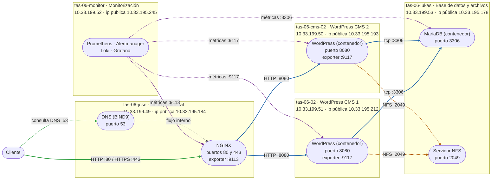

# Nodo Sur — Plataforma digital resiliente

**Asignatura:** EIN-090B · Taller de Administración de Sistemas

**Colaboradores:**
- Josecarlos Vidal
- Octavio Valencia
- Lukas Garrido

---

## 1. Descripción del proyecto

El proyecto tiene como propósito transformar un problema empresarial en una plataforma operable. El objetivo principal no es solamente instalar un CMS y mostrar su portada, sino construir una solución robusta que pueda ser publicada, administrada, diagnosticada, mantenida y recuperada ante posibles fallas. 

Para lograr esto, el equipo (JoseCarlos, Octavio, Lukas), deberán actuar como un proveedor de infraestructura. En este rol es fundamental justificar cada decisión técnica y sobre la arquitectura, mediante el establecimiento de requerimientos, la ejecución de pruebas, la recolección de métricas, el análisis de logs y la creación de procedimientos que sean completamente reproducibles.  

---

## 2. Estado del proyecto

| Entrega | Hito                                     | Fecha |
| ------- | ---------------------------------------- | ----- |
| 1       | Informe de requerimientos y arquitectura | 05/09 |
| 2       | Plataforma base y CMS funcional          | 05/09 |
| 3       | Publicación resiliente y seguridad       | 23/09 |
| 4       | Observabilidad y continuidad operacional |       |
| 5       | Incidente, auditoría y defensa final     |       |

---

## 3. Estructura del repositorio

```
nodo-sur/
├── README.md
├── bitacora/
│   ├── bitacora-general.md
│   ├── entorno-de-trabajo.md
│   └── uso-ia.md
├── decisiones/
│   ├── ADR-001 Selección de CMS.md
│   └── ADR-002 Nginx como balanceador en vez de HAProxy.md
├── docs/
│   ├── Proyecto_Integrador_TAS_2026_Nodo_Sur.pdf
│   └── entrega-1/
│       ├── Diagrama de despliegue.md
│       ├── E1_grupo06_informe.docx
│       └── diagrama-despliegue.png
├── evidencias/
│   └── evidencia1.md
├── infraestructura/
│   └── Inventario preliminar de infraestructura.md
└── scripts/
    ├── 01_docker.md
    ├── 02_monitor_vm.md
    ├── 03_nfs.md
    ├── 04_wordpress.md
    ├── 05_monitoreo_nginx_bind.md
    ├── 06_monitoreo_mariadb.md
    ├── script_cms.md          (instalación tradicional, histórico)
    ├── script_db.md           (instalación tradicional, histórico)
    └── script_dns.md
```

---

## 4. Caso de negocio

Nodo Sur es una red regional que agrupa pequeñas marcas, talleres creativos, productores y operadores de experiencias, quienes actualmente gestionan sus ventas, reservas, inscripciones y atención a clientes mediante las redes sociales, con formularios aislados y mensajería. Esta modalidad de operación dificulta la centralización de la información, aumenta el riesgo de pérdida de datos y genera problemas de disponibilidad de servicios.

El proyecto tiene como fin diseñar e implementar una plataforma digital *centralizada, administrable* y *resiliente* que permita a distintos miembros de Nodo Sur publicar sus productos y experiencias, gestionar pedidos y reservas, ofrecer contenidos y mantener comunicación con sus clientes **desde un único dominio**.

La solución propuesta debe soportar periodos de aumento de demanda asociados a campañas de difusión, manteniendo la continuidad del servicio web incluso ante la falla de uno de los nodos web. Para esto se plantea una arquitectura compuesta por servicios separados: un CMS, servidores web, una base de datos independiente, un punto de entrada con balanceo de carga, mecanismos de monitorización, gestión de logs y respaldos.

Este repositorio contiene la documentación, configuraciones, scripts, pruebas y evidencias asociadas al desarrollo de la plataforma como parte del proyecto integrador de **Taller de Administración de Sistemas (EIN-090B)** de la Universidad Técnica Federico Santa María.

---

## 5. Entrega 1 — Informe de requerimientos y arquitectura

### 5.1 Análisis del problema

- **Actores:** Pequeñas marcas, talleres creativos, productores y operadores de experiencias de la red regional; el personal con capacitación básica que administrará la plataforma; los clientes finales; y el equipo del proyecto, que actúa como proveedor de infraestructura.
- **Activos críticos:** El catálogo de productos y servicios, los registros de ventas, reservas e inscripciones a talleres, la base de datos separada, los archivos subidos al CMS y las credenciales administrativas.
- **Flujos de negocio:** Venta de catálogo, inscripción a talleres, reservas con cupos limitados, publicación de contenidos y atención posventa.
- **Supuestos:** La organización no tiene un equipo de desarrollo permanente, por lo que la plataforma debe basarse en software libre o de bajo costo. El tráfico experimentará picos de demanda breves durante las campañas de difusión.

**Consecuencias de las fallas sobre activos y flujos:**

| Activo / flujo | Falla | Pérdida o interrupción concreta | Requisito que lo cubre |
|---|---|---|---|
| Base de datos (pedidos, reservas, inscripciones) | Servicio caído o dato perdido | Sin ventas ni reservas mientras dure la falla, pedidos o inscripciones sin registro, cupos sobrevendidos o perdidos | RNF-02, RNF-06 |
| Archivos subidos (servidor NFS) | Servidor NFS caído, divergencia o disco lleno | Imágenes de catálogo no disponibles en uno o ambos backends, imposibilidad de publicar productos | RNF-03 |
| Nodo perimetral (DNS + Nginx) | Caída del host | Sitio completo inaccesible aunque los backends estén sanos | RNF-01, RNF-05 |
| Backend web (CMS 1 o CMS 2) | Caída de un nodo | Sin impacto si el otro absorbe la demanda, si no la absorbe, degradación o interrupción de ventas durante la campaña | RNF-01 |
| Flujo de reserva con cupos | Escritura duplicada o perdida | Doble reserva o cupo perdido (caso de las solicitudes duplicadas del incidente piloto) | RF-01 |
| Respaldos | Backup antiguo o nunca restaurado | Pérdida de semanas de datos y recuperación incierta (caso del respaldo sin probar) | RNF-06 |
| Credenciales administrativas | Compartidas, débiles, expuestas o sin revocación | Acceso indefinido de personas que ya no deberían tenerlo, sin trazabilidad | RNF-04 |
| Monitorización y logs | Ausencia de métricas y alertas | Fallas de horas sin diagnóstico (caso del formulario caído casi dos horas) | RNF-05, RNF-08 |

### 5.2 Requerimientos

Cada requerimiento incluye un umbral medible y una prueba. Instalar el servicio no demuestra por sí solo el cumplimiento.

| ID | Requerimiento | Tipo (F/NF) | Criterio de aceptación (umbral) | Prueba de validación |
|---|---|---|---|---|
| RF-01 | Contar con un CMS funcional para catálogo, pedidos, reservas y administración de contenidos | Funcional | Un flujo completo (producto o reserva → pedido registrado) se ejecuta bajo el dominio único y el registro es localizable en la aplicación y en la BD | Ejecutar la compra o reserva desde un cliente y consultar la tabla correspondiente en MariaDB |
| RNF-01 | Mantener la capa web operativa con al menos dos nodos web | No funcional | Con un backend detenido, ≥ 99 % de 100 solicitudes GET consecutivas responden 200 y la conmutación ocurre en ≤ 30 s | Detener el contenedor de WordPress de un backend y lanzar 100 solicitudes con `curl` en bucle; revisar los logs de acceso de Nginx |
| RNF-02 | La base de datos opera de forma independiente y no expuesta | No funcional | El puerto 3306 solo responde a 10.33.199.50 y .51 (WordPress) y a 10.33.199.52 (monitorización); cualquier otro origen es rechazado | `nc -zv 10.33.199.53 3306` desde un origen autorizado y desde uno no autorizado; revisión de reglas del firewall |
| RNF-03 | Persistencia y coherencia del estado compartido | No funcional | Un archivo subido por un backend se sirve con HTTP 200 y el mismo checksum desde el otro backend en ≤ 5 s | Subir una imagen y descargarla vía ambos backends; comparar `sha256sum` |
| RNF-04 | Administración remota solo por canales seguros y nominativos | No funcional | Autenticación SSH por clave pública, un usuario por integrante, sin login por contraseña ni cuentas compartidas; una cuenta puede revocarse sin afectar a las demás | Revisar `sshd_config`; revocar una clave de prueba y verificar que el acceso falla |
| RNF-05 | Detección de falla crítica en tiempo acotado | No funcional | Alerta de Alertmanager recibida en ≤ 5 min tras detener un backend, sin observar un panel | Detener un servicio y medir el tiempo entre el evento y la recepción de la alerta en el canal definido |
| RNF-06 | Continuidad mediante respaldos verificados | No funcional | Retención ≥ 30 días; restauración completa en ≤ 60 min con pérdida de datos ≤ 24 h | Restaurar en una VM de prueba y medir tiempos y datos recuperados (Entrega 4) |
| RNF-07 | Publicación bajo un dominio único con HTTPS válido | No funcional | `https://tas-06.arpa` responde sin error de certificado y HTTP en el 80 redirige a HTTPS | `curl -v` y `openssl s_client` desde un cliente |
| RNF-08 | Trazabilidad y hora consistente en logs | No funcional | Desfase entre nodos ≤ 1 s y misma zona horaria en VM y contenedores; un evento puede reconstruirse correlacionando logs de proxy, web, BD y SSH | Comparar `chronyc tracking` y `date` en todos los nodos y seguir una solicitud entre logs (consulta en Loki) |

### 5.3 Selección de CMS y suite

Evaluación de alternativas para el proyecto, comparando WordPress frente a Joomla y Drupal. Las versiones exactas de requisitos deben confirmarse en la documentación oficial de cada CMS antes de la entrega final.

| Criterio | WordPress | Joomla | Drupal |
|---|---|---|---|
| **Licenciamiento** | GPL, gratuito | GPL, gratuito | GPL, gratuito |
| **Comunidad/soporte** | Enorme, documentación abundante, muchos plugins de reservas | Grande, tercer CMS más usado, pero ecosistema de extensiones más pequeño que WordPress | Grande pero orientada a desarrolladores y proyectos enterprise/gobierno, menos enfocada en e-commerce |
| **Curva de operación** | Baja, adecuada para personal sin equipo técnico | Media, requiere entender su estructura de artículos, categorías y menús, más rígida que WordPress | Alta, requiere conocimientos técnicos serios (arquitectura de contenidos, módulos, a veces Drush/CLI) |
| **Recursos** | Imagen oficial `wordpress:php8.3-apache` en contenedor y MariaDB 11. 2 vCPU / 2 GB por backend es una base razonable para el volumen esperado, a validar con prueba de carga | Pila PHP + MySQL/MariaDB con requisitos comparables a WordPress | Pila similar, pero con Commerce y módulos a medida el consumo y el tuning requeridos son mayores |
| **Mantenimiento** | Parches frecuentes del núcleo; el mayor riesgo está en los plugins de terceros. Política: actualizar primero en pruebas, limitar la cantidad de plugins, deshabilitar la edición de archivos desde el panel y fijar versiones de imagen | Actualizaciones mayores más exigentes y extensiones con ciclos de soporte desiguales | Actualizaciones mayores costosas; requiere personal con conocimiento técnico para mantenerlo |
| **Compatibilidad** | Compatible con Docker, MariaDB y NFS; WooCommerce exige una versión mínima de WordPress y PHP; el plugin de reservas debe validarse con dos nodos | Compatible con la pila, pero e-commerce y reservas dependen de extensiones poco integradas | Compatible con la pila; e-commerce requiere Drupal Commerce y desarrollo a medida |
| **Límites conocidos / de operación** | Es *stateful* (uploads en disco), por lo que con dos nodos exige resolver la coherencia de archivos. `wp-cron` se dispara por visita y con dos nodos se ejecuta por duplicado (se resuelve con un cron del sistema en un solo nodo). `admin-ajax` carga bajo tráfico alto. Rendimiento sensible a plugins; requiere caché | No tiene un módulo de e-commerce/reservas tan maduro como WooCommerce; VirtueMart o HikaShop son menos pulidas | No tiene e-commerce/reservas nativo; requiere Drupal Commerce y trabajo de desarrollo a medida; mantenimiento más costoso |
| **Motivo de descarte** | — | El caso necesita catálogo, cupos y venta directa; hacerlo funcionar en Joomla implica sumar extensiones de terceros poco integradas entre sí, agregando fragilidad sin beneficio real sobre WordPress | Drupal está pensado para sitios complejos con lógica de contenido avanzada, no para una tienda con reservas simple; usarlo exigiría un equipo de desarrollo dedicado, contradiciendo la necesidad de operación con personal sin equipo técnico |

**Justificación técnica de WordPress + Nginx:**
- WordPress + WooCommerce cubre en un solo stack catálogo, pedidos, contenido y, con un plugin de reservas (a definir: Amelia o Bookly), el flujo de talleres con cupos limitados.
- Los backends usan la imagen oficial de WordPress con Apache y PHP 8.3, lo que simplifica el despliegue y la réplica por contenedor.
- Nginx actúa como proxy inverso y balanceador en el nodo perimetral, donde su menor consumo de recursos y su manejo eficiente de conexiones concurrentes son relevantes porque el caso menciona picos de tráfico en campañas de difusión.
- Al ser PHP + MariaDB/MySQL, es compatible con la arquitectura de referencia del enunciado (backend web + base de datos separada).
- Riesgo asumido: dependencia del ecosistema de plugins y del trabajo de mantenerlos actualizados; se mitiga con la política de mantenimiento indicada en la tabla.

### 5.4 Diagrama de despliegue

- Archivo: `docs/entrega-1/diagrama-despliegue.png` / `docs/entrega-1/Diagrama de despliegue.md`
- Subred de infraestructura: `10.33.199.48/29` (red: .48 · broadcast: .55 · host usables: .49–.54; el .54 está libre)
- Dominio interno: `tas-06.arpa`
- Todos los servicios corren en contenedores Docker (ver `scripts/01_docker.md`).
- Estado actual: además del nodo perimetral, las otras cuatro VM (CMS 1, CMS 2, monitor y base de datos) tienen una segunda tarjeta de red con IP pública (10.33.195.212, .193, .245 y .178). El diseño objetivo es que solo el nodo perimetral conserve dos tarjetas y el resto quede con una sola, la privada. Hasta entonces, el puerto 8080 de los backends se publica en todas las interfaces (ver *Acceso directo a backends*).
- Decisión pendiente: con una sola tarjeta, esas VM no tendrán salida a internet (`apk`, `docker pull`) salvo que el nodo perimetral haga NAT. Debe decidirse antes de retirar las tarjetas.



**Tabla de puertos y flujos:**

| Origen | Destino | Puerto | Protocolo | Propósito |
| --- | --- | --- | --- | --- |
| Cliente | DNS (nodo perimetral, 10.33.195.184 / .49) | 53 | DNS/UDP-TCP | Resolución del dominio `tas-06.arpa` |
| Cliente | Nginx (nodo perimetral, .49) | 443 | HTTPS/TCP | Acceso al sitio con TLS terminado en el nodo perimetral |
| Cliente | Nginx (nodo perimetral, .49) | 80 | HTTP/TCP | Solo redirección a HTTPS |
| Nginx (.49) | WordPress CMS 1 (.51) | 8080 | HTTP/TCP | Reenvío por red privada (upstream 1); publicado desde el puerto 80 del contenedor. Único origen permitido hacia el backend |
| Nginx (.49) | WordPress CMS 2 (.50) | 8080 | HTTP/TCP | Reenvío por red privada (upstream 2); publicado desde el puerto 80 del contenedor. Único origen permitido hacia el backend |
| CMS 1 / CMS 2 | MariaDB (.53) | 3306 | TCP | Consultas a la BD, solo por red privada |
| CMS 1 / CMS 2 | Servidor NFS (.53) | 2049 | NFS/TCP | Montaje de `wp-config.php` y de `wp-content/uploads` |
| Monitor (.52) | MariaDB (.53) | 3306 | TCP | `mysqld-exporter` con usuario de solo métricas |
| Monitor (.52) | Nodo perimetral (.49) | 9113 | HTTP/TCP | Métricas de Nginx (`nginx-prometheus-exporter`) |
| Monitor (.52) | CMS 1 y CMS 2 (.51 y .50) | 9117 | HTTP/TCP | Métricas de Apache (`apache-exporter`) |
| Administrador | Nodo perimetral (IP pública .184) | 22 | SSH/TCP | Único punto de entrada administrativo (bastión) |
| Nodo perimetral (.49) | CMS 1, CMS 2, monitor y BD (IP privadas) | 22 | SSH/TCP | Administración remota nominativa por clave pública (RNF-04), con salto (`ssh -J`) desde el bastión |
| Todos los nodos | Fuente NTP | 123 | UDP | Sincronización horaria (RNF-08) |

El canal de estadísticas de BIND9 (`127.0.0.1:8053`) está habilitado, pero aún no tiene exporter hacia Prometheus.

**Coherencia de archivos entre nodos.** El estado de WordPress se separa según dónde vive:

| Estado | Dónde vive | Cómo se mantiene coherente |
|---|---|---|
| Sesiones de WooCommerce, carritos, transients | Base de datos | Ya es coherente entre nodos porque ambos backends usan la misma BD |
| Archivos subidos (`wp-content/uploads`) | Disco | Volumen NFS compartido desde la VM de la BD (`/srv/nfs/wordpress/uploads`) |
| `wp-config.php` | Disco | Archivo único en el NFS (`/srv/nfs/wordpress/config`), montado en `/mnt/wp-config` de cada backend: misma configuración, claves y salts, de modo que las sesiones de inicio de sesión valen en ambos nodos |
| Plugins, temas y código | Volumen local de cada backend | Despliegue desde archivos versionados y `DISALLOW_FILE_MODS` para impedir instalar plugins en un solo nodo (pendiente de aplicar) |
| Tareas programadas (`wp-cron`) | Cada backend | `DISABLE_WP_CRON` en ambos y un cron del sistema en un solo nodo |

El NFS se aloja en la VM de la base de datos, y no en un nodo propio, por simplicidad y por la escasez de direcciones del /29. La alternativa evaluada (`lsyncd`/`rsync` entre backends) evita un servidor central, pero introduce una ventana de divergencia de segundos. El costo de la decisión es que la base de datos y los archivos comparten punto único de falla y compiten por el disco (ver 5.5). La decisión completa se documentará en ADR-003. Procedimiento: `scripts/03_nfs.md`.

**Alcance de los health checks.** La versión libre de Nginx solo ofrece detección pasiva (`max_fails`, `fail_timeout` y `proxy_next_upstream error timeout http_502 http_503 http_504`), según ADR-002.

| Detecta | No detecta |
|---|---|
| Servicio caído o conexión rechazada | Contenido distinto entre nodos |
| Timeouts del backend | Respuestas 200 lentas pero bajo el timeout |
| Respuestas 502, 503 y 504 | Caída de la BD (afecta a ambos backends por igual) |

Además, Nginx no reintenta por defecto solicitudes no idempotentes (POST). Un pedido que falla a mitad de camino no se reenvía al otro backend: se evita duplicarlo, pero ese cliente ve el error. Como complemento, Prometheus recolecta el estado de Nginx, Apache y MariaDB, y se incorporará un script con `curl` a un endpoint de salud de cada backend (verifica también la conexión a la BD), ejecutado por cron y con alerta.

**Acceso directo a backends.** Los backends no deben poder eludir los controles del punto de entrada. Hoy el puerto 8080 se publica en todas las interfaces y las VM de CMS, monitor y base de datos tienen una IP pública, por lo que un cliente podría saltarse Nginx. Controles:
- Dejar cada VM con una sola tarjeta de red (la privada) y retirar las IP públicas de CMS 1, CMS 2, monitor y base de datos; solo el nodo perimetral conserva dos tarjetas.
- Publicar el puerto 8080 solo en la IP privada de cada backend y aceptar únicamente a 10.33.199.49 (y el 9117 solo a 10.33.199.52).
- Docker inserta sus propias reglas de iptables y se salta el firewall del host, por lo que la restricción debe aplicarse también en la cadena `DOCKER-USER`.
- Nginx incluye un `server` por defecto que rechaza Hosts desconocidos, y los backends usan `set_real_ip_from 10.33.199.49` para registrar la IP real del cliente.
- SSH solo desde el nodo perimetral, que actúa como bastión.
- Prueba de aceptación: `curl http://10.33.195.212:8080` desde fuera debe fallar y `curl http://10.33.199.51:8080` desde un origen distinto de .49 debe ser rechazado.

El tráfico entre el nodo perimetral y los backends viaja sin cifrar dentro de la subred privada; se acepta como riesgo residual para este alcance.

### 5.5 Dimensionamiento y objetivos de servicio

Se distingue la **tolerancia a fallas de la capa web** de la **disponibilidad del servicio completo**. Tener dos backends solo protege contra la caída de uno de ellos. El servicio completo depende además del nodo perimetral y de la VM de la base de datos (que aloja MariaDB y el NFS), que son puntos únicos de falla.

| Indicador | Meta propuesta | Justificación |
|---|---|---|
| Disponibilidad mensual | ≥ 99,5 % | Equivale a un presupuesto de unas 3,6 h de indisponibilidad al mes (0,5 % de 720 h). La falla de un backend se absorbe (si el otro tiene capacidad); la caída del nodo perimetral o de la VM de la BD sí interrumpe el servicio. Con RTO de 60 min cabe una de ellas por mes; dos agotan el presupuesto |
| Detección de falla crítica | ≤ 5 min | Evita repetir el incidente de 2 h sin diagnóstico que originó el proyecto |
| RTO servicio web | ≤ 60 min | Una campaña no puede quedar caída más de 1 h sin impacto comercial |
| RPO general | ≤ 24 h | Aceptable en operación normal; a mejorar durante campañas con backups más frecuentes de la BD (10.33.199.53) |
| Retención de respaldos | ≥ 30 días | Cubre detección tardía de errores; con al menos una copia en ubicación separada |

**Capacidad con un solo backend (criterio N-1).** Dos nodos no garantizan continuidad si uno no puede absorber la demanda del otro. El criterio de diseño es que **cada backend debe poder atender el 100 % del pico previsto**.

- Medición: prueba de carga (`k6` o `ab`) sobre la página de catálogo y el checkout, con un solo backend activo.
- Umbrales de aceptación: p95 ≤ 2 s, CPU ≤ 85 %, errores < 1 %.
- Condición: pico proyectado de campaña ≤ capacidad medida de un backend.

Cálculo de referencia (supuestos ilustrativos que deben reemplazarse con las mediciones):

| Parámetro | Supuesto | Resultado |
|---|---|---|
| Procesos de Apache por backend | (2048 MB − ~600 MB para SO y Docker) ÷ ~60 MB por proceso | ≈ 24, se ajusta `MaxRequestWorkers` ≈ 20 (el valor por defecto, 150, agotaría la memoria) |
| Capacidad teórica por backend | 20 procesos ÷ 0,3 s por solicitud | ≈ 65 req/s |
| Capacidad con plugins reales | 50 % de la teórica | ≈ 30 req/s por backend |
| Conexiones a la BD | 2 backends × 20 procesos + monitor + margen | `max_connections` ≥ 50 |

Si el pico proyectado supera la capacidad de un backend, se aplican medidas de degradación controlada: caché de página, `limit_req` en Nginx para proteger el checkout y suspensión de tareas no críticas.

**Puntos únicos de falla identificados:**
- **Nodo perimetral (10.33.199.49):** concentra DNS y Nginx, su caída interrumpe la resolución del dominio y la distribución de tráfico. Además, con las VM en una sola tarjeta, es el único camino de administración (bastión).
- **VM de la base de datos (10.33.199.53):** aloja MariaDB (instancia única sin réplica) y el servidor NFS; una falla elimina datos y archivos a la vez, y ambos backends quedan inoperantes aunque sigan activos.
- **VM de monitorización (10.33.199.52):** única; su caída deja sin observabilidad ni alertas, pero no interrumpe el servicio.
- **Infraestructura de virtualización y red de laboratorio:** dependencia compartida por todos los nodos, no controlada por el equipo.

**Plan de crecimiento:**
- Separar DNS y Nginx en nodos distintos y evaluar un segundo nodo Nginx con VRRP/keepalived.
- Separar el servidor NFS de la base de datos e incorporar réplica de MariaDB (primario-réplica) con respaldo frecuente de binlogs para mejorar el RPO en campañas.
- Evolucionar el almacenamiento de archivos hacia almacenamiento de objetos compatible con S3 si el volumen crece.
- Agregar un tercer backend si el pico proyectado supera la capacidad medida de un nodo.
- Nota: el /29 tiene seis direcciones utilizables y cinco están asignadas; queda libre la .54, por lo que todo crecimiento adicional requiere una subred mayor.

### 5.6 Modelo de acceso, seguridad y operación

- **Accesos remotos:** SSH por clave pública hacia las IP privadas de cada nodo (10.33.199.49 a .53), con salto por el nodo perimetral (`ssh -J <usuario>@10.33.195.184 <usuario>@<IP privada>`), usuario nominativo por integrante, `PasswordAuthentication no`, `PermitRootLogin no`, `sudo` limitado y sin cuentas compartidas. Revocación individual eliminando la clave del usuario. Pertenecer al grupo `docker` equivale a tener acceso root, por lo que se limita a quienes administran los servicios. Estado actual: las VM usan cuentas `root` y de servicio con contraseña, que deben reemplazarse por usuarios nominativos con clave antes de dar por cumplido RNF-04.
- **Gestión de secretos:** contraseñas y credenciales fuera del repositorio. Se guardan en archivos `.env` (MariaDB, Grafana) y `.my.cnf` (exporter de MariaDB) con permisos `600`, ignorados por git; el repositorio solo versiona `.env.example` con valores de referencia (`<hidden_password>`). El `wp-config.php`, que contiene la contraseña de la BD, se comparte por NFS con acceso restringido a los backends. Si un secreto se expone, se rota de inmediato.
- **Firewall / segmentación:** solo el nodo perimetral expone 53, 80 y 443 (y el SSH como bastión) hacia la red pública. Los backends aceptan el 8080 solo desde .49; la BD acepta el 3306 solo desde .50, .51 y .52; el NFS acepta el 2049 solo desde .50 y .51; el SSH de los demás nodos solo desde .49. Política por defecto: denegar, aplicando las reglas también en `DOCKER-USER`.
- **Logs y monitorización:** la VM de monitorización ejecuta Prometheus, Alertmanager, Loki y Grafana en contenedores, con puertos publicados solo en `127.0.0.1` y acceso por túnel SSH (`AllowTcpForwarding local`) a través del bastión. Se recolectan métricas de Nginx, Apache y MariaDB mediante exporters; el exporter de BIND9 está pendiente. Retención de 7 días para métricas y logs. Logs de acceso y error de Nginx y Apache, slow query log de MariaDB y `auth.log` para SSH; NTP y la misma zona horaria en todos los nodos para correlacionar eventos. Procedimientos: `scripts/02_monitor_vm.md`, `05_monitoreo_nginx_bind.md` y `06_monitoreo_mariadb.md`.
- **Alertas:** Alertmanager agrupa las alertas, pero su receptor aún no tiene destino (correo o webhook), por lo que hoy no llegan a nadie. Es el principal pendiente para cumplir RNF-05.
- **Backup (diseño):** dump programado de la BD, respaldo de `wp-content/uploads` y de las configuraciones, retención ≥ 30 días, al menos una copia fuera del host de origen y verificación por checksum. Antes de cualquier operación destructiva (`docker compose down -v`) se hace un dump. Restauración probada en la Entrega 4.
- **Backup (estado actual):** respaldo manual con `mariadb-dump --all-databases` guardado en `/home/database/backups` de la VM de la base de datos (nombre con fecha y hora). El archivo verificado pesa 1,0 MB, termina en `Dump completed` y contiene `mydb` (52 tablas) y `mysql` (30 tablas, con usuarios y permisos). Pendientes: prueba de restauración en un contenedor aparte, copia en el nodo perimetral, automatización con retención de 30 días y respaldo de los archivos del NFS.
- **Respuesta a incidentes (diseño):** detectar → priorizar → contener → diagnosticar → corregir → validar → documentar → revertir si corresponde. Cada paso queda registrado con hipótesis, evidencia y marcas de tiempo en `bitacora/bitacora-general.md`.

**Política de datos:**

| Dato | Ubicación | Respaldo | Retención | Acceso | Capacidad y permisos |
|---|---|---|---|---|---|
| Pedidos, reservas, inscripciones y datos de clientes | MariaDB en la VM de BD (.53) | Dump diario + copia separada | ≥ 30 días | Solo el usuario de la aplicación desde .50 y .51 | Alerta al 80 % de disco |
| Archivos subidos y `wp-config.php` | NFS en la VM de BD (`/srv/nfs/wordpress`) | Copia diaria | ≥ 30 días | Solo .50 y .51, propietario `www-data` (uid 33), nunca `chmod 777` | Límite de tamaño por archivo y alerta al 80 % de disco |
| Logs | Cada nodo y Loki en el monitor | Centralización en la Entrega 4 | 7 días en Loki (configurado); a definir en cada nodo | Solo administradores nominativos, por túnel SSH | `logrotate` y límite de tamaño de logs de Docker |
| Métricas | Prometheus en el monitor (volumen propio) | — | 7 días (configurado) | Solo administradores nominativos, por túnel SSH | Vigilar el uso del volumen |
| Configuración | Repositorio (saneada) | Git | Historial completo | Cuentas nominativas | Sin secretos |

Los datos de clientes son datos personales. El equipo debe verificar con el docente la normativa chilena aplicable (Ley 19.628 y su actualización, Ley 21.719) y no incluir datos personales en el repositorio ni en capturas.

### 5.7 Plan de implementación por etapas

Responsables propuestos según la distribución actual del trabajo; confirmar en equipo.

| Etapa | Entregable | Responsable(s) | Depende de | Pruebas previstas | Criterio para avanzar | Reversión |
|---|---|---|---|---|---|---|
| Entrega 2 | Docker en los nodos, MariaDB y WordPress en contenedores, DNS y Nginx, servidor NFS y VM de monitorización; CMS 1, CMS 2, monitor y BD con una sola tarjeta de red (según `scripts/01_docker.md` a `04_wordpress.md`) | Octavio (CMS), Lukas (BD y NFS), Josecarlos (DNS y nodo perimetral) | VMs y red listas; decisión sobre salida a internet (NAT) | Resolución DNS de `tas-06.arpa`, acceso HTTPS por nombre, flujo de compra o reserva, BD inaccesible desde fuera, NFS montado en ambos backends, IP públicas sin respuesta | RF-01, RNF-02 y RNF-07 verificados | Dump de la BD y copia de los compose, de `nginx.conf` y de `/etc/network/interfaces` antes de cada cambio; `nginx -t` antes de `reload`; consola del hipervisor como vía de recuperación |
| Entrega 3 | Balanceo verificado entre ambos backends, script de salud, firewall en `DOCKER-USER` y prueba de capacidad N-1 | Octavio, Lukas, Josecarlos | Entrega 2 y ADR-003 | Distribución entre CMS 1 y CMS 2, retiro de un backend, checksum entre nodos, prueba de carga con un solo backend | RNF-01 y RNF-03 verificados y capacidad de un backend ≥ pico proyectado | Quitar el segundo backend del `upstream` y volver a un solo nodo |
| Entrega 4 | Alertas con destino, exporter de BIND9, agente de logs hacia Loki, backups automatizados y restauración | Equipo completo | Entrega 3 | Degradación controlada, alerta ≤ 5 min, restauración ≤ 60 min en VM de prueba | RNF-05, RNF-06 y RNF-08 verificados con marcas de tiempo | Restaurar la configuración anterior desde Git |
| Entrega 5 | Auditoría final e incidente no anunciado | Equipo completo | Entrega 4 | Recuperación validada con el flujo de negocio, defensa individual | Matriz de pruebas completa | Etiqueta de versión estable del repositorio |

### 5.8 Evidencias mínimas — checklist

- [x] Matriz requisito → componente → prueba → evidencia (ver tabla siguiente)
- [x] Diagrama legible y tabla de flujos/puertos
- [x] Registro de decisiones de arquitectura (ADR-001 y ADR-002, ADR-003 por redactar)
- [x] Inventario preliminar de VMs, CPU, RAM, disco, redes y dependencias (sección 6)
- [x] Riesgos priorizados y tratamiento propuesto (sección 7)

**Matriz de trazabilidad:**

| Requisito | Componente | Prueba | Evidencia esperada |
|---|---|---|---|
| RF-01 | WordPress + WooCommerce + MariaDB | Flujo de compra o reserva completo | Registro en la aplicación y en la BD |
| RNF-01 | Nginx (upstream) + 2 backends | Detener un backend y lanzar 100 solicitudes | Salida del bucle y logs de Nginx |
| RNF-02 | MariaDB + firewall | `nc` a 3306 desde origen autorizado y no autorizado | Salida de `nc`, reglas del firewall |
| RNF-03 | NFS (VM de BD) + montajes | Subir un archivo y comparar `sha256sum` por ambos backends | Checksums idénticos |
| RNF-04 | `sshd` + usuarios nominativos | Revocar una clave y verificar bloqueo | `sshd_config`, `auth.log` |
| RNF-05 | Prometheus + Alertmanager + script de salud | Detener un servicio y medir el tiempo hasta la alerta | Marcas de tiempo del evento y de la alerta |
| RNF-06 | Backups + VM de prueba | Restauración medida | Tiempos de RPO y RTO reales |
| RNF-07 | Nginx + certificado TLS | `curl -v` y `openssl s_client` | Salida sin errores de certificado |
| RNF-08 | NTP + logs (Loki) | `chronyc tracking`, `date` en cada nodo y correlación de una solicitud | Desfase ≤ 1 s, misma zona horaria y secuencia de eventos |

---

## 6. Inventario preliminar de infraestructura

Los recursos son estimaciones de diseño, salvo los de la VM de monitorización, que son reales. Se ajustan con la prueba de carga de la Entrega 3.

| VM/Host | Rol | CPU | RAM | Disco | Red | Dependencias |
|---|---|---|---|---|---|---|
| `tas-06-jose` | Nodo perimetral: DNS (BIND9, 53) + Nginx (80/443), punto de entrada y bastión SSH | 1 vCPU (estimado) | 1 GB (estimado) | 10 GB (estimado) | 10.33.199.49 · pública 10.33.195.184 (se conserva) | CMS 1, CMS 2, NTP |
| `tas-06-02` | WordPress CMS 1 (contenedor, 8080) + apache-exporter (9117) | 2 vCPU (estimado) | 2 GB (estimado) | 20 GB (estimado) | 10.33.199.51 · IP pública 10.33.195.212 a retirar | MariaDB, NFS |
| `tas-06-cms-02` | WordPress CMS 2 (contenedor, 8080) + apache-exporter (9117) | 2 vCPU (estimado) | 2 GB (estimado) | 20 GB (estimado) | 10.33.199.50 · IP pública 10.33.195.193 a retirar | MariaDB, NFS |
| `tas-06-lukas` | MariaDB 11 (contenedor, 3306) + servidor NFS (2049) | 2 vCPU (estimado) | 4 GB (estimado) | 191,7 GB (real); uso actual 1,5 GB | 10.33.199.53 · IP pública 10.33.195.178 a retirar | — |
| `tas-06-monitor` | Prometheus, Alertmanager, Loki y Grafana (contenedores) + mysqld-exporter | 2 vCPU (real) | 4 GB + 4 GB de swap (real) | 191,6 GB (real) | 10.33.199.52 · IP pública 10.33.195.245 a retirar | Exporters de los demás nodos |

Versiones conocidas: la VM de monitorización usa Alpine Linux 3.24.2, Docker v29.8.1 y Docker Compose v5.1.4; las VM de CMS y de base de datos usan Alpine Linux. Completar el sistema operativo y las versiones del resto de los nodos. Las IP públicas pertenecen a la red `10.33.195.128/25` del laboratorio.

---

## 7. Riesgos

| Riesgo | Probabilidad | Impacto | Tratamiento propuesto |
|---|---|---|---|
| Un backend no puede absorber el pico cuando cae el otro | Media | Alto | Criterio N-1 con prueba de carga; ajuste de `MaxRequestWorkers`, caché y `limit_req` |
| Caída de la VM de la BD (MariaDB y NFS comparten host) | Media | Alto | Declarado como SPOF; backups verificados, y separar el NFS y replicar la BD como evolución |
| Caída del nodo perimetral (DNS + Nginx en el mismo host y único bastión SSH) | Media | Alto | Declarado como SPOF; separar DNS y Nginx, evaluar segundo proxy con VRRP y mantener la consola del hipervisor como vía de emergencia |
| Divergencia de plugins entre backends | Media | Medio | `DISALLOW_FILE_MODS` y despliegue desde archivos versionados |
| Acceso directo a un backend que elude el punto de entrada (puerto 8080 abierto y IP pública en CMS 1, CMS 2, monitor y BD) | Alta | Medio | Dejar cada VM con una sola tarjeta (privada), publicar en IP privada y restringir en `DOCKER-USER` |
| Endpoints de estado y métricas expuestos (`/server-status`, exporters, BIND9) | Alta | Medio | Restringir `/server-status` a la red interna de Docker, limitar los exporters al origen 10.33.199.52 y dejar BIND9 en `127.0.0.1` |
| Resolvedor DNS abierto (recursión para cualquier origen) | Alta | Medio | Limitar `allow-recursion` y `allow-query-cache` a 10.33.199.48/29 y verificar `REFUSED` desde fuera |
| Alertas sin destino: una falla no avisa a nadie | Alta | Alto | Definir el receptor de Alertmanager y regla `up == 0` para todos los jobs |
| Falla no detectada a tiempo por health checks pasivos | Media | Alto | Script de comprobación activa con alerta y monitorización |
| Pérdida de datos por una operación destructiva sin respaldo previo | Media | Alto | Dump antes de `docker compose down -v` y backups automatizados |
| Respaldos solo manuales, en la misma VM y sin restauración probada | Alta | Alto | Prueba de restauración en un contenedor aparte, copia en el nodo perimetral, automatización con retención de 30 días y medición de RPO y RTO |
| Zonas horarias distintas entre VM y contenedores (el dump registró 23:11 en una VM cuya hora local era 20:11) | Media | Medio | Fijar `TZ` en los contenedores y sincronizar la hora de todos los nodos |
| Credenciales débiles o compartidas en las cuentas de las VM, alcanzables por IP pública hasta retirar la segunda tarjeta | Alta | Alto | Usuarios nominativos con clave, `PasswordAuthentication no`, `PermitRootLogin no`, cambio inmediato de las contraseñas actuales y secretos fuera del repositorio |
| Plugins desactualizados o vulnerables | Media | Medio | Política de actualización en pruebas, plugins mínimos e imágenes con etiqueta fija |

---

## 8. Registro de decisiones de arquitectura (ADR)

Cada decisión relevante se documenta en `decisiones/ADR-XXX-titulo.md` con este formato mínimo:

```
# ADR-XXX: Título de la decisión

## Contexto
## Opciones consideradas
## Decisión
## Consecuencias
```

| ADR | Decisión | Estado |
|---|---|---|
| ADR-001 | Selección de CMS: WordPress + WooCommerce frente a Joomla y Drupal | Aprobada |
| ADR-002 | Nginx como balanceador en vez de HAProxy, con detección pasiva de fallas | Aprobada |
| ADR-003 | Coherencia de archivos entre backends: NFS alojado en la VM de la BD frente a NFS en nodo propio y a `lsyncd`/`rsync` | Decidida, por redactar |

---

## 9. Bitácora de contribuciones por integrante

Cada integrante registra únicamente actividades respaldadas por evidencia en el repositorio. Detalle en `bitacora/bitacora-general.md`.

| Fecha | Integrante | Actividad | Entrega asociada |
|---|---|---|---|
| | | | |

---

## 10. Uso de inteligencia artificial

> Registro obligatorio según normativa del proyecto. Detalle en `bitacora/uso-ia.md`.

| Herramienta | Propósito | Fragmento relevante | Validación realizada | Cambios aplicados |
|---|---|---|---|---|
| Claude | Apoyo en redacción, estructura y corrección del informe, del README y de la documentación de scripts | Tablas de requerimientos con umbrales, política de datos, cálculo de capacidad N-1 y documentación de la configuración de Docker, NFS, monitorización y respaldo | A completar por el equipo: revisar cada cifra y comando y contrastarlo con pruebas y documentación oficial | A completar por el equipo |

_Nota: la respuesta de una IA no constituye evidencia técnica. Todo código o comando debe poder ser explicado por cualquier integrante del equipo._

---

## 11. Cómo reproducir / levantar el entorno

Los secretos nunca se versionan: cada nodo usa su propio `.env` (con permisos `600`), creado a partir de los valores de referencia `.env.example`. Orden de ejecución:

1. **Docker en todos los nodos:** `scripts/01_docker.md`.
2. **Base de datos y NFS (10.33.199.53):** levantar MariaDB con su compose y `.env`, y configurar el servidor NFS con `scripts/03_nfs.md`.
3. **Backends (10.33.199.51 y .50):** montar el NFS y levantar WordPress con `scripts/04_wordpress.md`.
4. **Nodo perimetral (10.33.199.49):** DNS y Nginx como balanceador hacia los backends.
5. **Monitorización (10.33.199.52):** `scripts/02_monitor_vm.md`, y después los exporters con `scripts/05_monitoreo_nginx_bind.md` y `scripts/06_monitoreo_mariadb.md`.
6. **Red:** dejar CMS 1, CMS 2, monitor y BD con una sola tarjeta (la privada), accediendo por salto desde el nodo perimetral.
7. **Verificación:** ejecutar las pruebas de la matriz de trazabilidad (5.8) y guardar la evidencia en `evidencias/`.

Los scripts `script_cms.md`, `script_db.md` y `script_dns.md` documentan la línea base de instalación tradicional, anterior a la contenerización.

---

## 12. Licencia / uso académico

Proyecto desarrollado con fines académicos para EIN-090B, Universidad Técnica Federico Santa María.