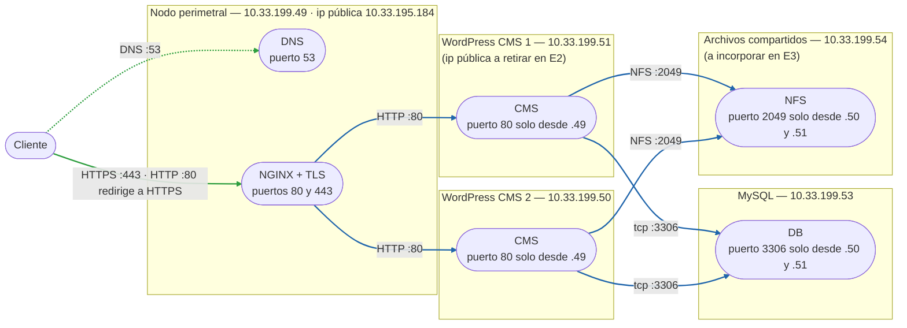

# Nodo Sur — Plataforma digital resiliente

**Asignatura:** EIN-090B · Taller de Administración de Sistemas
**Proyecto integrador 2026**
**Grupo:** 6
**Paralelo:** 701

**Integrantes:**
- Josecarlos Vidal
- Octavio Valencia
- Lukas Garrido

---

## 1. Descripción del proyecto

El proyecto tiene como propósito transformar un problema empresarial en una plataforma operable. El objetivo principal no es solamente instalar un CMS y mostrar su portada, sino construir una solución robusta que pueda ser publicada, administrada, diagnosticada, mantenida y recuperada ante posibles fallas. 

Para lograr esto, el equipo (JoseCarlos, Octavio, Lukas), deberán actuar como un proveedor de infraestructura. En este rol es fundamental justificar cada decisión técnica y sobre la arquitectura, mediante el establecimiento de requerimientos, la ejecución de pruebas, la recolección de métricas, el análisis de logs y la creación de procedimientos que sean completamente reproducibles.  

---

## 2. Estado del proyecto

| Entrega | Hito                                     | Fecha |
| ------- | ---------------------------------------- | ----- |
| 1       | Informe de requerimientos y arquitectura | 05/09 |
| 2       | Plataforma base y CMS funcional          | 05/09 |
| 3       | Publicación resiliente y seguridad       | 23/09 |
| 4       | Observabilidad y continuidad operacional |       |
| 5       | Incidente, auditoría y defensa final     |       |

---

## 3. Estructura del repositorio

```
nodo-sur/
├── README.md
├── bitacora/
│   ├── bitacora-general.md
│   ├── entorno-de-trabajo.md
│   └── uso-ia.md
├── decisiones/
│   ├── ADR-001 Selección de CMS.md
│   └── ADR-002 Nginx como balanceador en vez de HAProxy.md
├── docs/
│   ├── Proyecto_Integrador_TAS_2026_Nodo_Sur.pdf
│   └── entrega-1/
│       ├── Diagrama de despliegue.md
│       ├── E1_grupo06_informe.docx
│       └── diagrama-despliegue.png
├── evidencias/
│   └── evidencia1.md
├── infraestructura/
│   └── Inventario preliminar de infraestructura.md
└── scripts/
    ├── script_cms.md
    ├── script_db.md
    └── script_dns.md
```
---

## 4. Caso de negocio

Nodo Sur es una red regional que agrupa pequeñas marcas, talleres creativos, productores y operadores de experiencias, quienes actualmente gestionan sus ventas, reservas, inscripciones y atención a clientes mediante las redes sociales, con formularios aislados y mensajería. Actualmente esta modalidad de operación dificulta la centralización de la información, aumenta el riesgo de perdida de datos y genera problemas de disponibilidad de servicios. 

El proyecto tiene como fin el diseñar e implementar una plataforma digital, la cual sea *centralizada, administrable* y *resiliente* que permita a distintos miembros de Nodo Sur publicar sus productos y experiencias, gestionar pedidos y reservas, ofrecer contenidos y mantener comunicación con sus clientes **desde un único dominio**.

La solucion propuesta debe ser capaz de soportar periodos de aumento de demanda asociados a campañas de difusión, manteniendo la continuidad del servicio incluso ante la falla de uno de los nodos. Para esto se plantea una arquitectura compuesta por servicios separados, incluyendo una aplicación o CMS, servidores web, una base de datos independiente, balanceo de carga, mecanismos de monitorización, gestión de logs y respaldos.

Este repositorio contiene la documentación, configuraciones, scripts, pruebas y evidencias asociadas al desarrollo de la plataforma como parte del proyecto integrador de **Taller de Administración de Sistemas (EIN-090B)** de la Universidad Técnica Federico Santa María.

---

## 5. Entrega 1 — Informe de requerimientos y arquitectura

### 5.1 Análisis del problema

- **Actores:** Pequeñas marcas, talleres creativos, productores y operadores de experiencias de la red regional; el personal con capacitación básica que administrará la plataforma; los clientes finales; y el equipo del proyecto, que actúa como proveedor de infraestructura.
- **Activos críticos:** El catálogo de productos y servicios, los registros de ventas, reservas e inscripciones a talleres, la base de datos separada, los archivos subidos al CMS y las credenciales administrativas.
- **Flujos de negocio:** Venta de catálogo, inscripción a talleres, reservas con cupos limitados, publicación de contenidos y atención posventa.
- **Supuestos:** La organización no tiene un equipo de desarrollo permanente, por lo que la plataforma debe basarse en software libre o de bajo costo. El tráfico experimentará picos de demanda breves durante las campañas de difusión.

**Consecuencias de las fallas sobre activos y flujos:**

| Activo / flujo | Falla | Pérdida o interrupción concreta | Requisito que lo cubre |
|---|---|---|---|
| Base de datos (pedidos, reservas, inscripciones) | Servicio caído o dato perdido | Sin ventas ni reservas mientras dure la falla, pedidos o inscripciones sin registro, cupos sobrevendidos o perdidos | RNF-02, RNF-06 |
| Archivos subidos (`wp-content/uploads`) | Divergencia entre backends o disco lleno | Imágenes de catálogo que aparecen o desaparecen según el nodo que atiende, imposibilidad de publicar productos | RNF-03 |
| Nodo perimetral (DNS + Nginx) | Caída del host | Sitio completo inaccesible aunque los backends estén sanos | RNF-01, RNF-05 |
| Backend web (CMS 1 o CMS 2) | Caída de un nodo | Sin impacto si el otro absorbe la demanda, si no la absorbe, degradación o interrupción de ventas durante la campaña | RNF-01 |
| Flujo de reserva con cupos | Escritura duplicada o perdida | Doble reserva o cupo perdido (caso de las solicitudes duplicadas del incidente piloto) | RF-01 |
| Respaldos | Backup antiguo o nunca restaurado | Pérdida de semanas de datos y recuperación incierta (caso del respaldo sin probar) | RNF-06 |
| Credenciales administrativas | Compartidas sin revocación | Acceso indefinido de personas que ya no deberían tenerlo, sin trazabilidad | RNF-04 |
| Monitorización y logs | Ausencia de métricas y alertas | Fallas de horas sin diagnóstico (caso del formulario caído casi dos horas) | RNF-05, RNF-08 |

### 5.2 Requerimientos

Cada requerimiento incluye un umbral medible y una prueba. Instalar el servicio no demuestra por sí solo el cumplimiento.

| ID | Requerimiento | Tipo (F/NF) | Criterio de aceptación (umbral) | Prueba de validación |
|---|---|---|---|---|
| RF-01 | Contar con un CMS funcional para catálogo, pedidos, reservas y administración de contenidos | Funcional | Un flujo completo (producto o reserva → pedido registrado) se ejecuta bajo el dominio único y el registro es localizable en la aplicación y en la BD | Ejecutar la compra o reserva desde un cliente y consultar la tabla correspondiente en la BD |
| RNF-01 | Mantener la capa web operativa con al menos dos nodos web | No funcional | Con un backend detenido, ≥ 99 % de 100 solicitudes GET consecutivas responden 200 y la conmutación ocurre en ≤ 30 s | Detener Nginx en un backend y lanzar 100 solicitudes con `curl` en bucle; revisar los logs de acceso del proxy |
| RNF-02 | La base de datos opera de forma independiente y no expuesta | No funcional | El puerto 3306 solo responde a 10.33.199.50 y 10.33.199.51; cualquier otro origen es rechazado | `nc -zv 10.33.199.53 3306` desde un origen autorizado y desde uno no autorizado; revisión de reglas del firewall |
| RNF-03 | Persistencia y coherencia del estado compartido | No funcional | Un archivo subido por un backend se sirve con HTTP 200 y el mismo checksum desde el otro backend en ≤ 5 s | Subir una imagen y descargarla vía ambos backends; comparar `sha256sum` |
| RNF-04 | Administración remota solo por canales seguros y nominativos | No funcional | Autenticación SSH por clave pública, un usuario por integrante, sin login por contraseña ni cuentas compartidas; una cuenta puede revocarse sin afectar a las demás | Revisar `sshd_config`; revocar una clave de prueba y verificar que el acceso falla |
| RNF-05 | Detección de falla crítica en tiempo acotado | No funcional | Alerta automática recibida en ≤ 5 min tras detener un backend, sin observar un panel | Detener un servicio y medir el tiempo entre el evento y la recepción de la alerta |
| RNF-06 | Continuidad mediante respaldos verificados | No funcional | Retención ≥ 30 días; restauración completa en ≤ 60 min con pérdida de datos ≤ 24 h | Restaurar en una VM de prueba y medir tiempos y datos recuperados (Entrega 4) |
| RNF-07 | Publicación bajo un dominio único con HTTPS válido | No funcional | `https://tas-06.arpa` responde sin error de certificado y HTTP en el 80 redirige a HTTPS | `curl -v` y `openssl s_client` desde un cliente |
| RNF-08 | Trazabilidad y hora consistente en logs | No funcional | Desfase entre nodos ≤ 1 s; un evento puede reconstruirse correlacionando logs de proxy, web, BD y SSH | Comparar `chronyc tracking` en todos los nodos y seguir una solicitud entre logs |

### 5.3 Selección de CMS y suite

Evaluación de alternativas para el proyecto, comparando WordPress frente a Joomla y Drupal. Las versiones exactas de requisitos deben confirmarse en la documentación oficial de cada CMS antes de la entrega final.

| Criterio | WordPress | Joomla | Drupal |
|---|---|---|---|
| **Licenciamiento** | GPL, gratuito | GPL, gratuito | GPL, gratuito |
| **Comunidad/soporte** | Enorme, documentación abundante, muchos plugins de reservas | Grande, tercer CMS más usado, pero ecosistema de extensiones más pequeño que WordPress | Grande pero orientada a desarrolladores y proyectos enterprise/gobierno, menos enfocada en e-commerce |
| **Curva de operación** | Baja, adecuada para personal sin equipo técnico | Media, requiere entender su estructura de artículos, categorías y menús, más rígida que WordPress | Alta, requiere conocimientos técnicos serios (arquitectura de contenidos, módulos, a veces Drush/CLI) |
| **Recursos** | Pila PHP + MySQL/MariaDB soportada por Ubuntu 24.04 (PHP 8.3). Con PHP-FPM, 2 vCPU / 2 GB por backend es una base razonable para el volumen esperado, a validar con prueba de carga | Pila similar; requisitos comparables a WordPress | Pila similar, pero con Commerce y módulos a medida el consumo y el tuning requeridos son mayores |
| **Mantenimiento** | Parches frecuentes del núcleo; el mayor riesgo está en los plugins de terceros. Política: actualizar primero en pruebas, limitar la cantidad de plugins y deshabilitar la edición de archivos desde el panel | Actualizaciones mayores más exigentes y extensiones con ciclos de soporte desiguales | Actualizaciones mayores costosas; requiere personal con conocimiento técnico para mantenerlo |
| **Compatibilidad** | Compatible con Nginx + PHP-FPM + MySQL de Ubuntu 24.04; WooCommerce exige una versión mínima de WordPress y PHP; el plugin de reservas debe validarse con dos nodos | Compatible con la pila, pero e-commerce y reservas dependen de extensiones poco integradas | Compatible con la pila; e-commerce requiere Drupal Commerce y desarrollo a medida |
| **Límites conocidos / de operación** | Es *stateful* (uploads en disco), por lo que con dos nodos exige resolver la coherencia de archivos. `wp-cron` se dispara por visita y con dos nodos se ejecuta por duplicado (se resuelve con un cron del sistema en un solo nodo). `admin-ajax` carga bajo tráfico alto. Rendimiento sensible a plugins; requiere caché | No tiene un módulo de e-commerce/reservas tan maduro como WooCommerce; VirtueMart o HikaShop son menos pulidas | No tiene e-commerce/reservas nativo; requiere Drupal Commerce y trabajo de desarrollo a medida; mantenimiento más costoso |
| **Motivo de descarte** | — | El caso necesita catálogo, cupos y venta directa; hacerlo funcionar en Joomla implica sumar extensiones de terceros poco integradas entre sí, agregando fragilidad sin beneficio real sobre WordPress | Drupal está pensado para sitios complejos con lógica de contenido avanzada, no para una tienda con reservas simple; usarlo exigiría un equipo de desarrollo dedicado, contradiciendo la necesidad de operación con personal sin equipo técnico |

**Justificación técnica de WordPress + Nginx:**
- Nginx maneja conexiones concurrentes con menor consumo de recursos que Apache, relevante porque el caso menciona picos de tráfico en campañas de difusión.
- WordPress + WooCommerce cubre en un solo stack catálogo, pedidos, contenido y, con un plugin de reservas (a definir: Amelia o Bookly), el flujo de talleres con cupos limitados.
- Al ser PHP + MySQL, es compatible con la arquitectura de referencia del enunciado (backend web + base de datos separada).
- Riesgo asumido: dependencia del ecosistema de plugins y del trabajo de mantenerlos actualizados; se mitiga con la política de mantenimiento indicada en la tabla.

### 5.4 Diagrama de despliegue

- Archivo: `docs/entrega-1/diagrama-despliegue.png` / `docs/entrega-1/Diagrama de despliegue.md`
- Subred de infraestructura: `10.33.199.48/29` (red: .48 · gateway: .52 · broadcast: .55 · host usables: .49–.54)
- Dominio interno: `tas-06.arpa`
- Estado actual frente a diseño objetivo: hoy CMS 1 mantiene una IP pública (10.33.196.212) y no existe nodo de archivos compartidos. El diagrama muestra el **diseño objetivo**; la IP pública del CMS 1 se retira en la Entrega 2 y el nodo de archivos (.54) se incorpora en la Entrega 3.



**Tabla de puertos y flujos:**

| Origen | Destino | Puerto | Protocolo | Propósito |
| --- | --- | --- | --- | --- |
| Cliente | DNS (nodo perimetral, 10.33.195.184 / .49) | 53 | DNS/UDP-TCP | Resolución del dominio `tas-06.arpa` |
| Cliente | Nginx (nodo perimetral, .49) | 443 | HTTPS/TCP | Acceso al sitio con TLS terminado en el nodo perimetral |
| Cliente | Nginx (nodo perimetral, .49) | 80 | HTTP/TCP | Solo redirección a HTTPS |
| Nginx (.49) | WordPress CMS 1 (.51) | 80 | HTTP/TCP | Reenvío por red privada (upstream 1). Único origen permitido hacia el puerto 80 del backend |
| Nginx (.49) | WordPress CMS 2 (.50) | 80 | HTTP/TCP | Reenvío por red privada (upstream 2). Único origen permitido hacia el puerto 80 del backend |
| CMS 1 / CMS 2 | MySQL DB (.53) | 3306 | TCP | Consultas a la BD, solo por red privada |
| CMS 1 / CMS 2 | Archivos compartidos (.54) | 2049 | NFS/TCP | Montaje de `wp-content/uploads` (E3) |
| Administrador | Todos los nodos (IP privadas) | 22 | SSH/TCP | Administración remota nominativa por clave pública (RNF-04) |
| Todos los nodos | Fuente NTP | 123 | UDP | Sincronización horaria (RNF-08) |

**Coherencia de archivos entre nodos.** El estado de WordPress se separa según dónde vive:

| Estado | Dónde vive | Cómo se mantiene coherente |
|---|---|---|
| Sesiones de WooCommerce, carritos, transients | Base de datos | Ya es coherente entre nodos porque ambos backends usan la misma BD |
| Archivos subidos (`wp-content/uploads`) | Disco | Montaje NFS compartido desde .54 (propuesta, ver ADR-003) |
| Código, plugins, temas y `wp-config.php` | Disco de cada backend | Despliegue desde archivos versionados y `DISALLOW_FILE_MODS` para impedir instalar plugins en un solo nodo |
| Tareas programadas (`wp-cron`) | Cada backend | `DISABLE_WP_CRON` en ambos y un cron del sistema en un solo nodo |

La dependencia se resuelve con NFS por simplicidad y coherencia inmediata. La alternativa evaluada (`lsyncd`/`rsync` entre backends) evita un nodo nuevo, pero introduce una ventana de divergencia de segundos. El nodo NFS pasa a ser un punto único de falla, declarado en 5.5. La decisión completa se documenta en ADR-003.

**Alcance de los health checks.** La versión libre de Nginx solo ofrece detección pasiva (`max_fails`, `fail_timeout` y `proxy_next_upstream error timeout http_502 http_503 http_504`), según ADR-002.

| Detecta | No detecta |
|---|---|
| Servicio caído o conexión rechazada | Contenido distinto entre nodos |
| Timeouts del backend | Respuestas 200 lentas pero bajo el timeout |
| Respuestas 502, 503 y 504 | Caída de la BD (afecta a ambos backends por igual) |

Además, Nginx no reintenta por defecto solicitudes no idempotentes (POST). Un pedido que falla a mitad de camino no se reenvía al otro backend: se evita duplicarlo, pero ese cliente ve el error. Como complemento se incorpora un script con `curl` a un endpoint de salud de cada backend (verifica también la conexión a la BD), ejecutado por cron y con alerta, para dar detección activa fuera de Nginx.

**Acceso directo a backends.** Los backends no deben poder eludir los controles del punto de entrada:
- El puerto 80 de CMS 1 y CMS 2 acepta conexiones únicamente desde 10.33.199.49 (firewall en cada backend).
- Se retira la IP pública del CMS 1 (E2).
- Nginx incluye un `server` por defecto que rechaza Hosts desconocidos, y los backends usan `set_real_ip_from 10.33.199.49` para registrar la IP real del cliente.
- SSH solo desde la red de administración.
- Prueba de aceptación: `curl http://10.33.196.212` desde fuera debe fallar y `curl http://10.33.199.51` desde un origen distinto de .49 debe ser rechazado.

El tráfico entre el nodo perimetral y los backends viaja sin cifrar dentro de la subred privada; se acepta como riesgo residual para este alcance.

### 5.5 Dimensionamiento y objetivos de servicio

Se distingue la **tolerancia a fallas de la capa web** de la **disponibilidad del servicio completo**. Tener dos backends solo protege contra la caída de uno de ellos. El servicio completo depende además del nodo perimetral, la base de datos y el nodo de archivos, que son puntos únicos de falla.

| Indicador | Meta propuesta | Justificación |
|---|---|---|
| Disponibilidad mensual | ≥ 99,5 % | Equivale a un presupuesto de unas 3,6 h de indisponibilidad al mes (0,5 % de 720 h). La falla de un backend se absorbe (si el otro tiene capacidad); la caída del nodo perimetral, de la BD o del nodo de archivos sí interrumpe el servicio. Con RTO de 60 min cabe una de ellas por mes; dos agotan el presupuesto |
| Detección de falla crítica | ≤ 5 min | Evita repetir el incidente de 2 h sin diagnóstico que originó el proyecto |
| RTO servicio web | ≤ 60 min | Una campaña no puede quedar caída más de 1 h sin impacto comercial |
| RPO general | ≤ 24 h | Aceptable en operación normal; a mejorar durante campañas con backups más frecuentes de la BD (10.33.199.53) |
| Retención de respaldos | ≥ 30 días | Cubre detección tardía de errores; con al menos una copia en ubicación separada |

**Capacidad con un solo backend (criterio N-1).** Dos nodos no garantizan continuidad si uno no puede absorber la demanda del otro. El criterio de diseño es que **cada backend debe poder atender el 100 % del pico previsto**.

- Medición: prueba de carga (`k6` o `ab`) sobre la página de catálogo y el checkout, con un solo backend activo.
- Umbrales de aceptación: p95 ≤ 2 s, CPU ≤ 85 %, errores < 1 %.
- Condición: pico proyectado de campaña ≤ capacidad medida de un backend.

Cálculo de referencia (supuestos ilustrativos que deben reemplazarse con las mediciones):

| Parámetro | Supuesto | Resultado |
|---|---|---|
| Workers PHP-FPM por backend | (2048 MB − ~600 MB para SO y Nginx) ÷ ~60 MB por worker | ≈ 24, se fija `pm.max_children` ≈ 20 |
| Capacidad teórica por backend | 20 workers ÷ 0,3 s por solicitud | ≈ 65 req/s |
| Capacidad con plugins reales | 50 % de la teórica | ≈ 30 req/s por backend |
| Conexiones a la BD | 2 backends × 20 workers + margen | `max_connections` ≥ 50 |

Si el pico proyectado supera la capacidad de un backend, se aplican medidas de degradación controlada: caché FastCGI en Nginx, `limit_req` para proteger el checkout y suspensión de tareas no críticas.

**Puntos únicos de falla identificados:**
- **Nodo perimetral (10.33.199.49):** concentra DNS y Nginx; su caída interrumpe la resolución del dominio y la distribución de tráfico.
- **Base de datos (10.33.199.53):** instancia única sin réplica; si cae, ambos backends quedan sin datos aunque sigan activos.
- **Nodo de archivos NFS (10.33.199.54), cuando se incorpore:** su caída deja sin uploads a ambos backends.
- **Infraestructura de virtualización y red de laboratorio:** dependencia compartida por todos los nodos, no controlada por el equipo.

**Plan de crecimiento:**
- Separar DNS y Nginx en nodos distintos y evaluar un segundo nodo Nginx con VRRP/keepalived.
- Incorporar réplica de MySQL (primario-réplica) y respaldo frecuente de binlogs para mejorar el RPO en campañas.
- Evolucionar el almacenamiento de archivos hacia almacenamiento de objetos compatible con S3 si el volumen crece.
- Agregar un tercer backend si el pico proyectado supera la capacidad medida de un nodo.
- Nota: el /29 solo deja libre la IP .54; todo crecimiento adicional requiere una subred mayor.

### 5.6 Modelo de acceso, seguridad y operación

- **Accesos remotos:** SSH por clave pública hacia las IP privadas de cada nodo (10.33.199.49/50/51/53/54), usuario nominativo por integrante, `PasswordAuthentication no`, `PermitRootLogin no`, `sudo` limitado y sin cuentas compartidas. Revocación individual eliminando la clave del usuario.
- **Gestión de secretos:** contraseñas y credenciales fuera del repositorio (ver `script_db.md`, donde se sanitizó con `<hidden_password>`); uso de variables de entorno o archivo `.env` ignorado por git; `wp-config.php` con permisos restrictivos y fuera del versionado.
- **Firewall / segmentación:** solo el nodo perimetral expone 53, 80 y 443 hacia la red pública. Los backends aceptan el 80 solo desde .49; la BD acepta el 3306 solo desde .50 y .51; el NFS acepta el 2049 solo desde .50 y .51; el SSH solo desde la red de administración. Política por defecto: denegar.
- **Logs y monitorización (diseño):** logs de acceso y error de Nginx, logs de PHP-FPM en ambos backends, slow query log de MySQL, `auth.log` para SSH; NTP en todos los nodos para correlacionar eventos; script de comprobación activa de backends con alerta (herramienta de métricas a definir en la Entrega 4).
- **Backup (diseño):** dump programado de la BD (base: `octavio_bd_backup.sql`), respaldo de `wp-content/uploads` y de las configuraciones, retención ≥ 30 días, al menos una copia fuera del host de origen y verificación por checksum. Restauración probada en la Entrega 4.
- **Respuesta a incidentes (diseño):** detectar → priorizar → contener → diagnosticar → corregir → validar → documentar → revertir si corresponde. Cada paso queda registrado con hipótesis, evidencia y marcas de tiempo.

**Política de datos:**

| Dato | Ubicación | Respaldo | Retención | Acceso | Capacidad y permisos |
|---|---|---|---|---|---|
| Pedidos, reservas, inscripciones y datos de clientes | BD (.53) | Dump diario + copia separada | ≥ 30 días | Solo el usuario de la aplicación desde .50 y .51 | Alerta al 80 % de disco |
| Archivos subidos | `wp-content/uploads` (NFS, .54) | Copia diaria | ≥ 30 días | `www-data`; nunca `chmod 777` | Límite de tamaño por archivo y alerta al 80 % de disco |
| Logs | Cada nodo | Centralización en la Entrega 4 | A definir (propuesta: 90 días) | Solo administradores nominativos | `logrotate` |
| Configuración | Repositorio (saneada) | Git | Historial completo | Cuentas nominativas | Sin secretos |

Los datos de clientes son datos personales. El equipo debe verificar con el docente la normativa chilena aplicable (Ley 19.628 y su actualización, Ley 21.719) y no incluir datos personales en el repositorio ni en capturas.

### 5.7 Plan de implementación por etapas

Responsables propuestos según la distribución actual del trabajo; confirmar en equipo.

| Etapa | Entregable | Responsable(s) | Depende de | Pruebas previstas | Criterio para avanzar | Reversión |
|---|---|---|---|---|---|---|
| Entrega 2 | WordPress + Nginx + PHP-FPM + MySQL en VMs separadas, DNS, HTTPS, firewall y retiro de la IP pública del CMS 1 (según `script_cms.md` y `script_db.md`) | Octavio (CMS), Lukas (BD), Josecarlos (DNS y nodo perimetral) | VMs y red listas | Resolución DNS de `tas-06.arpa`, acceso HTTPS por nombre, flujo de compra o reserva, BD inaccesible desde fuera | RNF-02, RNF-07 y RF-01 verificados | Snapshot de VM y copia de `nginx.conf` antes de cada cambio; `nginx -t` antes de `reload` |
| Entrega 3 | Segundo backend, balanceo con `upstream`, nodo de archivos compartidos y script de salud | Octavio, Lukas, Josecarlos | Entrega 2 y ADR-003 | Distribución entre CMS 1 y CMS 2, retiro de un backend, prueba de checksum entre nodos, prueba de capacidad N-1 | RNF-01 y RNF-03 verificados y capacidad de un backend ≥ pico proyectado | Quitar el segundo backend del `upstream` y volver a un solo nodo |
| Entrega 4 | Monitoreo, alertas y backups automatizados con restauración medida | Equipo completo | Entrega 3 | Degradación controlada, alerta ≤ 5 min, restauración ≤ 60 min en VM de prueba | RNF-05 y RNF-06 verificados con marcas de tiempo | Restaurar la configuración anterior desde Git |
| Entrega 5 | Auditoría final e incidente no anunciado | Equipo completo | Entrega 4 | Recuperación validada con el flujo de negocio, defensa individual | Matriz de pruebas completa | Etiqueta de versión estable del repositorio |

### 5.8 Evidencias mínimas — checklist

- [x] Matriz requisito → componente → prueba → evidencia (ver tabla siguiente)
- [x] Diagrama legible y tabla de flujos/puertos
- [x] Registro de decisiones de arquitectura (ADR-001, ADR-002 y ADR-003)
- [x] Inventario preliminar de VMs, CPU, RAM, disco, redes y dependencias (sección 6)
- [x] Riesgos priorizados y tratamiento propuesto (sección 7)

**Matriz de trazabilidad:**

| Requisito | Componente | Prueba | Evidencia esperada |
|---|---|---|---|
| RF-01 | WordPress + WooCommerce + BD | Flujo de compra o reserva completo | Registro en la aplicación y en la BD |
| RNF-01 | Nginx (upstream) + 2 backends | Detener un backend y lanzar 100 solicitudes | Salida del bucle y logs del proxy |
| RNF-02 | MySQL + firewall | `nc` a 3306 desde origen autorizado y no autorizado | Salida de `nc`, reglas del firewall |
| RNF-03 | NFS (.54) + montajes | Subir un archivo y comparar `sha256sum` por ambos backends | Checksums idénticos |
| RNF-04 | `sshd` + usuarios nominativos | Revocar una clave y verificar bloqueo | `sshd_config`, `auth.log` |
| RNF-05 | Script de salud + alertas | Detener un servicio y medir el tiempo hasta la alerta | Marcas de tiempo del evento y de la alerta |
| RNF-06 | Backups + VM de prueba | Restauración medida | Tiempos de RPO y RTO reales |
| RNF-07 | Nginx + certificado TLS | `curl -v` y `openssl s_client` | Salida sin errores de certificado |
| RNF-08 | NTP + logs | `chronyc tracking` y correlación de una solicitud | Desfase ≤ 1 s y secuencia de eventos |

---

## 6. Inventario preliminar de infraestructura

Los recursos son estimaciones de diseño, no mediciones. Se ajustan con la prueba de carga de la Entrega 3.

| VM/Host | Rol | CPU | RAM | Disco | Red | Dependencias |
|---|---|---|---|---|---|---|
| Nodo perimetral | DNS (53) + Nginx con TLS (80/443), punto de entrada | 1 vCPU (estimado) | 1 GB (estimado) | 10 GB (estimado) | 10.33.199.49 · pública 10.33.195.184 | CMS 1, CMS 2, NTP |
| WordPress CMS 1 | Backend web (Nginx + PHP-FPM + WordPress) | 2 vCPU (estimado) | 2 GB (estimado) | 20 GB (estimado) | 10.33.199.51 · IP pública 10.33.196.212 a retirar en E2 | BD, NFS |
| WordPress CMS 2 | Backend web (Nginx + PHP-FPM + WordPress) | 2 vCPU (estimado) | 2 GB (estimado) | 20 GB (estimado) | 10.33.199.50 | BD, NFS |
| MySQL DB | Base de datos | 2 vCPU (estimado) | 4 GB (estimado) | 30 GB (estimado) | 10.33.199.53 | — |
| Archivos compartidos (E3) | NFS para `wp-content/uploads` | 1 vCPU (estimado) | 2 GB (estimado) | 50 GB (estimado) | 10.33.199.54 | — |

---

## 7. Riesgos

| Riesgo | Probabilidad | Impacto | Tratamiento propuesto |
|---|---|---|---|
| Un backend no puede absorber el pico cuando cae el otro | Media | Alto | Criterio N-1 con prueba de carga; caché FastCGI, `limit_req` y degradación controlada |
| Divergencia de archivos entre backends | Alta (si no se resuelve) | Alto | NFS compartido, prueba de checksum y `DISALLOW_FILE_MODS` (ADR-003) |
| Caída del nodo perimetral (DNS + Nginx en el mismo host) | Media | Alto | Declarado como SPOF; separar DNS y Nginx y evaluar segundo proxy con VRRP |
| Caída o corrupción de la BD sin réplica | Media | Alto | Backups verificados, RPO mejorado en campañas, réplica como evolución |
| Acceso directo a un backend que elude el punto de entrada | Alta (CMS 1 con IP pública hoy) | Medio | Retirar la IP pública y limitar el 80 a .49 con firewall |
| Falla no detectada a tiempo por health checks pasivos | Media | Alto | Script de comprobación activa con alerta y monitorización en la Entrega 4 |
| Respaldos sin restauración probada | Media | Alto | Restauración en VM de prueba con medición de RPO y RTO |
| Credenciales compartidas o sin revocación | Baja | Alto | SSH nominativo por clave pública y secretos fuera del repositorio |
| Plugins desactualizados o vulnerables | Media | Medio | Política de actualización en pruebas, plugins mínimos y revisión periódica |

---

## 8. Registro de decisiones de arquitectura (ADR)

Cada decisión relevante se documenta en `decisiones/ADR-XXX-titulo.md` con este formato mínimo:

```
# ADR-XXX: Título de la decisión

## Contexto
## Opciones consideradas
## Decisión
## Consecuencias
```

| ADR | Decisión | Estado |
|---|---|---|
| ADR-001 | Selección de CMS: WordPress + WooCommerce frente a Joomla y Drupal | Aprobada |
| ADR-002 | Nginx como balanceador en vez de HAProxy, con detección pasiva de fallas | Aprobada |
| ADR-003 | Coherencia de archivos entre backends: NFS frente a `lsyncd`/`rsync` | Propuesta, por confirmar |

---

## 9. Bitácora de contribuciones por integrante

Cada integrante registra únicamente actividades respaldadas por evidencia en el repositorio.

| Fecha | Integrante | Actividad | Entrega asociada |
|---|---|---|---|
| | | | |

---

## 10. Uso de inteligencia artificial

> Registro obligatorio según normativa del proyecto. Detalle en `bitacora/uso-ia.md`.

| Herramienta | Propósito | Fragmento relevante | Validación realizada | Cambios aplicados |
|---|---|---|---|---|
| Claude | Apoyo en redacción, estructura y corrección del informe y del README de la Entrega 1 | Tablas de requerimientos con umbrales, política de datos y cálculo de capacidad N-1 | A completar por el equipo: revisar cada cifra y comando y contrastarlo con pruebas y documentación oficial | A completar por el equipo |

_Nota: la respuesta de una IA no constituye evidencia técnica. Todo código o comando debe poder ser explicado por cualquier integrante del equipo._

---

## 11. Cómo reproducir / levantar el entorno

> _Se completa a partir de la Entrega 2 en adelante, cuando exista implementación._

---

## 12. Licencia / uso académico

Proyecto desarrollado con fines académicos para EIN-090B, Universidad Técnica Federico Santa María.
