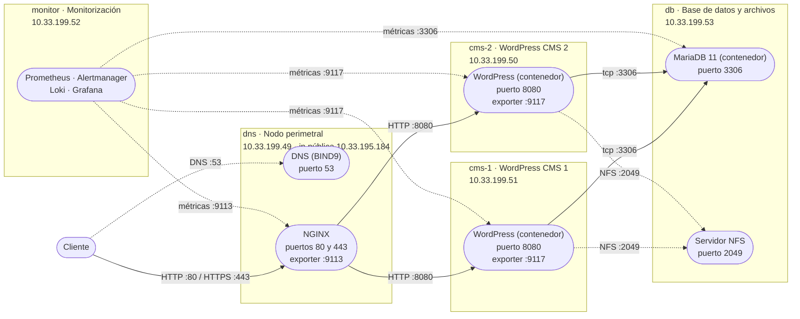

**Departamento de electronica y informatica**
**USM sede Concepción**

 

## NODO SUR
### Plataforma digital resiliente, observable y operable

 

**Informe Proyecto Integrador**
Asignatura: EIN-090B · Taller de Administración de Sistemas (TAS)

 

| | |
|---|---|
| **Integrantes** | Josecarlos Vidal   Octavio Valencia   Lukas Garrido |
| **Equipo** | Grupo 06 (`tas-06`) |
| **Profesor** | Jose Anotino Arellano |
| **Fecha** | 23 de noviembre de 2026 |
| **Versión del documento** | v4.0 |
| **Repositorio** | [NodoSur](https://github.com/LukasGarrido/TAS) |

## Resumen

Nodo Sur es una red regional de pequeñas marcas, talleres creativos, productores y operadores de experiencias que hoy vende, reserva y atiende clientes mediante redes sociales y formularios aislados, con riesgo de pérdida de datos y de indisponibilidad (un formulario caído casi dos horas sin diagnóstico fue el incidente que originó el proyecto). Este informe documenta el diseño, la implementación y la operación de una plataforma centralizada bajo un único dominio interno (`tas-06.arpa`).

La solución usa WordPress + WooCommerce en dos backends contenerizados (`wordpress:php8.3-apache`), un nodo perimetral con BIND9 y Nginx (proxy inverso, balanceador pasivo y bastión SSH), una VM de datos con MariaDB 11 y un servidor NFS compartido para archivos y configuración (`/srv/nfs/wordpress`), y una VM de monitorización con Prometheus (v3.5.0), Alertmanager (v0.28.1), Loki (v3.5.0) y Grafana (v11.6.0). Se definieron ocho requerimientos medibles (RF-01 y RNF-01 a RNF-08), objetivos de servicio (disponibilidad ≥ 99,5 %, detección ≤ 5 min, RTO ≤ 60 min, RPO ≤ 24 h) y un criterio de capacidad N-1.

A la fecha de la entrega final, la arquitectura, el modelo de seguridad, la persistencia NFS y la observabilidad están desplegados y validados según los scripts y bitácoras del repositorio. El capítulo 7 compara el diseño de la Entrega 1 con la arquitectura final y concluye que la estructura se mantuvo, con brechas concentradas en controles operativos como el destino de las alertas, la frecuencia de respaldo y la restauración probada. Se documentan los respaldos automáticos de MariaDB, con copia externa diaria en el nodo perimetral y retención de 30 días en ambas ubicaciones, la segmentación mediante UFW y reglas de `DOCKER-USER`, y los puntos únicos de falla identificados (nodo perimetral y VM de datos).

**Palabras clave:** WordPress, Nginx, balanceo, tolerancia a fallas, NFS, MariaDB, Prometheus, Loki, respaldo, RPO/RTO, runbook.

## Índice General

1. [Introducción](#1-introducción)
   - [1.1 Contexto y motivación](#11-contexto-y-motivación)
   - [1.2 Planteamiento del problema](#12-planteamiento-del-problema)
   - [1.3 Objetivos](#13-objetivos)
   - [1.4 Alcance y limitaciones](#14-alcance-y-limitaciones)
   - [1.5 Metodología y organización del equipo](#15-metodología-y-organización-del-equipo)
   - [1.6 Estructura del documento](#16-estructura-del-documento)
2. [Requerimientos y Arquitectura (Entrega 1)](#2-requerimientos-y-arquitectura-entrega-1)
   - [2.1 Problema, actores y activos críticos](#21-problema-actores-y-activos-críticos)
   - [2.2 Requerimientos y criterios de aceptación](#22-requerimientos-y-criterios-de-aceptación)
   - [2.3 Selección del CMS y la suite tecnológica](#23-selección-del-cms-y-la-suite-tecnológica)
   - [2.4 Arquitectura, flujos y puertos](#24-arquitectura-flujos-y-puertos)
   - [2.5 Seguridad y administración de datos](#25-seguridad-y-administración-de-datos)
3. [Plataforma Base y CMS Funcional (Entrega 2)](#3-plataforma-base-y-cms-funcional-entrega-2)
   - [3.1 Infraestructura, inventario y línea base](#31-infraestructura-inventario-y-línea-base)
   - [3.2 Almacenamiento y permisos (NFS)](#32-almacenamiento-y-permisos-nfs)
   - [3.3 DNS, servidor web y TLS](#33-dns-servidor-web-y-tls)
4. [Publicación Resiliente, Contenedores y Seguridad (Entrega 3)](#4-publicación-resiliente-contenedores-y-seguridad-entrega-3)
   - [4.1 Aplicación multicontenedor reproducible](#41-aplicación-multicontenedor-reproducible)
   - [4.2 Balanceo pasivo y alta disponibilidad](#42-balanceo-pasivo-y-alta-disponibilidad)
   - [4.3 Firewall y seguridad de red (DOCKER-USER)](#43-firewall-y-seguridad-de-red-docker-user)
5. [Observabilidad y Continuidad Operacional (Entrega 4)](#5-observabilidad-y-continuidad-operacional-entrega-4)
   - [5.1 Pila de monitorización y métricas](#51-pila-de-monitorización-y-métricas)
   - [5.2 Alertas y trazabilidad de logs](#52-alertas-y-trazabilidad-de-logs)
   - [5.3 Respaldo automático de MariaDB](#53-respaldo-automático-de-mariadb)
6. [Incidente, Auditoría y Defensa Final (Entrega 5)](#6-incidente-auditoría-y-defensa-final-entrega-5)
7. [Análisis Integrado de la Solución](#7-análisis-integrado-de-la-solución)
   - [7.1 Cumplimiento de requerimientos](#71-cumplimiento-de-requerimientos)
   - [7.2 Análisis comparativo: diseño de la Entrega 1 frente a la arquitectura final](#72-análisis-comparativo-diseño-de-la-entrega-1-frente-a-la-arquitectura-final)
8. [Conclusiones](#8-conclusiones-y-trabajo-futuro)
9. [Referencias](#9-referencias)
10. [Anexos](#10-anexos)
    - [Anexo A — Matriz de trazabilidad](#anexo-a--matriz-de-trazabilidad)
    - [Anexo B — Inventario y versiones](#anexo-b--inventario-y-versiones)
    - [Anexo C — Matriz de flujos, puertos y firewall](#anexo-c--matriz-de-flujos-puertos-y-firewall)
    - [Anexo D — Runbook operativo](#anexo-d--runbook-operativo)
    - [Anexo E — Bitácora de cambios](#anexo-e--bitácora-de-cambios)
    - [Anexo F — Registro de Decisiones (ADR)](#anexo-f--registro-de-decisiones-adr)
    - [Anexo G — Contribución individual](#anexo-g--contribución-individual)
    - [Anexo H — Uso de inteligencia artificial](#anexo-h--uso-de-inteligencia-artificial)
    - [Anexo I — Correspondencia con las rúbricas](#anexo-i--correspondencia-con-las-rúbricas)

## Glosario y siglas

| Sigla | Significado |
|---|---|
| ADR | Architecture Decision Record |
| CMS | Content Management System |
| FQDN | Fully Qualified Domain Name |
| N-1 | Criterio de diseño: el sistema opera con un nodo menos |
| NFS | Network File System |
| RPO / RTO | Recovery Point / Recovery Time Objective |
| SLO | Service Level Objective |
| SPOF | Single Point of Failure |
| TLS | Transport Layer Security |
| UFW | Uncomplicated Firewall |

---

# 1. Introducción

## 1.1 Contexto y motivación

Nodo Sur agrupa a pequeñas marcas, talleres creativos, productores y operadores de experiencias. Hoy gestionan ventas, reservas, inscripciones y atención al cliente por redes sociales, formularios aislados y mensajería. Esto dificulta centralizar la información, aumenta el riesgo de pérdida de datos y genera problemas de disponibilidad.

## 1.2 Planteamiento del problema

Se requiere una plataforma digital **centralizada, administrable y resiliente** que permita a los miembros publicar productos y experiencias, gestionar pedidos y reservas, ofrecer contenidos y comunicarse con sus clientes **desde un único dominio**. Debe soportar picos de demanda por campañas de difusión y mantener el servicio web aun si uno de los nodos web falla.

El equipo actúa como proveedor de infraestructura: cada decisión técnica debe justificarse con requerimientos, pruebas, métricas, logs y procedimientos reproducibles. No basta con instalar un CMS y mostrar su portada.

## 1.3 Objetivos

**Objetivo general.** Diseñar, implementar y operar una plataforma web para Nodo Sur que pueda publicarse, administrarse, diagnosticarse, mantenerse y recuperarse ante fallas.

**Objetivos específicos.**
1. Definir requerimientos medibles y una arquitectura justificada (Entrega 1).
2. Implementar la plataforma base y un CMS funcional con flujo de negocio completo (Entrega 2).
3. Publicar el servicio con dos backends, balanceo, segmentación y secretos controlados (Entrega 3).
4. Implementar monitorización, alertas, logs, respaldos y restauración medida (Entrega 4).
5. Gestionar un incidente no anunciado y auditar la solución (Entrega 5).

## 1.4 Alcance y limitaciones

- **Incluye:** VM con Alpine Linux y Docker (el nodo perimetral usa Ubuntu 24.04), WordPress/WooCommerce, MariaDB 11, servidor NFS, BIND9, Nginx, pila completa de monitorización y respaldos automáticos.
- **No incluye:** alta disponibilidad real del nodo perimetral ni de la base de datos, cifrado del tráfico interno entre proxy y backends, ni almacenamiento de objetos.
- **Restricciones:** subred `10.33.199.48/29` (seis direcciones utilizables, cinco asignadas) y software libre, por ausencia de un equipo de desarrollo permanente en la organización.

## 1.5 Metodología y organización del equipo

El trabajo se versiona en el repositorio Git del proyecto (bitácora, ADR, scripts, evidencias e inventario). Las decisiones relevantes se registran como ADR. Distribución de responsabilidades basada en los componentes del sistema:

| Integrante | Rol y responsabilidad principal |
|---|---|
| Octavio Valencia | CMS y backends WordPress (`cms-1`, `cms-2`) |
| Lukas Garrido | Base de datos (MariaDB 11) y servidor NFS (`db`) |
| Josecarlos Vidal | DNS (BIND9), nodo perimetral y balanceador Nginx (`dns`) |
| Equipo completo | Pila de monitorización, alertas, respaldos y operaciones (`monitor`) |

**Calendario de entregas:**

| Entrega | Hito | Fecha |
|---|---|---|
| 1 | Informe de requerimientos y arquitectura | 05/09/2026 |
| 2 | Plataforma base y CMS funcional | 05/09/2026 |
| 3 | Publicación resiliente y seguridad | 23/09/2026 |
| 4 | Observabilidad y continuidad operacional | 23/11/2026 |
| 5 | Incidente, auditoría y defensa final | 30/11/2026 |

## 1.6 Estructura del documento

Los capítulos 2 a 6 corresponden a las cinco entregas. El capítulo 7 integra los resultados y compara el diseño de la Entrega 1 con la arquitectura final, el 8 presenta conclusiones, y los anexos reúnen inventario, matrices, bitácora y registro de uso de IA.

---

# 2. Requerimientos y Arquitectura (Entrega 1)

## 2.1 Problema, actores y activos críticos

**Actores.** Son las marcas, talleres, productores y operadores de la red regional. También el personal con capacitación básica que administrará la plataforma, los clientes finales y el equipo del proyecto como proveedor de infraestructura.

**Activos críticos.** El catálogo de productos y servicios, los registros de ventas, reservas e inscripciones, la base de datos separada, los archivos subidos al CMS y las credenciales administrativas.

**Flujos de negocio.** Venta de catálogo, inscripción a talleres, reservas con cupos limitados, publicación de contenidos y atención posventa.

**Supuestos.** La organización no tiene equipo de desarrollo permanente, por lo que se usa software libre o de bajo costo. El tráfico presenta picos breves durante campañas de difusión.

**Consecuencias de las fallas sobre activos y flujos:**

| Activo / flujo | Falla | Pérdida o interrupción concreta | Requisito |
|---|---|---|---|
| Base de datos (pedidos, reservas, inscripciones) | Servicio caído o dato perdido | Sin ventas ni reservas, pedidos sin registro, cupos sobrevendidos o perdidos | RNF-02, RNF-06 |
| Archivos subidos (NFS) | NFS caído, divergencia o disco lleno | Imágenes de catálogo no disponibles, no se pueden publicar productos | RNF-03 |
| Nodo perimetral (DNS + Nginx) | Caída del host | Sitio inaccesible aunque los backends estén sanos | RNF-01, RNF-05 |
| Backend web | Caída de un nodo | Sin impacto si el otro absorbe la demanda. En caso contrario, degradación o interrupción de ventas | RNF-01 |
| Flujo de reserva con cupos | Escritura duplicada o perdida | Doble reserva o cupo perdido (solicitudes duplicadas del incidente piloto) | RF-01 |
| Respaldos | Backup antiguo o nunca restaurado | Pérdida de semanas de datos y recuperación incierta | RNF-06 |
| Credenciales administrativas | Compartidas, débiles o sin revocación | Acceso indefinido sin trazabilidad | RNF-04 |
| Monitorización y logs | Ausencia de métricas y alertas | Fallas de horas sin diagnóstico | RNF-05, RNF-08 |

## 2.2 Requerimientos y criterios de aceptación

Cada requerimiento tiene umbral medible y prueba. **Tabla 1.**

| ID | Requerimiento | Tipo | Criterio de aceptación | Prueba de validación |
|---|---|---|---|---|
| RF-01 | CMS funcional para catálogo, pedidos, reservas y contenidos | F | Un flujo completo (producto o reserva → pedido) bajo el dominio único, con registro localizable en la aplicación y en la BD | Ejecutar compra o reserva desde un cliente y consultar la tabla en MariaDB |
| RNF-01 | Capa web con al menos dos nodos | NF | Con un backend detenido, ≥ 99 % de 100 GET responden 200 y la conmutación ocurre en ≤ 30 s | Detener un contenedor WordPress, lanzar 100 solicitudes con `curl` y revisar logs de Nginx |
| RNF-02 | BD independiente y no expuesta | NF | El 3306 solo responde a .50 y .51 (WordPress) y .52 (monitor), otros orígenes son rechazados | `nc -zv 10.33.199.53 3306` desde origen autorizado y no autorizado, y revisar reglas de firewall |
| RNF-03 | Persistencia y coherencia del estado compartido | NF | Un archivo subido por un backend se sirve con 200 y el mismo checksum desde el otro en ≤ 5 s | Subir imagen y descargarla por ambos backends, comparar `sha256sum` |
| RNF-04 | Administración remota por canales seguros y nominativos | NF | SSH por clave pública, un usuario por integrante, sin contraseña ni cuentas compartidas, con revocación individual | Revisar `sshd_config`, revocar una clave de prueba y verificar el bloqueo |
| RNF-05 | Detección de falla crítica en tiempo acotado | NF | Alerta recibida en ≤ 5 min tras detener un backend, sin observar un panel | Detener un servicio y medir el tiempo hasta la alerta |
| RNF-06 | Continuidad mediante respaldos verificados | NF | Retención ≥ 30 días, restauración completa en ≤ 60 min con pérdida ≤ 24 h | Restaurar en una VM de prueba y medir tiempos y datos recuperados |
| RNF-07 | Dominio único con HTTPS válido | NF | `https://tas-06.arpa` sin error de certificado, HTTP:80 redirige a HTTPS | `curl -v` y `openssl s_client` desde un cliente |
| RNF-08 | Trazabilidad y hora consistente | NF | Desfase entre nodos ≤ 1 s y misma zona horaria, un evento se reconstruye correlacionando proxy, web, BD y SSH | `chronyc tracking` y `date` en todos los nodos, seguir una solicitud en Loki |

## 2.3 Selección del CMS y la suite tecnológica

Se compararon WordPress, Joomla y Drupal (decisión formal en **ADR-001**, aprobada).

| Criterio | WordPress | Joomla | Drupal |
|---|---|---|---|
| Licenciamiento | GPL, gratuito | GPL, gratuito | GPL, gratuito |
| Comunidad y soporte | Enorme, muchos plugins de reservas | Grande, menos extensiones | Grande, orientada a desarrolladores y proyectos enterprise |
| Curva de operación | Baja | Media | Alta |
| Recursos | Imagen oficial `wordpress:php8.3-apache` y MariaDB 11, 2 vCPU / 2 GB por backend | Comparable a WordPress | Mayor consumo y tuning con Commerce |
| Mantenimiento | Parches frecuentes, el riesgo está en plugins | Actualizaciones mayores exigentes | Actualizaciones mayores costosas |
| Compatibilidad | Docker, MariaDB y NFS, WooCommerce exige versiones mínimas | E-commerce y reservas dependen de extensiones poco integradas | E-commerce requiere Drupal Commerce y desarrollo a medida |
| Límites conocidos | *Stateful* (uploads en disco), `wp-cron` duplicado con dos nodos | Módulo de e-commerce menos maduro | Sin e-commerce/reservas nativo |
| Motivo de descarte | — | Suma extensiones frágiles sin beneficio sobre WordPress | Exige equipo de desarrollo dedicado |

**Justificación de WordPress + Nginx.**
- WordPress + WooCommerce cubre catálogo, pedidos, contenido y reservas.
- Imagen oficial con Apache y PHP 8.3: despliegue simple y réplica por contenedor.
- Nginx como proxy inverso y balanceador: bajo consumo y buen manejo de conexiones concurrentes ante picos de campaña (**ADR-002**).
- Pila PHP + MariaDB compatible con la arquitectura de referencia.

## 2.4 Arquitectura, flujos y puertos

**Figura 1.** Diagrama de despliegue (subred `10.33.199.48/29`, dominio `tas-06.arpa`).

**Tabla 3.** Matriz de puertos y flujos permitidos.

| Origen | Destino | Puerto | Protocolo | Propósito |
|---|---|---|---|---|
| Cliente | DNS (.49) | 53 | DNS UDP/TCP | Resolución de `tas-06.arpa` |
| Cliente | Nginx (.49) | 443 | HTTPS | Acceso al sitio con TLS terminado en el nodo perimetral |
| Cliente | Nginx (.49) | 80 | HTTP | Solo redirección a HTTPS |
| Nginx (.49) | CMS 1 (.51) y CMS 2 (.50) | 8080 | HTTP | Reenvío a los backends, único origen permitido |
| CMS 1 / CMS 2 | MariaDB (.53) | 3306 | TCP | Consultas a la BD, solo por red privada |
| CMS 1 / CMS 2 | NFS (.53) | 2049 | NFS/TCP | Volúmenes Docker NFS con `wp-config.php` y `wp-content/uploads` |
| Monitor (.52) | MariaDB (.53) | 3306 | TCP | `mysqld-exporter` (puerto 9104) con usuario de solo métricas |
| Monitor (.52) | Nginx (.49) | 9113 | HTTP | `nginx-prometheus-exporter` |
| Monitor (.52) | CMS 1 y CMS 2 | 9117 | HTTP | `apache-exporter` |
| Administrador | Nodo perimetral (IP pública .184) | 22 | SSH | Único punto de entrada administrativo (bastión) |
| Nodo perimetral | Demás nodos (IP privadas) | 22 | SSH | Administración nominativa con salto (`ssh -J`) |
| Nodo perimetral (.49) | VM `db` (.53) | 22 | SSH/SCP | Copia diaria de respaldos con el usuario `database` y una llave restringida (`from`, `restrict`) |
| Todos los nodos | Fuente NTP | 123 | UDP | Sincronización horaria (RNF-08) |

## 2.5 Seguridad y administración de datos

- **Accesos remotos.** SSH por clave pública hacia IP privadas con salto por el bastión, usuario nominativo por integrante, `PasswordAuthentication no`, `PermitRootLogin no`.
- **Secretos.** Fuera del repositorio. Archivos `.env` (MariaDB, Grafana) y `.my.cnf` (exporter) con permisos `600` e ignorados por git.
- **Firewall y segmentación.** UFW en el host y reglas en `DOCKER-USER` para controlar el acceso al puerto 3306 (MariaDB) exclusivamente desde .50, .51 y .52.

---

# 3. Plataforma Base y CMS Funcional (Entrega 2)

## 3.1 Infraestructura, inventario y línea base

**Tabla 2.** Inventario y especificaciones técnicas de las máquinas virtuales.

| VM (Hostname) | Nodo | Rol y servicios | IP privada | IP pública / Red | SO y versión |
|---|---|---|---|---|---|
| `dns` | Perimetral | DNS (BIND9, puerto 53), Nginx (80/443), bastión SSH, `nginx-exporter` (9113), copia externa de respaldos (`pull-db.sh`) | `10.33.199.49` | `10.33.195.184` | Ubuntu 24.04 LTS (88 GB libres) |
| `cms-1` | CMS 1 | WordPress (`wordpress:php8.3-apache`, 8080), `apache-exporter` (9117) | `10.33.199.51` | Pública a retirar | Alpine Linux, Docker |
| `cms-2` | CMS 2 | WordPress (`wordpress:php8.3-apache`, 8080), `apache-exporter` (9117) | `10.33.199.50` | Pública a retirar | Alpine Linux, Docker |
| `db` | Datos | MariaDB 11 (3306), Servidor NFS (`/srv/nfs/wordpress`, 2049) | `10.33.199.53` | Pública a retirar | Alpine Linux, Docker (191,7 GB disco) |
| `monitor` | Monitorización | Prometheus (9090), Alertmanager (9093), Loki (3100), Grafana (3000), `mysqld-exporter` (9104) | `10.33.199.52` | Pública a retirar | Alpine Linux 3.24.2, Docker v29.8.1, Compose v5.1.4 (191,6 GB disco) |

## 3.2 Almacenamiento y permisos (NFS)

El servidor NFS corre en la VM `db` sobre Alpine Linux con OpenRC y comparte con los backends la configuración y los archivos subidos de WordPress, para que ambos nodos sirvan el mismo contenido. Las VM de WordPress no montan el recurso en su sistema de archivos: lo consumen directamente como volúmenes Docker de tipo NFS. Se instala con `nfs-utils` y los servicios `rpcbind` y `nfs` se habilitan en el runlevel `default`.

| Elemento | Valor |
|---|---|
| Servidor | `10.33.199.53` |
| Clientes | `cms-1` (`10.33.199.51`) y `cms-2` (`10.33.199.50`) |
| Directorio exportado | `/srv/nfs/wordpress`, con los subdirectorios `config/` y `uploads/` |
| Puertos | 2049/TCP (NFS) y 111 (rpcbind) |
| Propietario | `nobody:nobody` |
| Opciones de exportación | `rw,sync,no_subtree_check,no_root_squash` sobre `10.33.199.48/29` |

El `wp-config.php` se obtiene del backend con la configuración más completa, mediante `docker compose exec wordpress cat`, y se copia por `scp` a `/srv/nfs/wordpress/config/`. En los backends **no existe un montaje NFS a nivel de sistema operativo** (no se usan `/etc/fstab` ni el servicio `netmount`): la configuración y los archivos multimedia se exponen a los contenedores mediante volúmenes Docker con el controlador `local` y opciones NFS v4 (`type=nfs`, `o=addr=10.33.199.53,rw`), por ejemplo `wp_uploads_shared` para `wp-content/uploads`. Docker monta el volumen al iniciar el contenedor, por lo que la disponibilidad del NFS en `db` condiciona el arranque de los backends.

La verificación consiste en `rc-service nfs status` y `exportfs -v` en el servidor, y en `docker volume inspect wp_uploads_shared` y `docker compose exec wordpress sha256sum` sobre `wp-config.php` en cada backend, cuyo resultado debe coincidir entre ambos.

**Nota de seguridad.** La exportación cubre toda la subred `/29` y usa `no_root_squash`, mientras que el diseño de la Entrega 1 preveía exportar solo a `.50` y `.51`, sin `no_root_squash` y con propietario `www-data`. El acceso al puerto 2049 queda limitado a esos dos orígenes por UFW en la VM `db`, pero la desviación se registra en la sección 7.2.

## 3.3 DNS, servidor web y TLS

- BIND9 en `dns` resuelve el dominio interno `tas-06.arpa`, con recursión restringida a la subred `10.33.199.48/29` y canal de estadísticas en `127.0.0.1:8053`.
- Nginx termina TLS en el nodo perimetral y redirige HTTP (80) a HTTPS (443). El certificado del dominio `tas-06.arpa` fue generado y firmado con **OpenSSL**, dado que un dominio `.arpa` no puede validarse con una CA pública. Se valida con `curl -v` y `openssl s_client -connect tas-06.arpa:443`. El cifrado llega hasta Nginx, el tráfico entre el proxy y los backends viaja sin cifrar por la red privada (ver 1.4). [CONFIRMAR: ruta de certificado y llave, vigencia y procedimiento de renovación.]

---

# 4. Publicación Resiliente, Contenedores y Seguridad (Entrega 3)

## 4.1 Aplicación multicontenedor reproducible

Todos los servicios corren bajo Docker y Docker Compose con imágenes de versión fija. Los backends ejecutan `wordpress:php8.3-apache` junto a `lusotycoon/apache-exporter` en el puerto 9117. Se habilitó el módulo `server-status` en Apache mediante `/opt/cms/status.conf` (`RewriteEngine Off`) para permitir el scraping de métricas.

En los nodos Alpine la instalación usa los paquetes `docker` y `docker-cli-compose` del repositorio `community` de Alpine v3.24, y el servicio se habilita con `rc-update add docker default` para que arranque con el sistema. La verificación considera `rc-status`, `docker version`, `docker compose version` y `docker run --rm hello-world`. En el nodo perimetral, que usa Ubuntu 24.04, el exporter de Nginx también se ejecuta como contenedor con Docker Compose.

## 4.2 Balanceo pasivo y alta disponibilidad

Mediante Nginx como proxy inverso y balanceador de carga, se distribuyen las peticiones hacia ambos backends WordPress con el algoritmo **round robin**, que es el predeterminado de Nginx (sin `ip_hash` ni `least_conn`), de modo que las peticiones se alternan entre `cms-1` y `cms-2`. Ante la caída de un backend, la detección pasiva de Nginx (`max_fails`, `fail_timeout`) redirige el tráfico al nodo sano, garantizando tolerancia a fallas de nodo único.

## 4.3 Firewall y seguridad de red (`DOCKER-USER`)

La seguridad de red se organiza en dos capas independientes, porque Docker manipula iptables directamente y se salta UFW al publicar puertos.

| Capa | Herramienta | Protege |
|---|---|---|
| Host | UFW | SSH y cualquier servicio del host, como el NFS |
| Contenedor | `iptables`, cadena `DOCKER-USER` | Puertos publicados por Docker, como el 3306 de MariaDB |

En la VM `db` el procedimiento documentado deja UFW con política `deny incoming` y con el SSH (22) permitido solo desde el nodo perimetral, que actúa como bastión. UFW se activa al arranque con `rc-update add ufw default`. Para MariaDB, la cadena `DOCKER-USER` acepta el puerto 3306 solo desde `10.33.199.50`, `.51` y `.52` y descarta el resto, usando `--ctorigdstport 3306` con `--ctdir ORIGINAL` para identificar el puerto original antes de la traducción de direcciones de Docker. Como esas reglas se pierden al reiniciar, se guardan en `/etc/local.d/firewall.start`, un script que espera a que Docker esté disponible, vacía la cadena y vuelve a cargar las reglas, y que se activa con `rc-update add local default`.

El procedimiento incluye medidas de reversión. Antes de activar UFW se arma un temporizador de seguridad de 5 minutos que lo desactiva si algo sale mal, sin tocar `DOCKER-USER` para no abrir el 3306. Además se mantiene una secuencia de emergencia por la consola de la plataforma. Antes de dar por cerrado el cambio se prueba una segunda sesión SSH desde el bastión, un intento desde otra VM que debe fallar por tiempo de espera, la lista de reglas con `iptables -L DOCKER-USER -n -v --line-numbers` y la conectividad al 3306 con `nc` desde cada origen, además de una prueba de reinicio.

Los puertos de los backends siguen el mismo patrón, con el 8080 permitido solo desde el nodo perimetral y el 9117 solo desde el monitor. La documentación del repositorio registra esa extensión como recomendación y no como cambio aplicado y verificado en `cms-1`, `cms-2` y `monitor`.

---

# 5. Observabilidad y Continuidad Operacional (Entrega 4)

## 5.1 Pila de monitorización y métricas

La VM `monitor` ejecuta el stack de observabilidad con puertos enlazados estrictamente a `127.0.0.1`. El acceso de los administradores se realiza mediante reenvío de puertos SSH (`AllowTcpForwarding local`).

| Componente | Exporter / Fuente | Puerto | Métrica clave / Job |
|---|---|---|---|
| Proxy Nginx | `nginx-prometheus-exporter` 1.3.0, alimentado por `stub_status` en `127.0.0.1:8081` | 9113 | `nginx_up`, conexiones activas (`job: nginx-lb`) |
| Backends Apache | `apache-exporter` | 9117 | `apache_up`, workers ocupados |
| Base de datos MariaDB | `prom/mysqld-exporter` v0.17.2 | 9104 | `mysql_up`, conexiones, consultas (`job: mariadb`) |
| DNS BIND9 | Canal de estadísticas en `127.0.0.1:8053`, sin exporter | 8053 | Pendiente de conectar a Prometheus |
| Monitorización central | Prometheus / Grafana / Loki | 9090 / 3000 / 3100 | Métricas de infraestructura, paneles y logs centralizados |

**Nginx.** Se habilita un sitio exclusivo en `127.0.0.1:8081` con `stub_status` y acceso permitido solo desde el propio nodo. El exporter corre como contenedor con `network_mode: host` en el nodo perimetral para alcanzar esa dirección local y expone sus métricas en el puerto 9113. Prometheus lo consulta en `10.33.199.49:9113` con el job `nginx-lb`. La verificación consiste en consultar `nginx_status` y `/metrics` (donde `nginx_up` debe valer 1) y en comprobar el estado `UP` del objetivo en Prometheus.

**MariaDB.** Se crea el usuario `prometheus`, restringido al origen `10.33.199.52`, con un máximo de tres conexiones y los privilegios mínimos `PROCESS`, `REPLICATION CLIENT` y `SELECT`. Las credenciales viven en `mysqld-exporter/.my.cnf` con permisos 600 y fuera del repositorio. El servicio se agrega al compose de `/opt/nodo-sur-monitoring` y el job `mariadb` apunta a `mysqld-exporter:9104` dentro de la red de Compose. La verificación comprueba que `mysql_up` valga 1, que el objetivo esté en `UP` y que ya no existan rechazos (`Access denied`) en los registros de MariaDB. En Grafana se crea una fuente de datos de tipo Prometheus y un panel con la consulta `mysql_up`.

**BIND9.** Se habilita el canal de estadísticas en `127.0.0.1:8053`, sin autenticación y por eso limitado a la interfaz local, validado con `named-checkconf` y aplicado con `rndc reconfig`. Todavía no existe un exporter que lo conecte a Prometheus.

## 5.2 Alertas y trazabilidad de logs

- **Alertas:** Alertmanager configurado en el puerto 9093 con reglas base en Prometheus (`alerts.yml`).
- **Logs:** Recolectados y centralizados en Loki (retención de 7 días). Sincronización horaria por NTP en todos los nodos (RNF-08).

## 5.3 Respaldos automáticos de MariaDB y copia externa

El respaldo funciona en dos etapas que corren en máquinas distintas, lo que permite cumplir la retención de 30 días y la copia fuera del host de origen exigidas por RNF-06.

| Etapa | Máquina | Qué hace | Cuándo |
|---|---|---|---|
| 1. Dump | `db` (`10.33.199.53`) | Genera el respaldo de todas las bases, lo comprime y crea su checksum | 02:30 hora de Chile, días pares del mes |
| 2. Copia | Nodo perimetral (`10.33.199.49`) | Se conecta a la BD por SSH, trae los respaldos nuevos y verifica su checksum | 07:00 UTC (04:00 en Chile), todos los días |

### Etapa 1: dump en la VM de datos

El script `/usr/local/bin/backup-db.sh` se ejecuta desde el cron de root con `flock -n`, para evitar que dos ejecuciones se pisen entre sí. Corre como root porque necesita `docker exec`, y el propio script entrega los archivos al usuario `database`.

- **Acción.** `mariadb-dump --all-databases --single-transaction --routines --triggers --events`, ejecutado dentro del contenedor. La opción `--single-transaction` produce un volcado consistente sin bloquear tablas InnoDB, de modo que no se frenan pedidos ni reservas. La contraseña de root se lee desde la variable de entorno del contenedor, por lo que no queda escrita en el script, en el historial ni en el crontab.
- **Escritura segura.** El volcado se escribe primero en un archivo temporal `.part` y solo recibe su nombre final si pasó todas las validaciones. Nunca queda un respaldo a medias que parezca válido.
- **Verificación.** Se comprueba la cadena `Dump completed` al final del volcado, se comprime con `gzip`, se valida con `gzip -t` y se genera un checksum SHA-256 (`.sha256`).
- **Permisos.** Propietario `database` y modo 640. No se agregó ese usuario al grupo `docker`, porque equivale a otorgar privilegios de root.
- **Retención.** Treinta días (`find ... -mtime +30 -delete`), aplicada al final, de modo que un fallo nunca deja la VM sin respaldos.
- **Registro.** `/var/log/backup-db.log`, con hora de Chile porque el script fija `TZ=America/Santiago`.

En la prueba manual, el volcado de 5,1 MB se comprimió a 1,0 MB y el checksum validó correctamente. Los respaldos generados por cron corresponden al 18, 20 y 22 de noviembre, con 776,1 KB, 776,1 KB y 809,0 KB respectivamente. El cron de Alpine (BusyBox) interpreta `*/2` en el día del mes como días pares, lo que se comprobó con los respaldos reales, y al cambiar de mes pueden pasar tres días entre respaldos, por ejemplo del 30 al 2.

### Etapa 2: copia externa en el nodo perimetral

El nodo perimetral trae los respaldos y la VM de datos no los envía. Esta decisión se tomó por tres razones. El firewall de la VM de datos solo acepta SSH entrante desde el nodo perimetral. Si la VM de datos se compromete, no tiene credenciales para entrar al nodo perimetral, de modo que la copia externa queda a salvo. Y no fue necesario abrir ninguna regla nueva de firewall.

El script `~/pull-db.sh` se ejecuta con cron a las 07:00 UTC y con `flock -n`:

- **Copia incremental.** Trae solo los respaldos que aún no tiene, por lo que puede ejecutarse las veces que se quiera sin duplicar ni gastar tráfico.
- **Verificación.** Comprueba el SHA-256 de cada archivo copiado. Si no coincide, lo elimina y deja el error en el registro.
- **Fecha original.** Usa `scp -p` para conservar la fecha del respaldo, de modo que la retención de 30 días cuente desde su creación y no desde su copia.
- **Independencia.** No borra nada en la VM de datos ni replica borrados. Si un respaldo desaparece allí, la copia se conserva.
- **Retención y registro.** Treinta días en `~/db`, con registro en `~/pull-db.log`.
- **Horario.** El nodo perimetral usa UTC, por lo que el cron se escribió en esa zona. Las 07:00 UTC equivalen a las 04:00 en horario de verano y a las 03:00 en horario de invierno, siempre después del dump de las 02:30. Corre a diario aunque el dump sea cada dos días. Si no hay respaldo nuevo, el script termina con `0 nuevos`, de modo que no depende de la paridad de los días.

La primera ejecución manual copió y verificó los tres respaldos existentes y la segunda no copió ninguno, lo que demuestra que es seguro repetirla. Una tarea temporal programada a tres minutos confirmó que cron la dispara sin intervención.

### Acceso SSH de mínimo alcance

Para esa copia se creó en el nodo perimetral una llave ed25519 dedicada (`id_pull`). Es una llave exclusiva para esta tarea, de modo que su revocación no afecta a otros accesos (RNF-04). No tiene contraseña porque cron no puede escribirla, y ese riesgo se compensa limitando su alcance en el destino:

| Elemento | Efecto |
|---|---|
| `from="10.33.199.49"` | La llave solo sirve si la conexión proviene del nodo perimetral |
| `restrict` | Desactiva terminal interactiva, reenvío de puertos, agente y X11, y deja disponibles solo comandos puntuales y `scp` |
| Archivo en `/etc/ssh/authorized_keys.d/database` | Pertenece a root, de modo que el usuario no puede modificar sus propias llaves autorizadas |
| Bloque `Match User database` al final de `sshd_config` | Afecta solo a ese usuario, y root y los demás siguen usando su `.ssh/authorized_keys` |

El cambio se aplicó con una copia previa de la configuración (`sshd_config.bak`), validación con `sshd -t` y `reload`, que no corta las sesiones abiertas, con la consola de la plataforma disponible como vía de recuperación.

**Hallazgo.** Al intentar instalar la llave con `ssh-copy-id` falló la escritura de `.ssh/authorized_keys`. La causa es que el `home` del usuario `database` es el mismo directorio que usa root, y su carpeta `.ssh` pertenece a root con permisos 700. Instalar la llave allí habría permitido entrar como root, lo que contradice `PermitRootLogin no` y el principio de accesos nominativos, por lo que se optó por el archivo de llaves aparte.

### Estado y pendientes

| Componente | Ubicación | Estado |
|---|---|---|
| Dump automático (02:30, días pares) | `db` | Funcionando, con respaldos del 18, 20 y 22 de noviembre |
| Verificación de integridad (gzip y SHA-256) | `db` | Funcionando |
| Retención de 30 días | `db` | Programada en el script |
| Acceso SSH del nodo perimetral con llave restringida | `db` y nodo perimetral | Funcionando |
| Copia automática (07:00 UTC, diaria) | Nodo perimetral | Programada y probada |
| Verificación SHA-256 de cada copia | Nodo perimetral | Funcionando |
| Retención de 30 días | Nodo perimetral | Programada en el script |

Quedan pendientes tres elementos. El primero es la **prueba de restauración**, cuyo procedimiento está definido pero no ejecutado. Consiste en levantar un contenedor `mariadb:11` aparte, sin puertos publicados ni volúmenes compartidos, restaurar con `gunzip -c ... | docker exec -i`, comprobar que existan las bases `mydb` y `mysql` y que `mydb` tenga 52 tablas, medir el tiempo con `time` y eliminar el contenedor. Ese tiempo es el que se contrasta con el RTO de 60 minutos de RNF-06. El segundo es el **respaldo de los archivos del NFS y de las configuraciones**. El tercero es la **verificación del flujo completo sin intervención**, prevista para el siguiente dump, el 24 de noviembre a las 02:30, con la copia correspondiente después de las 04:00 hora de Chile.

**Hallazgo de zona horaria.** En la prueba del 10/11 el volcado registró las 13:07, mientras el archivo en la VM marca las 10:07. El contenedor trabaja en UTC y la VM en hora de Chile (UTC-3), y el nodo perimetral también usa UTC. No afecta al respaldo, porque los scripts fijan `TZ`, pero confirma el riesgo de RNF-08 sobre zonas horarias distintas.

---

# 6. Incidente, Auditoría y Defensa Final (Entrega 5)

Las pruebas operativas y la simulación de incidentes se estructuran bajo el runbook del Anexo D, validando los flujos de negocio (RF-01) y la recuperación ante fallas de infraestructura.

---

# 7. Análisis Integrado de la Solución

## 7.1 Cumplimiento de requerimientos

| ID | Requisito | Estado | Observación |
|---|---|---|---|
| RF-01 | CMS funcional (catálogo, pedidos, reservas) | [Implementado] | WordPress + WooCommerce operativo con BD centralizada |
| RNF-01 | Capa web con al menos dos nodos | [Implementado] | Dos réplicas con balanceador Nginx |
| RNF-02 | BD independiente y no expuesta | [Implementado] | MariaDB en VM dedicada, puerto 3306 restringido en `DOCKER-USER` y persistente al reinicio |
| RNF-03 | Persistencia y coherencia compartida | [Implementado] | Servidor NFS en `/srv/nfs/wordpress` |
| RNF-04 | Administración SSH segura y nominativa | [Por evidenciar] | SSH en `db` solo desde el bastión y llave dedicada de alcance mínimo para los respaldos. Falta consolidar cuentas sin root en todos los nodos |
| RNF-05 | Detección de falla crítica en tiempo acotado | [Parcial] | Pila Prometheus/Alertmanager lista. Falta definir destino |
| RNF-06 | Continuidad y respaldos verificados | [Implementado] | Dump automático cada dos días (02:30, días pares) con SHA-256 y copia externa diaria en el nodo perimetral, con retención de 30 días en ambos. Falta prueba de restauración y respaldo del NFS |
| RNF-07 | Dominio único con HTTPS válido | [Implementado] | `https://tas-06.arpa` con Nginx TLS |
| RNF-08 | Trazabilidad y hora consistente | [Parcial] | NTP y Loki configurados. La zona horaria difiere entre nodos (VM `db` en hora de Chile, nodo perimetral y contenedores en UTC) |

## 7.2 Análisis comparativo: diseño de la Entrega 1 frente a la arquitectura final

### 7.2.1 Propósito, fuentes y criterio de comparación

Este apartado contrasta lo que el equipo definió en el informe de la Entrega 1 con lo que quedó desplegado y documentado al cierre de la Entrega 4. Busca responder tres preguntas. La primera es si la arquitectura propuesta se mantuvo. La segunda es qué cambió y por qué. La tercera es qué elementos comprometidos en el diseño no aparecen cumplidos en la documentación final.

Las fuentes utilizadas son el informe de la Entrega 1 ([E01_tas_06](https://github.com/LukasGarrido/TAS/blob/master/docs/entrega-1/E1_grupo06_informe.pdf) v.1), los registros de decisión ADR-001 y ADR-002, la bitácora general, el README del repositorio, la documentación de scripts (`scripts_docker.md`, `scripts_Servidor_NFS.md`, `scripts_firewall_ufw.md`, `scripts_monitorización.md`, `scripts_DataBase-Grafana.md` y `respaldos-mariadb.md`) y los capítulos 2 a 5 de este informe.

**Nota metodológica sobre el punto de partida.** El documento de la Entrega 1 que está en el repositorio no es el texto original sin modificar. Su propia introducción indica que la arquitectura evolucionó respecto de la propuesta inicial, que era una instalación tradicional con Nginx y PHP-FPM. Además describe la VM de monitorización con sus recursos reales, un elemento que la bitácora fecha el 15/11. Por esa razón la comparación usa tres puntos de referencia y no dos:

1. **Propuesta inicial.** Se reconstruye a partir de la introducción de la Entrega 1, de los ADR y de los scripts de línea base tradicional (`script_cms.md`, `script_db.md` y `script_dns.md`).
2. **Diseño de la Entrega 1.** Es la versión del informe disponible en el repositorio, que ya incorpora contenedores, NFS y monitorización.
3. **Arquitectura final.** Es lo descrito en los capítulos 2 a 5 de este informe, contrastado con la documentación de los scripts.

Cada elemento comparado se clasifica con una de las siguientes categorías:

| Categoría | Significado |
|---|---|
| **Se mantuvo** | El diseño de la Entrega 1 y el estado final coinciden |
| **Se concretó** | El diseño ya existía y la implementación le agregó detalle verificable, como versiones, rutas o parámetros |
| **Cambió** | El estado final difiere del diseño de la Entrega 1 |
| **Brecha** | La Entrega 1 lo exigía y la documentación final no muestra que esté cumplido, o muestra una configuración distinta |

### 7.2.2 Evolución de la arquitectura en tres estados

**Tabla 4.** Evolución de los componentes principales.

| Aspecto | Propuesta inicial | Diseño de la Entrega 1 | Arquitectura final | Clasificación |
|---|---|---|---|---|
| Modelo de despliegue | Instalación tradicional sobre las VM | Contenedores Docker en todos los servicios | Docker y Docker Compose con imágenes de versión fija, instalados desde el repositorio `community` de Alpine v3.24 en los nodos Alpine, y con Docker Compose en el nodo perimetral (Ubuntu 24.04) | Cambió respecto de la propuesta inicial y se mantuvo desde la Entrega 1 |
| Servidor web de los backends | Nginx con PHP-FPM | Imagen `wordpress:php8.3-apache` | Misma imagen, con el módulo `server-status` habilitado mediante `/opt/cms/status.conf` | Cambió y luego se concretó |
| Punto de entrada y balanceo | Nginx en el nodo perimetral junto con DNS, en lugar del HAProxy del enunciado (ADR-002) | Nginx como proxy inverso con balanceo round robin y detección pasiva (`max_fails`, `fail_timeout`) | Igual | Se mantuvo |
| Archivos compartidos entre backends | Sin solución. Cada backend guardaba sus archivos de forma local | NFS alojado en la VM de base de datos, exportado solo a `.50` y `.51` (ADR-003) | NFS v4 con exportación a toda la subred `/29`, configuración e imágenes como volúmenes Docker NFS (p. ej. `wp_uploads_shared`), sin montaje NFS en el sistema operativo de los backends | Cambió, se concretó y presenta desviaciones |
| Base de datos | MariaDB en VM separada | MariaDB 11 en contenedor, puerto 3306 restringido a `.50`, `.51` y `.52` | Igual, con reglas persistentes en `DOCKER-USER` y UFW en la VM | Se mantuvo y se concretó |
| Monitorización | No contemplada | VM `monitor` con Prometheus, Alertmanager, Loki y Grafana, accesibles solo por túnel SSH | Igual, con versiones fijas, exporters de Nginx, Apache y MariaDB y trabajos definidos (`nginx-lb`, `mariadb`) | Cambió y luego se concretó |
| Respaldos | Un respaldo manual de la base anterior | Diseño automatizado con retención de 30 días y copia fuera del host | Dump automático en la VM de datos y copia externa diaria en el nodo perimetral, con verificación SHA-256 y retención de 30 días en ambos | Se concretó con desviaciones |
| Seguridad de red | Sin controles específicos | UFW y reglas en `DOCKER-USER` | UFW y `DOCKER-USER` documentados y verificados en la VM `db` mediante `/etc/local.d/firewall.start` | Se concretó en `db` |

**Tabla 5.** Línea de tiempo según la bitácora general y la documentación de scripts. Las fechas corresponden a la puesta en marcha de cada elemento y no necesariamente al orden en que se diseñó.

| Fecha | Hito registrado | Elemento del diseño que materializa |
|---|---|---|
| 01/09 | Definición del problema y del plan general | Entrega 1 |
| 05/09 | Elección de WordPress con WooCommerce | ADR-001 |
| 09/09 | Levantamiento de las VM y configuración del DNS | Nodo perimetral y dominio `tas-06.arpa` |
| 10/09 | Base de datos central, acceso restringido y ajuste del archivo `hosts` por el sufijo de la VPN | Aislamiento de MariaDB (RNF-02) |
| 12/09 | Hallazgo de que la base de datos aceptaba conexiones desde cualquier origen | Reglas en `DOCKER-USER` |
| 15/09 | Carpeta compartida en red entre los servidores web | NFS (RNF-03, ADR-003) |
| 18/09 | Corrección de las fotos que no aparecían en el segundo servidor | Coherencia de archivos entre nodos |
| 20/09 | WordPress en contenedores con la base y la carpeta compartida | Dos backends contenerizados (RNF-01) |
| 25/09 | Nginx como balanceador con HTTPS y pruebas de falla | RNF-01 y RNF-07 |
| 10/11 | Prueba del volcado con las opciones definitivas y creación de `backup-db.sh` | Respaldos (RNF-06) |
| 15/11 | VM de monitorización con tableros | Observabilidad (RNF-05 y RNF-08) |
| 18/11 | Primer respaldo ejecutado por cron, seguido de los del 20 y el 22 | Respaldos automáticos (RNF-06) |
| 22/11 | Llave SSH dedicada y copia externa diaria en el nodo perimetral | Copia fuera del host de origen (RNF-06) |
| 23/11 | Cierre y entrega | Entrega 4 |

### 7.2.3 Elementos que se mantuvieron

La estructura general de la solución no cambió entre el diseño y la implementación. Los elementos que permanecieron son los siguientes:

- **Topología de cinco máquinas virtuales.** Nodo perimetral, dos backends, VM de datos y VM de monitorización conservan sus roles y sus direcciones (`.49`, `.51`, `.50`, `.53` y `.52`). Esta estabilidad es coherente con la restricción de la subred `10.33.199.48/29`, que ofrece seis direcciones utilizables, de las cuales cinco están asignadas y solo queda libre la `.54`. Con ese margen cualquier rediseño que sumara nodos habría exigido una subred mayor, de modo que el equipo optó por consolidar funciones en lugar de agregar máquinas.
- **Dominio y entrada única.** El dominio interno `tas-06.arpa` y la publicación por los puertos 80 y 443 desde el nodo perimetral se mantuvieron sin cambios, así como la redirección de HTTP a HTTPS.
- **Selección del CMS.** WordPress con WooCommerce, sustentado en el ADR-001, siguió siendo la base de la plataforma durante todo el proyecto. No hubo reevaluación de Joomla ni de Drupal.
- **Nginx como balanceador con detección pasiva.** La decisión del ADR-002 se sostuvo. Las limitaciones que el diseño declaró desde el inicio, como no detectar contenido distinto entre nodos ni la caída de la base de datos, siguen siendo las mismas.
- **Separación de la base de datos.** MariaDB 11 permanece en una VM propia, con el puerto 3306 abierto únicamente a los dos backends y al monitor.
- **Ubicación del NFS en la VM de datos.** El diseño aceptó desde el inicio que base de datos y archivos compartieran punto único de falla. La implementación respetó esa decisión y no la modificó.
- **Esquema de monitorización.** Los servicios de observabilidad escuchan solo en `127.0.0.1` y se consultan mediante túnel SSH (`AllowTcpForwarding local`) a través del bastión. Los exporters usan los mismos puertos previstos (9113, 9117 y 9104).
- **Conjunto de requerimientos.** Los nueve requerimientos de la Entrega 1 (RF-01 y RNF-01 a RNF-08) se mantienen con sus mismos umbrales. No se agregaron, eliminaron ni relajaron criterios, lo que permite evaluar el cumplimiento final con la misma vara que se fijó al inicio.
- **Puntos únicos de falla declarados.** El nodo perimetral y la VM de datos siguen siendo los mismos que el diseño señaló como riesgo residual, sin mitigación adicional. Esto es consistente con el alcance declarado, que excluye la alta disponibilidad real de esos componentes.

### 7.2.4 Elementos que cambiaron o se concretaron

**De instalación tradicional a contenedores.** El cambio más profundo respecto de la propuesta inicial fue abandonar la instalación directa sobre el sistema operativo y pasar a Docker y Docker Compose. Esto aportó reproducibilidad, ya que los servicios se levantan desde archivos versionados y con imágenes de versión fija. A cambio introdujo un efecto no trivial sobre la seguridad. Docker inserta sus propias reglas de iptables y por eso se salta el firewall del host. La bitácora del 12/09 documenta que la base de datos seguía aceptando conexiones desde cualquier origen pese a las reglas aplicadas. La solución fue agregar reglas explícitas en la cadena `DOCKER-USER`, que hoy se cargan al arranque mediante `/etc/local.d/firewall.start`, un script que espera a que Docker esté disponible antes de aplicarlas.

**De Nginx con PHP-FPM a Apache con PHP 8.3 en los backends.** La propuesta inicial contemplaba Nginx también como servidor web de cada backend. La implementación final usa la imagen oficial `wordpress:php8.3-apache`, de modo que Nginx quedó reservado al nodo perimetral. Este cambio tuvo tres consecuencias:

1. Fue necesario habilitar `server-status` en Apache y desplegar `apache-exporter` (puerto 9117) para poder medir los backends.
2. El cálculo de capacidad del diseño pasó a basarse en procesos de Apache (`MaxRequestWorkers`) y no en procesos de PHP-FPM.
3. Parte de la justificación escrita en los ADR dejó de describir el estado real (ver 7.2.9).

**De archivos locales a almacenamiento compartido.** En un primer momento cada backend guardaba por su cuenta las imágenes subidas, de modo que una foto cargada a través de un nodo no existía en el otro. El diseño resolvió esto con NFS y la implementación lo concretó con NFS v4, con la configuración y los archivos multimedia expuestos a los contenedores como volúmenes Docker NFS (p. ej. `wp_uploads_shared`), sin montaje NFS en el sistema operativo de las VM de WordPress. Con ello ambos backends comparten además `wp-config.php`, claves y salts, que es la condición para que una sesión iniciada en un nodo valga en el otro. La implementación se apartó del diseño en la forma de exportar: el script exporta `/srv/nfs/wordpress` a toda la subred `10.33.199.48/29` con la opción `no_root_squash` y deja como propietario a `nobody:nobody`, mientras que la Entrega 1 preveía exportar solo a `.50` y `.51`, sin `no_root_squash` y con propietario `www-data` (uid 33). El acceso efectivo al puerto 2049 queda limitado a esos dos orígenes por UFW en la VM de datos, lo que atenúa la desviación sin eliminarla.

**De una VM prevista a una pila de observabilidad con versiones y trabajos definidos.** La monitorización fue una incorporación posterior a la propuesta inicial. En la versión final quedó fijada con Prometheus v3.5.0, Alertmanager v0.28.1, Loki v3.5.0 y Grafana v11.6.0, con exporters para Nginx (1.3.0), Apache y MariaDB (v0.17.2). El exporter de Nginx se alimenta de un sitio `stub_status` accesible solo en `127.0.0.1:8081` y corre con `network_mode: host`. El de MariaDB usa un usuario `prometheus` limitado al origen `10.33.199.52`, con tres conexiones como máximo y privilegios mínimos de lectura de métricas. Cada exporter aporta una métrica de vida (`nginx_up`, `apache_up` y `mysql_up`) sobre la que se pueden construir las reglas de alerta.

**De un respaldo manual a un respaldo automatizado con copia externa.** La Entrega 1 reconocía que solo existía un respaldo manual de la base anterior. La implementación incorporó dos etapas en máquinas distintas. En la VM de datos, `backup-db.sh` realiza el volcado con `mariadb-dump --all-databases --single-transaction --routines --triggers --events`, comprueba la cadena `Dump completed`, comprime con `gzip`, valida con `gzip -t`, genera un checksum SHA-256 y elimina lo anterior a 30 días. En el nodo perimetral, `pull-db.sh` trae cada día los respaldos nuevos por SSH, verifica su checksum y aplica la misma retención. El diseño decidió que el nodo perimetral *jala* los respaldos en lugar de que la base de datos los *empuje*, porque el firewall de la VM de datos solo acepta SSH desde el nodo perimetral y porque una VM de datos comprometida no tendría credenciales para alcanzar la copia externa. Para ello se creó una llave dedicada, restringida con `from="10.33.199.49"` y `restrict` en un archivo de llaves bajo `/etc/ssh/authorized_keys.d/` y un bloque `Match User database` en `sshd_config`. Este avance cierra la exigencia de copia fuera del host de origen y se aparta del diseño en tres aspectos que se detallan en 7.2.5 y 7.2.7: la frecuencia, la falta de prueba de restauración y la ausencia del respaldo de los archivos del NFS.

**Estado de los ADR.** El ADR-003 pasó de estar decidido y por redactar a figurar como aprobado en el Anexo F, justificado por las limitaciones de la subred `/29`.

**Nomenclatura de los hosts.** La Entrega 1 y el README identifican las VM como `tas-06-jose`, `tas-06-02`, `tas-06-cms-02`, `tas-06-lukas` y `tas-06-monitor`. El inventario final las nombra `dns`, `cms-1`, `cms-2`, `db` y `monitor`, pero la documentación de scripts más reciente, incluida la de respaldos y la del firewall, sigue usando los nombres `tas-06-*`. El cambio de nombres no altera la arquitectura, pero conviene unificar el criterio para que el informe sea consistente con el repositorio.

**Sistema operativo del nodo perimetral.** El inventario indica Alpine Linux para todas las VM, pero la documentación de respaldos y de monitorización muestra que el nodo perimetral usa Ubuntu 24.04, con `sites-available` de Nginx y `systemd`. La corrección se incorporó en la Tabla 2.

### 7.2.5 Brechas entre el diseño y la documentación final

La Entrega 1 fijó varios controles y verificaciones que la documentación final no muestra como completados, y la documentación de scripts revela además algunas configuraciones que se apartan del diseño. Se listan como brechas y no como incumplimientos confirmados, ya que pueden estar resueltas sin haberse documentado todavía.

**Tabla 6.** Brechas detectadas.

| Elemento | Estado en la documentación | Impacto | Acción propuesta |
|---|---|---|---|
| Retiro de las IP públicas de `cms-1`, `cms-2`, `db` y `monitor` | El inventario las mantiene como "Pública a retirar" | Si el puerto 8080 se publica en todas las interfaces, un cliente puede eludir Nginx | Retirar las segundas tarjetas o bloquear el acceso en `DOCKER-USER` y probar con `curl` desde fuera |
| SSH nominativo, sin root y sin contraseña | RNF-04 figura como "Por evidenciar". En `db` el SSH solo se acepta desde el nodo perimetral, pero el `home` del usuario `database` coincide con el de root | No se puede demostrar la revocación individual de accesos en todos los nodos | Adjuntar `sshd_config` y la prueba de revocación de una clave y separar los `home` |
| Destino de las alertas | Alertmanager está activo, pero falta definir el receptor | RNF-05 no puede medirse, ya que ninguna alerta llega a una persona | Configurar correo o webhook y medir el tiempo hasta la alerta |
| Frecuencia del respaldo frente al RPO de 24 h | El dump corre cada dos días (días pares) y al cambiar de mes pueden pasar tres días entre respaldos | El RPO real alcanza 2 días y, en el cambio de mes, 3, y excede el objetivo | Pasar el dump a frecuencia diaria o justificar un RPO mayor |
| Respaldo de archivos del NFS y de configuraciones | La documentación lo declara pendiente | Una falla del disco dejaría sin imágenes ni configuración | Agregar ambos al flujo de respaldo y a la copia externa |
| Restauración medida en un entorno de prueba | El procedimiento está definido en un contenedor aparte, pero no se ha ejecutado | RTO y RPO continúan sin medirse | Restaurar en el contenedor de prueba y registrar tiempos y conteo de tablas |
| Script de salud activo con `curl` a cada backend | No se documenta | No hay compensación para la detección pasiva de Nginx | Implementarlo con cron y alerta |
| Exporter para el canal de estadísticas de BIND9 | La documentación indica que no está configurado | El DNS no tiene observabilidad | Incorporarlo o declarar el alcance excluido |
| Prueba de capacidad N-1 y ajuste de `MaxRequestWorkers` | No se documentan resultados | El criterio de que un backend absorba el pico sigue sin validarse | Ejecutar `k6` o `ab` con un solo backend activo |
| `DISALLOW_FILE_MODS` y `DISABLE_WP_CRON` | No se documentan | Riesgo de divergencia de plugins y de tareas programadas duplicadas | Aplicar y adjuntar la configuración |
| Plugin de reservas con cupos | No se nombra | El flujo de talleres con cupos limitados queda sin su componente identificado | Documentar el plugin elegido, que la Entrega 1 dejó entre Amelia y Bookly |
| Restricción de `/server-status` a la red interna | Se habilitó vía `status.conf` y no se documenta quién puede acceder | Posible exposición de métricas | Verificar que solo responda a la red interna y al monitor |
| Agente de logs hacia Loki | Se afirma la centralización, pero no se nombra el agente | La trazabilidad de RNF-08 no es reproducible | Documentar el agente y su configuración |
| Dimensionamiento medido de las VM | El inventario no incluye CPU ni RAM de la mayoría de los nodos | Los valores de la Entrega 1 seguían siendo estimaciones | Completar con valores reales |
| Exporter de MariaDB publicado en `0.0.0.0:9104` en la VM de datos | El listado de contenedores del 10/11 lo muestra abierto a todas las interfaces y UFW lo permite solo desde el monitor | UFW no protege puertos publicados por Docker, de modo que el puerto queda accesible desde cualquier origen que alcance la VM | Publicarlo en la IP privada o agregar una regla en `DOCKER-USER`, y aclarar si el exporter corre en `db`, en `monitor` o en ambas |
| Recursión de BIND9 | El script de monitorización muestra `allow-recursion` y `allow-query-cache` en `any`, mientras la sección 3.3 declara la recursión restringida a la `/29` | Resolvedor abierto a cualquier origen, con riesgo de uso en ataques de amplificación | Confirmar la configuración vigente y limitarla a `10.33.199.48/29` y `localhost` |
| Exportación NFS | Se exporta a toda la `/29` con `no_root_squash` y propietario `nobody:nobody` | Un cliente con privilegios de root en la subred podría actuar como root sobre los archivos compartidos | Exportar solo a `.50` y `.51` y evaluar `root_squash` con propietario `www-data` |
| Firewall en `cms-1`, `cms-2`, `monitor` y nodo perimetral | La documentación registra la extensión del patrón como recomendación y no como cambio aplicado | Los puertos 8080 y 9117 podrían quedar sin restricción de origen | Aplicar y adjuntar las reglas por nodo, con prueba de reinicio |
| Zona horaria homogénea | La VM `db` usa hora de Chile, mientras el nodo perimetral y los contenedores usan UTC | Dificulta la correlación de eventos entre logs (RNF-08) | Fijar `TZ` en contenedores y servidores o documentar la convención usada |

### 7.2.6 Comparación por requerimiento

**Tabla 7.** Criterio de la Entrega 1 frente al estado final.

| ID | Criterio de aceptación de la Entrega 1 | Estado final | Diferencia u observación |
|---|---|---|---|
| RF-01 | Flujo completo producto o reserva a pedido, localizable en la aplicación y en la BD | Implementado | WordPress con WooCommerce opera con base centralizada. Falta nombrar el plugin de reservas |
| RNF-01 | Con un backend detenido, al menos 99 % de 100 solicitudes responden 200 y la conmutación ocurre en 30 s o menos | Implementado | Dos réplicas tras Nginx. Se recomienda adjuntar la salida de la prueba de 100 solicitudes |
| RNF-02 | El 3306 solo responde a `.50`, `.51` y `.52` | Implementado | Cumplido con UFW y `DOCKER-USER` persistente, verificado con `nc` desde cada origen. Queda por cerrar el puerto 9104 |
| RNF-03 | Mismo archivo con el mismo checksum desde ambos backends en 5 s o menos | Implementado | Cumplido con NFS v4, con verificación de `sha256sum` sobre `wp-config.php`. La exportación presenta desviaciones de seguridad |
| RNF-04 | SSH por clave, un usuario por integrante, sin root ni contraseña | Por evidenciar | Hay SSH restringido al bastión y llave de alcance mínimo en `db`. Falta la demostración de revocación individual en todos los nodos |
| RNF-05 | Alerta recibida en 5 min o menos tras detener un servicio | Parcial | La pila existe, pero sin destino de alertas no es medible |
| RNF-06 | Retención de 30 días y restauración en 60 min o menos con pérdida de 24 h o menos | Parcial | Cumplidas la retención en dos ubicaciones, la verificación SHA-256 y la copia externa. Faltan la prueba de restauración, el respaldo del NFS y una frecuencia compatible con el RPO |
| RNF-07 | HTTPS válido y redirección de HTTP a HTTPS | Implementado | Mismo diseño, con TLS terminado en Nginx |
| RNF-08 | Desfase de 1 s o menos, misma zona horaria y reconstrucción de un evento entre logs | Parcial | NTP y Loki configurados, pero la zona horaria difiere entre nodos y contenedores |

Del total de nueve requerimientos, cinco figuran como implementados, uno por evidenciar y tres como parciales. Ninguno se descartó ni se modificó.

### 7.2.7 Comparación de los objetivos de servicio

**Tabla 8.** Metas de la Entrega 1 frente a lo observable en el estado final.

| Indicador | Meta de la Entrega 1 | Estado final | Comentario |
|---|---|---|---|
| Disponibilidad mensual | 99,5 % o más | Sin medición documentada | Prometheus permitiría calcularla a partir de `up`, pero el informe no presenta el resultado |
| Detección de falla crítica | 5 min o menos | No verificable | Depende de definir el destino de las alertas |
| RTO del servicio web | 60 min o menos | Sin medición | El procedimiento de restauración está definido, pero no se ha ejecutado |
| RPO general | 24 h o menos | En riesgo | Con respaldos cada dos días, y tres en el cambio de mes, el peor caso supera las 24 h |
| Retención de respaldos | 30 días o más | Cumplido | Se aplica `find ... -mtime +30 -delete` en la VM de datos y en el nodo perimetral, que es una ubicación distinta del host de origen |

### 7.2.8 Riesgos de la Entrega 1 y su estado final

**Tabla 9.** Seguimiento de los riesgos identificados en el diseño.

| Riesgo de la Entrega 1 | Control previsto | Estado final | Fundamento |
|---|---|---|---|
| Credenciales compartidas o sin revocación | SSH nominativo, secretos en `.env` y `.my.cnf` con permisos 600 | Parcial | Los secretos están definidos y la llave de respaldo es dedicada, pero falta evidencia de las cuentas SSH en todos los nodos |
| Base de datos expuesta | Publicar en IP privada y restringir en `DOCKER-USER` | Mitigado | Reglas persistentes y verificadas en la VM de datos tras el incidente del 12/09 |
| Acceso directo a un backend | Publicar 8080 solo en la IP privada y retirar IP públicas | Parcial | La restricción está verificada en `db` y recomendada para los backends. Las IP públicas siguen en el inventario |
| Divergencia de archivos entre backends | NFS compartido y edición de archivos deshabilitada | Parcial | Uploads y configuración compartidos. Falta documentar `DISALLOW_FILE_MODS` |
| Falla no detectada a tiempo | Alertas con destino y script de comprobación activa | Parcial | Reglas base presentes. Sin destino ni script de salud documentados |
| Respaldo nunca probado | Respaldos automáticos, copia externa y restauración probada | Parcial | Respaldo automático con verificación y copia externa operativos. Falta restauración y respaldo del NFS |
| Un backend no absorbe el pico | Prueba N-1 y ajuste de `MaxRequestWorkers` | Sin evidencia | No se presentan resultados de carga |
| Certificado TLS mal configurado | Validación y renovación gestionada | Parcial | TLS operativo según RNF-07. La renovación no se documenta |
| Plugins desactualizados o vulnerables | Actualización en pruebas y plugins mínimos | Sin evidencia | No se documenta el inventario de plugins |
| Endpoints de estado y métricas expuestos | Restringir `/server-status` y exporters al monitor, BIND9 solo en localhost | Parcial | `stub_status` en `127.0.0.1:8081` y BIND9 en `127.0.0.1:8053` cumplen. Falta verificar `/server-status` y el puerto 9104 |
| Resolvedor DNS abierto | Limitar la recursión a la subred `/29` | Por confirmar | La sección 3.3 declara la recursión restringida, pero el script documentado muestra `any` |

De los once riesgos, uno quedó mitigado, siete parcialmente, dos sin evidencia y uno por confirmar.

### 7.2.9 Vigencia de las decisiones de arquitectura

**Tabla 10.** Estado de los registros de decisión.

| ADR | Decisión | Vigencia | Observación |
|---|---|---|---|
| ADR-001 | WordPress con WooCommerce frente a Joomla y Drupal | Vigente | La decisión se sostiene. Su texto indica que WordPress es servido por Nginx y que Nginx maneja mejor la concurrencia que Apache, mientras que los backends finales ejecutan Apache. Conviene aclarar que la ventaja de Nginx aplica a la capa de proxy |
| ADR-002 | Nginx como balanceador en vez de HAProxy | Vigente | Sus consecuencias se cumplieron, entre ellas la ausencia de health checks activos y de panel de estadísticas. La justificación que habla de Nginx con PHP-FPM como servidor web de cada backend ya no describe la implementación |
| ADR-003 | NFS en la VM de base de datos | Vigente | Figura como aprobado en el Anexo F. Su archivo no se incluyó entre los documentos revisados para esta comparación. El script de exportación se aparta de lo previsto en el diseño (ver 7.2.5) |

### 7.2.10 Hipótesis del diseño validadas por la operación

La comparación permite observar qué anticipó correctamente la Entrega 1 y qué descubrió el equipo en la práctica.

- **Docker y el firewall.** La Entrega 1 advertía que Docker se salta el firewall del host y que la restricción debía aplicarse en `DOCKER-USER`. La bitácora del 12/09 registra el hallazgo en la práctica, con la base de datos aceptando conexiones desde cualquier origen. El diseño fue correcto, pero el caso muestra que ese control debe aplicarse desde el primer despliegue y no después de detectar el problema. El mismo patrón reaparece con el puerto 9104 del exporter, que UFW permite solo desde el monitor pero que Docker publica en todas las interfaces.
- **Estado compartido.** El diseño señalaba que WordPress es *stateful* y que con dos nodos había que resolver la coherencia de archivos. El síntoma apareció exactamente así el 18/09, con fotos visibles solo desde el servidor que las recibió. El NFS lo resolvió.
- **Zonas horarias.** El README anticipaba el riesgo de zonas horarias distintas entre VM y contenedores, con un dump registrado a las 23:11 en una VM cuya hora local era las 20:11. La prueba del 10/11 lo repitió, con un volcado registrado a las 13:07 en un archivo que la VM marca a las 10:07. Se mitigó fijando `TZ` en los scripts de respaldo, pero el nodo perimetral sigue en UTC, de modo que la diferencia persiste a nivel de sistema.
- **Diseño del respaldo externo.** No estaba previsto en la Entrega 1 el modelo en que el nodo perimetral trae los respaldos. Surgió de respetar el firewall existente, que solo permite SSH desde el bastión, y resultó más seguro que el modelo inverso. En el proceso apareció un hallazgo sobre cuentas, porque el `home` del usuario `database` coincide con el de root.
- **Resolución de nombres desde la VPN.** Este punto no estaba previsto en la Entrega 1. Los clientes conectados por la red institucional no resolvían `tas-06.arpa` por un conflicto con el sufijo de búsqueda de la VPN, y fue necesario un ajuste manual en el archivo `hosts`. Es una limitación del entorno del laboratorio que conviene registrar como lección operativa.
- **Capacidad.** El diseño condicionó la continuidad a que un backend pudiera absorber el 100 % del pico. Esa hipótesis sigue sin contrastarse con mediciones.

### 7.2.11 Valoración global de la comparación

La arquitectura definida en la Entrega 1 se mantuvo en su estructura. Los cinco nodos, sus direcciones, los flujos entre ellos, las tecnologías principales y las decisiones de los ADR siguen siendo los mismos. Los cambios ocurridos fueron de implementación y de detalle, y se explican en su mayoría por dos motivos: la adopción de contenedores, que obligó a replantear el firewall y el servidor web de los backends, y la necesidad de resolver el estado compartido entre dos nodos.

Respecto de la continuidad operacional, el avance sobre lo comprometido en el diseño es sustancial. Los respaldos pasaron de ser un archivo manual a un flujo automático de dos etapas, con verificación de integridad, retención de 30 días y copia fuera del host de origen, y la observabilidad cubre proxy, backends y base de datos con exporters de alcance mínimo.

Las diferencias relevantes entre el diseño y el resultado no están en la arquitectura sino en los controles que la hacen verificable y en algunas configuraciones de acceso. Las alertas sin destino, la frecuencia de respaldo, la restauración sin probar, el respaldo pendiente del NFS, las cuentas SSH por consolidar y las IP públicas por retirar concentran las brechas operativas de la Tabla 6. A ellas se suman tres configuraciones que se apartan del diseño y que convendría corregir o justificar, que son la exportación del NFS, el puerto 9104 y la recursión de BIND9. Ninguna de ellas exige rediseñar la solución. Todas se cierran con configuración y con evidencia.

Por último, los puntos únicos de falla identificados en la Entrega 1, el nodo perimetral y la VM de datos, permanecen sin cambios. Esto es coherente con el alcance declarado, pero implica que la solución entrega tolerancia a fallas en la capa web y no alta disponibilidad del servicio completo, tal como se anticipó desde el diseño.

---

# 8. Conclusiones

El proyecto Nodo Sur demostró la viabilidad de construir una infraestructura resiliente, contenerizada y observable con software libre sobre Alpine Linux (nodos de aplicación, datos y monitorización) y Ubuntu 24.04 LTS (nodo perimetral). La separación de la base de datos, el uso de almacenamiento compartido NFS y la monitorización con Prometheus y Grafana otorgan una base sólida para la operación regional. La comparación con el diseño de la Entrega 1 muestra que la arquitectura se mantuvo: los cinco nodos, sus flujos y las decisiones de los ADR siguen vigentes, y los cambios fueron de implementación, principalmente la adopción de contenedores, el cambio del servidor web de los backends a Apache y la incorporación del NFS. Los respaldos avanzaron más allá de lo comprometido, con un flujo automático de dos etapas que incluye copia externa y verificación de integridad. Las diferencias relevantes están en los controles que hacen verificable la solución, como el destino de las alertas, la frecuencia de los respaldos, la restauración medida, el respaldo de los archivos del NFS, las cuentas SSH nominativas y el retiro de las IP públicas, y en tres configuraciones que conviene corregir o justificar, que son la exportación del NFS, el puerto 9104 del exporter y la recursión de BIND9.

Como trabajo futuro se contempla la separación de DNS y Nginx, la replicación de MariaDB, la ejecución y medición de la prueba de restauración, el respaldo de los archivos del NFS y de las configuraciones, y el ajuste de la frecuencia de respaldo al RPO de 24 horas.

---

# 9. Referencias

[1] WordPress.org, «Documentation and Developer Resources», https://wordpress.org/support/
[2] WooCommerce, «WooCommerce Documentation», https://woocommerce.com/documentation/
[3] Nginx, «Module ngx_http_upstream_module Reference», https://nginx.org/en/docs/http/ngx_http_upstream_module.html
[4] MariaDB Foundation, «MariaDB Knowledge Base», https://mariadb.com/kb/
[5] Prometheus, «Prometheus Documentation», https://prometheus.io/docs/
[6] Grafana Labs, «Loki Documentation», https://grafana.com/docs/loki/latest/
[7] Docker Inc., «Packet filtering and firewalls», https://docs.docker.com/network/packet-filtering-firewalls/

---

# 10. Anexos

## Anexo A — Matriz de trazabilidad
(Ver tablas de requisitos en los capítulos 2 y 7).

## Anexo B — Inventario y versiones
(Ver Tabla 2, sección 3.1, con versiones exactas de Alpine, Docker, MariaDB, WordPress, Prometheus y Grafana).

## Anexo C — Matriz de flujos, puertos y firewall
(Ver Tabla 3, sección 2.4, y las reglas de `DOCKER-USER` documentadas en `scripts_firewall_ufw.md`).

## Anexo D — Runbook operativo
1. **backend caído:** verificar `up` en Prometheus, reiniciar contenedor Docker o aislar temporalmente en `upstream` de Nginx.
2. **BD caída:** revisar contenedor MariaDB, espacio en disco (`df -h`) y conexiones máximas (`max_connections`).
3. **NFS no disponible:** verificar servicio `nfs` en `db` y los volúmenes NFS en los backends con `docker volume inspect wp_uploads_shared` y comprobando que el contenedor accede a `wp-content/uploads`.
4. **Respaldo no generado o inválido:** revisar `/var/log/backup-db.log` en `db` y `~/pull-db.log` en el nodo perimetral, comprobar el espacio con `df -h` y verificar los checksums con `sha256sum -c *.sha256` en ambas ubicaciones.
5. **Restauración de la base de datos (procedimiento previsto, aún no probado):** levantar un contenedor `mariadb:11` aparte, sin puertos ni volúmenes compartidos, restaurar con `gunzip -c` hacia `docker exec -i`, verificar las bases `mydb` y `mysql`, medir con `time` y eliminar el contenedor.
6. **Pérdida de acceso por firewall:** desde la consola de la plataforma ejecutar `ufw disable`, `iptables -F INPUT` y `iptables -P INPUT ACCEPT`.

## Anexo E — Bitácora de cambios
- **2026-09-09:** Estructuración inicial del repositorio e inventario de infraestructura.
- **2026-09-10:** Migración e importación de la base de datos desde la VM auxiliar hacia la VM `db`, con habilitación de acceso remoto al puerto 3306 y resolución DNS para `tas-06.arpa`.
- **2026-09-20:** Despliegue de backends Docker con contenedores WordPress y montaje NFS compartido.
- **2026-11-15:** Puesta en marcha de la VM de monitorización (`monitor`) con Prometheus, Alertmanager, Loki, Grafana y exporters.
- **2026-11-10:** Prueba del volcado con las opciones definitivas, hallazgo de la diferencia de zona horaria entre contenedor y VM, y creación de `backup-db.sh` en `db`.
- **2026-11-18:** Primer respaldo ejecutado automáticamente por cron, seguido de los del 20 y el 22 de noviembre.
- **2026-11-22:** Creación de la llave dedicada `id_pull`, del archivo de llaves `/etc/ssh/authorized_keys.d/database` y del bloque `Match User database` en `sshd_config`, y puesta en marcha de `pull-db.sh` en el nodo perimetral con cron a las 07:00 UTC.

## Anexo F — Registro de Decisiones (ADR)
- **ADR-001:** Selección de WordPress + WooCommerce frente a Joomla y Drupal (Aprobada).
- **ADR-002:** Nginx como balanceador pasivo en vez de HAProxy (Aprobada).
- **ADR-003:** NFS compartido en la VM de base de datos (Aprobada por limitaciones de subred /29).

## Anexo G — Contribución individual
- **Josecarlos Vidal:** Configuración de DNS (BIND9), proxy inverso Nginx, certificado TLS y reglas de perimetral.
- **Octavio Valencia:** Despliegue de contenedores WordPress, configuración de WooCommerce, plugins y exporters de Apache, cortafuegos UFW.
- **Lukas Garrido:** Configuración de MariaDB 11, servidor NFS, scripts de respaldo automático con compresión y checksums.

## Anexo H — Uso de inteligencia artificial
Registro conforme a `bitacora/uso-ia.md`:
- **Claude:** Soporte en redacción de scripts de respaldo, comandos SQL, resolución de errores de red y diagnóstico de DNS para `tas-06.arpa`.
- *Validación:* Todo script o comando generado por IA fue probado empíricamente en el laboratorio antes de su integración.

## Anexo I — Correspondencia con las rúbricas
Correspondencia directa establecida entre los Capítulos 2 a 6 y las rúbricas de las Entregas 1 a 5 de la asignatura EIN-090B (Taller de Administración de Sistemas).
